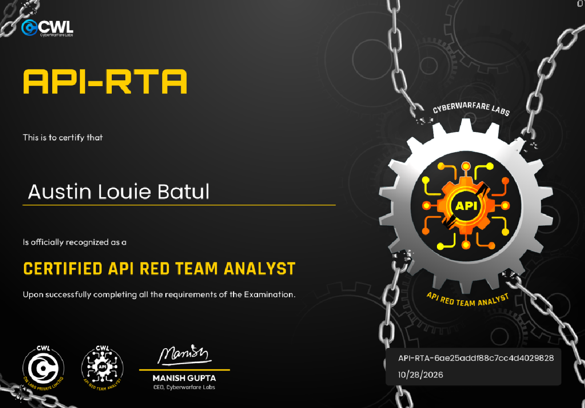

# How I Followed VulnCart’s Trust Failures in the Certified API Red Team Analyst \(API\-RTA\)

Made and wrote by Austin BC

CyberWarFare Labs’ Certified API Red Team Analyst \(API\-RTA\) focuses on one deliberately vulnerable ecommerce backend, VulnCart, and thirteen examination objectives\. The point is not a single spectacular exploit\. The interesting part is how relatively small mistakes in API design lead into one another, from frontend discovery and identity handling to checkout logic and cloud storage access\.

The application’s own guidance follows four activities: exploring the storefront anonymously, authenticating to reach user functions, manipulating tokens and request parameters, and purchasing restricted products\. My route through the lab followed that progression, although some of the most useful discoveries happened before I had a valid user session\. I have kept the lab specific addresses, secrets, and identifiers redacted in the examples below; placeholders identify values that must come from an actual session, not captured output\.

## Attack Techniques Covered

The lab involved API reconnaissance, unminified JavaScript review, unauthenticated user enumeration, JWT claim inspection, discovery of an exposed HS256 signing secret in a JWKS response, token forgery, and access to other users’ account data\. Database testing covered UNION based SQLite SQL injection, schema enumeration, product discovery, and sqlmap tuning after an unsuccessful initial scan\. Business logic testing included manipulated checkout prices, boundary checks against a minimum price, and reversal of a deterministic gift card generator\. Cloud investigation covered unauthenticated Lambda access, S3 object path probing, debug information exposure, and missing object authorization\. BOLA, IDOR, BFLA, and SSRF were also considered as vulnerability classifications; not all were independently demonstrated\.

## Getting Oriented

VulnCart looks like an ordinary storefront: a login page, a product catalog, a wallet you can top up, a cart, and a checkout flow\. The API routes sit beneath /api/v1/\. One detail matters immediately when testing it outside the browser: authentication is carried by the vulncart\_token cookie rather than an Authorization: Bearer header\. Sending the same JWT in the wrong place can leave the backend treating the request as anonymous\.

The initial theoretical questions previewed several distinct access control and request handling concepts\. BOLA concerns access to objects beyond the authenticated user’s authorization; IDOR describes unsafe access through user controllable object references\. SSRF involves influencing a server to issue requests to attacker chosen destinations, while BFLA concerns access to functions the caller should not be allowed to invoke\. These were classifications appearing in the examination material, not proof that every category had a separate successful exploit\.

## Reading the Frontend Before Attacking the API

Before crafting payloads, I fetched the static files served to the browser\. That gave me a better starting point than guessing endpoints based on a typical ecommerce API\.

```
curl -s http://TARGET:PORT/static/login.html
curl -s http://TARGET:PORT/static/index.html
curl -s http://TARGET:PORT/static/app.js
```

The unminified app\.js file was one of the most useful artifacts in the run\. It contained the frontend fetch calls for login, profile retrieval, wallet balance and top up, product search, adding and clearing cart items, demo users, and order placement\. Reading those functions gave me an API map before I had authenticated\.

Two functions shaped what I tested next\. toggleDemoUsers\(\) sent an unauthenticated GET request to /api/v1/demo\-users and filled a login helper with account details\. checkout\(\) built a JSON body from the form fields product\_id, price, and discount\_percentage and posted it to /api/v1/orders\. That second behavior did not prove a server vulnerability yet, but it identified a price field worth testing rather than assuming that the displayed catalog price was enforced on the backend\.

```
curl -s http://TARGET:PORT/api/v1/demo-users | python3 -m json.tool
```

The response contained several hundred email addresses paired with numeric user IDs\. They were seeded demo accounts, exposed without authentication\. I did not find an obvious common password from that listing, so I did not treat it as a demonstrated credential stuffing route\. Its real value came later: the JWT attack needed a user\_id already present in the database, and this endpoint supplied valid candidates\.

## Recovering the Signing Key from JWKS

Authenticated requests used an HS256 signed JWT in vulncart\_token\. The token included the claims shown below\. This is a schematic JSON representation, not a captured token: null marks numeric fields whose live values are not reproduced\.

```
{
  "iss": "https://vulncart.internal",
  "sub": "user<REDACTED_ID>",
  "user_id": null,
  "role": "user",
  "scope": ["products:read", "wallet:read", "orders:read"],
  "iat": null,
  "exp": 9999999999
}
```

HS256 is symmetric: the same secret signs and verifies the token\. When that secret is exposed, a valid signature no longer proves that the claims came from the application\. The next place I checked was the familiar JWKS discovery path\. That endpoint often publishes asymmetric public keys for interoperability, but publishing a symmetric octet key has very different consequences\.

```
curl -s http://TARGET:PORT/.well-known/jwks.json
```

The JWKS response contained a keys array with an oct key and a k field\. That field held the symmetric signing key encoded as base64url\. After extracting k, the following was used to decode the value:

```
echo "BASE64URL_VALUE" | tr '_-' '/+' | base64 -d
```

The decoded HMAC secret could then be used to sign new tokens\. The actual k field and recovered secret are not reproduced here\. Exposing an asymmetric public verification key is not the same failure; the problem here was disclosing material that must remain secret for HS256\.

## Forging a Token and Working Through Anonymous Fallbacks

The next step was to sign a JWT claiming an identity from the demo account list\. I used Python and PyJWT to set the issuer, subject, user ID, role, scopes, issuance time, and expiry\. The version below preserves the documented claims but uses clearly marked variables for the redacted ID and signing secret\. It is a reproducible template, not a verbatim terminal transcript; both values must be supplied before execution\.

```
import jwt
import time

USER_ID = int("<VALID_NUMERIC_USER_ID>")  # Replace with an ID from /demo-users
SECRET = "<RECOVERED_HS256_SECRET>"      # Replace with the decoded JWKS key

token = jwt.encode({
    "iss": "https://vulncart.internal",
    "sub": f"user{USER_ID}",
    "user_id": USER_ID,
    "role": "user",
    "scope": ["products:read", "wallet:read", "orders:read"],
    "iat": int(time.time()),
    "exp": 9999999999
}, SECRET, algorithm="HS256")
print(token)
```

Two problems cost time before the forged session was recognized\. First, a token with an absent or stale iat value could still decode and pass the mathematical signature check, yet the backend fell back to an anonymous context\. Second, a token containing a user\_id that was not a real database record produced the same result\. The adjustment was to issue the token with the current Unix time and select a user ID obtained from the demo users endpoint rather than inventing one\.

Those failures matter because a valid JWT signature is only part of the application’s session validation path\. In this lab, an anonymous response did not necessarily mean the recovered HMAC secret was wrong\. I had to confirm both the timestamp and the existence of the claimed account before moving on\.

## Reading Another Account Through a Forged Session

Once the backend accepted the signed cookie, the user profile and order endpoints responded in the context represented by that token:

```
TOKEN="<forged_jwt>"
curl -s http://TARGET:PORT/api/v1/users/me -H "Cookie: vulncart_token=$TOKEN"
curl -s http://TARGET:PORT/api/v1/orders -H "Cookie: vulncart_token=$TOKEN"
```

The /users/me response returned the selected account’s balance, email, numeric ID, and role, while /orders exposed its order history\. Changing user\_id to a different valid account and signing again changed whose data was returned, without possessing that account’s password\. That is the cross account effect emphasized by the lab’s BOLA and IDOR questions\.

The important distinction is how that access was obtained\. Because I had the signing secret, the backend accepted a correctly signed user\_id as the claimed identity\. That demonstrated JWT forgery and account impersonation, but it did not independently prove that an endpoint allowed an ordinary authenticated user to change an object ID and bypass authorization\. The lab introduced this behavior under BOLA and IDOR; I would not claim an additional standalone object access control exploit from the token substitution alone\.

## SQL Injection in Product Search

With an accepted user context, I turned to /api/v1/products/search?name=\. The name parameter was vulnerable to string concatenation in its SQL query\. A manually constructed UNION SELECT queried SQLite’s sqlite\_master table, using an injected quote and SQL comment to complete the surrounding query:

```
curl -s -G "http://TARGET:PORT/api/v1/products/search" \
  --data-urlencode "name=x' UNION SELECT name,sql,3 FROM sqlite_master WHERE type='table'--" \
  -H "Cookie: vulncart_token=$TOKEN"
```

The probe returned table names with CREATE TABLE statements, confirming SQLite and exposing the schema\. The tables I mapped included users, orders, products, cart, giftcards, and giftcard\_redemptions\. This mattered for more than enumeration: the schema supplied the real column names needed to inspect hidden products and stored gift card information instead of guessing at the application’s data model\.

My first automatic sqlmap attempt did not recognize the injection\. The likely issue was the surrounding quote and SQL comment, which the default heuristic did not handle cleanly\. Rather than treating the initial scanner output as conclusive, I used the manually confirmed injection context to specify the prefix, suffix, technique, and database type:

```
sqlmap -u "http://TARGET:PORT/api/v1/products/search?name=test" \
  --cookie="vulncart_token=$TOKEN" \
  --batch --prefix="'" --suffix="--" \
  --technique=U --dbms=sqlite --tables
```

With those settings, sqlmap listed the database tables\. This is why keeping the failed automatic pass is useful: the scanner had not disproved SQL injection\. It needed the same context already demonstrated by the manual UNION request\.

## Finding the Product the Storefront Did Not Show

The public storefront displayed two ordinary items and hinted at premium products available only to trusted users\. Instead of brute forcing product identifiers, I used the known search injection to request product records directly:

```
curl -s -G "http://TARGET:PORT/api/v1/products/search" \
  --data-urlencode "name=x' UNION SELECT id,name,price FROM products--" \
  -H "Cookie: vulncart_token=$TOKEN"
```

The broader products inspection revealed a hidden premium row with visible set to 0\. Its price was stored in the database, despite the item being omitted from the regular product display\. The three column query above returns id, name, and price; it does not return visible\. That setting was established from the broader products inspection\. I am not publishing an unverified numeric product ID or catalog price\.

That product record answered a discovery question, but it also led into a different test\. Finding a price in the database is not the same as determining the lowest amount the application will accept at checkout\. The frontend code had already shown that the browser submits a price field\. I needed to see what the server did with that value\.

## Changing the Checkout Price

I tested the order endpoint with a price far below the product’s catalog amount\. In this redacted request, PRODUCT\_ID must be set to the numeric ID recovered from the database; the value is deliberately not invented here:

```
# Set PRODUCT_ID to the numeric product ID recovered from the database.
curl -s -X POST "http://TARGET:PORT/api/v1/orders" \
  -H "Cookie: vulncart_token=$TOKEN" \
  -H "Content-Type: application/json" \
  -d "{\"product_id\": $PRODUCT_ID, \"price\": 1}"
```

The order response recorded a completed purchase at $1 even though the catalog price was substantially higher\. That is a price integrity and business logic failure: the server allowed a client supplied amount to determine the charge instead of deriving an authoritative price from the selected product\. The result resembles mass assignment in that a sensitive field was accepted from client input, although the main consequence here was business logic manipulation rather than a conventional object property overwrite\.

A $1 order still did not establish the absolute minimum\. The run continued with negative values, zero, fractional amounts, and larger positive values to see when the returned order stopped matching the submitted number:

```
for p in -99999 -1 0 0.0001 0.001 0.01 1 10 100; do
  echo "=== price=$p ==="
  curl -s -X POST "http://TARGET:PORT/api/v1/orders" \
    -H "Cookie: vulncart_token=$TOKEN" -H "Content-Type: application/json" \
    -d "{\"product_id\": $PRODUCT_ID, \"price\": $p}"
done
```

The critical observation was the amount actually recorded in the order response, not merely the input sent\. At lower input values, the backend began clamping the price to a floor\. That means a negative or zero request was not automatically a negative or zero purchase\. The boundary test established that clamping occurred, but the exact floor value is not reproduced here\. Without the returned order amounts, I cannot state an exact numerical minimum\.

## Reversing the Gift Card Generator

The wallet page, payment\.html, exposed a gift card redemption function alongside a simple mathematical captcha\. Inspecting the frontend source revealed that the gift card value was constructed from a fixed substitution table, a hardcoded seed, and a constant suffix:

```
function generateGiftCode() {
  const table = {
    "v": "3", "u": "1", "l": "2", "n": "a",
    "c": "9", "a": "7", "r": "5", "t": "a"
  };
  const seed = "vulncart";
  let out = "";
  for (let c of seed) out += table[c];
  out += "994e";
  return "GIFT-" + out;
}
```

Nothing in that code generated a fresh random value or used a server held secret\. Applying the listed substitutions to the eight characters in vulncart gives 312a975a, then appending the suffix produces GIFT\-312a975a994e\. That is a value derived directly from the supplied JavaScript\. I did not preserve a separate redemption success response, so the computed string should not be confused with a verified transaction result\.

The redemption request used /api/v1/payments/giftcard\. The code derived from the frontend is shown below\. CAPTCHA\_TEXT and CAPTCHA\_VALUE represent the challenge response as text and an integer, respectively, and must be supplied before sending the request:

```
curl -s -X POST "http://TARGET:PORT/api/v1/payments/giftcard" \
  -H "Cookie: vulncart_token=$TOKEN" \
  -H "Content-Type: application/json" \
  -d "{\"code\": \"GIFT-312a975a994e\", \"captcha\": \"$CAPTCHA_TEXT\", \"answer\": $CAPTCHA_VALUE}"
```

The captcha variables above represent the actual challenge answers, not a bypass of the captcha itself\. I also examined the giftcards table through SQL injection to determine the stored amount, but the amount and redemption response are not reproduced here\. The derived code is supported by the JavaScript; a successful wallet credit is not independently evidenced by a captured transaction\. The underlying weakness is that the supposedly secret redemption value was predictable from client side code\.

## Following Order Status into AWS Lambda and S3

Order data exposed a second service responsible for checking delivery or order state\. Its address appeared both in the checkout response and in the orders table\. The service used an AWS Lambda Function URL with the path /fetch\_order\_status:

```
https://<function-id>.lambda-url.<region>.on.aws/fetch_order_status
```

I called that endpoint directly, using its path parameter to name an object under the backing storage location:

```
LAMBDA="https://<function-id>.lambda-url.<region>.on.aws"
curl -s "$LAMBDA/fetch_order_status?path=orders/order_status.json"
```

A valid object path returned JSON from S3 through the Lambda response, without an authorization check tying the caller to that object\. The weakness was an unauthenticated object retrieval proxy with access to backend storage\. This is related in spirit to server side request abuse, but the documented behavior was not an arbitrary URL fetch and does not by itself prove classical SSRF against internal network destinations\.

Finding an existing S3 key took trial and error\. I found object names following folder/file\.json patterns rather than simple root level filenames\. NoSuchKey indicated that the Lambda had attempted an S3 read but that the selected object was absent; a 400 Bad Request was instead associated with malformed paths, including leading slashes or parent directory sequences\. Distinguishing those results helped focus the search on plausible object keys instead of repeatedly changing input that the function would reject\.

The same Lambda Function URL exposed a debug endpoint:

```
curl -s "$LAMBDA/debug"
```

The /debug response disclosed the AWS account ID, full Lambda ARN, and attached S3 bucket name\. That connected the application’s order status workflow to specific cloud resources and identified AWS Lambda as the executing service\. I have omitted the identifier values rather than presenting made up account numbers, resource names, or JSON output\.

One payment related objective remained unresolved during my lab session\. It called for a particular stored payment data item associated with a specific account\. I investigated the SQL injection, impersonated account access, and S3 proxy paths, but did not obtain that value\. The completion certificate confirms that the certification was awarded; it does not turn an unresolved finding into a successful capture\.

## What I Took Away From VulnCart

The most useful habit in this examination was reading the application before attacking it\. app\.js showed where the frontend obtained account records and which values it sent at checkout\. That reconnaissance gave me real user IDs for JWT testing and an explicit reason to question how prices were calculated\. It also reinforced why the browser is not a place to enforce trust: the client can always modify values it sends\.

The exposed JWKS oct key was the most direct authentication failure\. Publishing the symmetric HMAC key meant I could sign claims the server would accept\. The initially anonymous forged tokens also taught a useful diagnostic lesson: correct signatures do not guarantee that the rest of a session validation pipeline accepts the token\. My token tests exposed both an iat problem and a nonexistent user\_id causing the same fallback\.

The product search issue made the database reachable, while the checkout and gift card logic showed what could go wrong even when an application has an authentication layer\. On the cloud side, an unprotected Lambda Function URL let a caller ask a privileged backend component for stored objects and runtime details\. Applying explicit authentication and object authorization to the serverless entry point matters just as much as applying them to the main API\.

For anyone working through the same lab, the sequence that made the difference was simple: inspect the static frontend, pay attention to the cookie the server actually reads, validate forged token claims carefully, establish SQL injection context manually before relying on automation, and compare the server recorded purchase price with the input supplied\. The completion certificate reflects the examination outcome\. The payment data objective remains the one gap in the attack chain I could not close\.

**CyberWarFare Labs completion certificate**


